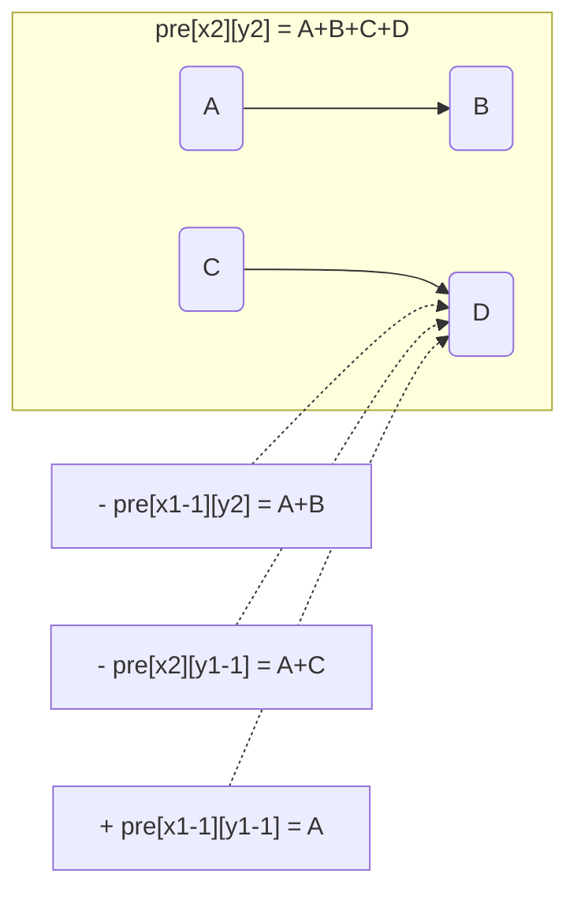

# 前缀和与差分

## 复杂度

| 操作 | 朴素 | 前缀和/差分 |
|------|------|------------|
| 查询区间和 | O(r-l+1) | **O(1)** 预处理 O(n) |
| 区间整体加 x | O(r-l+1) | **O(1)** 差分数组 |
| 二维查询矩形和 | O((x2-x1)(y2-y1)) | **O(1)** 预处理 O(nm) |
| 二维矩形加 x | O(面积) | **O(1)** 二维差分 |

## 一维前缀和

### 核心思想

把"多次区间查询"预处理成前缀和数组，O(n) 预处理后每次查询 O(1)。

### 模板

```cpp
int a[N], pre[N];

// 预处理
for(int i = 1; i <= n; i++) pre[i] = pre[i-1] + a[i];

// 查询 [l, r] 的和（1-indexed）
int sum = pre[r] - pre[l-1];
```

### 常见应用

```cpp
// 1. 快速求一段区间的最大值（RMQ）
// 用前缀和 + 单调队列（见尺取法章节）

// 2. 快速求区间 gcd（ST 表或线段树）
// ST 表：O(n log n) 预处理，O(1) 查询

// 3. 前缀和求异或（前缀异或 = 前缀和改加号为异或）
int xorsum[N];
for(int i = 1; i <= n; i++) xorsum[i] = xorsum[i-1] ^ a[i];
int segment_xor = xorsum[r] ^ xorsum[l-1];
```

## 二维前缀和

### 公式推导

```
pre[i][j] = pre[i-1][j]      // 上半部分
          + pre[i][j-1]      // 左半部分
          - pre[i-1][j-1]    // 减去重复的左上角
          + a[i][j]          // 加当前格
```

### 图解

```
pre[x2][y2] 的矩形区域 = 整个大矩形 (A+B+C+D)

要得到 D 区域，需要减去：
  - pre[x1-1][y2]  → 去掉 A+B （上半部分）
  - pre[x2][y1-1]  → 去掉 A+C （左半部分）
  + pre[x1-1][y1-1] → 加回 A   （左上角被减了两次）

     y1-1  y1  y2
   ┌─────┬───────┐
x1-1│  A │   B   │
   ├─────┼───────┤
x1  │  C │   D   │  ← 我们要的区域
   └─────┴───────┘

  D = pre[x2][y2] - pre[x1-1][y2] - pre[x2][y1-1] + pre[x1-1][y1-1]
```



### 模板

```cpp
int a[N][N], pre[N][N];

void init(int n, int m)
{
    for(int i = 1; i <= n; i++)
        for(int j = 1; j <= m; j++)
            pre[i][j] = pre[i-1][j] + pre[i][j-1] - pre[i-1][j-1] + a[i][j];
}

// 查询 (x1,y1) 到 (x2,y2) 的矩形和（左上角到右下角）
int query(int x1, int y1, int x2, int y2)
{
    return pre[x2][y2] - pre[x1-1][y2] - pre[x2][y1-1] + pre[x1-1][y1-1];
}
```

### 图解

```
pre[x2][y2] = 整个大矩形
- pre[x1-1][y2]   // 去掉上面
- pre[x2][y1-1]   // 去掉左边
+ pre[x1-1][y1-1] // 加回多减的左上角
```

## 差分数组（区间修改，单点查询）

### 核心思想

差分是前缀和的逆操作。对区间 `[l, r]` 加 x，只需要改两个端点。

### 图解

```
原数组:     [a1, a2, a3, a4, a5, a6, a7, a8]
差分数组:   [d1, d2, d3, d4, d5, d6, d7, d8]
还原: a[i] = a[i-1] + d[i]（前缀和还原原数组）

区间 [3, 6] 每个数加 5:
          
原:    a1  a2  a3  a4  a5  a6  a7  a8
          ┌──────────────┐
改:    a1  a2  a3+5 a4+5 a5+5 a6+5 a7  a8
          └──────────────┘

只需改差分数组 2 个端点:
d[3] += 5    ← 起点：标记"开始加"
d[7] -= 5    ← r+1：标记"结束加"

然后做前缀和还原：
  a1 = d1
  a2 = d1 + d2
  a3 = d1 + d2 + d3          ← 含了 +5
  a4 = d1 + d2 + d3 + d4     ← 含了 +5
  ...
  a7 = d1 + d2 + d3 + d4 + d5 + d6 + d7   ← d7 是 -5，抵消了 ✓
  a8 = 同上但 d8 没动

一个区间修改 = 两次单点修改！
```

### 模板

```cpp
int d[N];

// 对 [l, r] 每个数加 x
void add(int l, int r, int x)
{
    d[l] += x;
    d[r+1] -= x;   // r+1 可能等于 n+1，数组开 N+2 防止越界
}

// 做完全部修改后，前缀和还原原数组
int a[N];
for(int i = 1; i <= n; i++) a[i] = a[i-1] + d[i];
```

### 初始值怎么来？

```cpp
// 方法 1：d[1] = a[1], d[i] = a[i] - a[i-1]
d[1] = a[1];
for(int i = 2; i <= n; i++) d[i] = a[i] - a[i-1];

// 方法 2：全 0 开始，把初始值也当作单点修改
memset(d, 0, sizeof(d));
for(int i = 1; i <= n; i++) add(i, i, a[i]);
// 做所有 add(l, r, x)
for(int i = 1; i <= n; i++) d[i] += d[i-1];
// 此时 d[i] = 原 a[i] + 所有修改
```

### 例题

> 给定长度 n 的数组，q 次操作 `[l, r]` 每个数加 x，最后输出数组。

```cpp
#include<bits/stdc++.h>
using namespace std;
typedef long long ll;

const int N = 1e6 + 10;
ll a[N], d[N];

int main()
{
    int n, q;
    cin >> n >> q;
    for(int i = 1; i <= n; i++) cin >> a[i];
    // 初始差分
    d[1] = a[1];
    for(int i = 2; i <= n; i++) d[i] = a[i] - a[i-1];
    while(q--)
    {
        int l, r; ll x;
        cin >> l >> r >> x;
        d[l] += x;
        d[r+1] -= x;
    }
    // 还原
    for(int i = 1; i <= n; i++)
    {
        d[i] += d[i-1];
        cout << d[i] << ' ';
    }
    return 0;
}
```

## 二维差分（矩形加 x）

### 模板

```cpp
int d[N][N];

// 矩形 (x1,y1) 到 (x2,y2) 加 x
void add(int x1, int y1, int x2, int y2, int x)
{
    d[x1][y1]     += x;
    d[x2+1][y1]   -= x;
    d[x1][y2+1]   -= x;
    d[x2+1][y2+1] += x;
}

// 还原：二维前缀和
for(int i = 1; i <= n; i++)
    for(int j = 1; j <= m; j++)
        d[i][j] += d[i-1][j] + d[i][j-1] - d[i-1][j-1];
```

### 原理

类似一维差分，4 个点标记矩形边界。

## 易错点

1. **数组下标**：差分 `r+1` 可能等于 `n+1`，数组要开 `N+2` 防止越界
2. **前缀和方向**：前缀和是 `pre[i] = pre[i-1] + a[i]`，不要写成 `pre[i] = pre[i+1]`
3. **1-indexed vs 0-indexed**：上面模板全是 1-indexed。0-indexed 时 `[l, r]` 求和公式改成 `pre[r+1] - pre[l]`
4. **数据范围**：前缀和可能溢出 int，用 `long long`

## 常见题目模式

| 题目 | 方法 |
|------|------|
| 多次区间求和 | 前缀和 |
| 多次区间加 + 最后看数组 | 差分数组 |
| 多次区间加 + 多次区间求和 | 用树状数组/线段树（单点修改+区间查询） |
| 最大子数组和（k 长度） | 前缀和 + 滑窗 |
| 区间和是否等于目标 | 前缀和 + 哈希表 |
