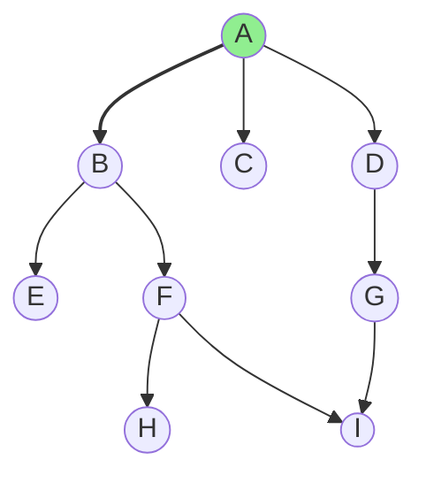

# BFS 广度优先搜索

## 核心思想

一层一层从起点向外扩展，用**队列**实现。扩展顺序保证了先被访问到的节点**距离最小**。

**BFS 一定能找到**最短步数（无权图），DFS 不保证。

### 图解：BFS vs DFS 搜索顺序对比

```
图:
        A
       /|\
      B C D
     /|   \
    E F    G
       \   /
        H I

BFS 从 A 出发（层序）:
  Level 0: [A]
  Level 1: [B, C, D]      ← 第一层邻居
  Level 2: [E, F, G]      ← 第二层
  Level 3: [H, I]         ← 第三层
  
  访问顺序: A B C D E F G H I
  距离 A=0, B/C/D=1, E/F/G=2, H/I=3
  
  最短路径保证：第一次到达的就是最短距离！

DFS 从 A 出发（深度优先）:
  A → B → E (回溯)
  A → B → F → H (回溯)
  A → B → F → I (回溯)
  A → C (回溯)
  A → D → G → H (已访问，跳过)
  A → D → G → I (已访问，跳过)
  
  访问顺序: A B E F H I C D G
  到达 H 可能路径长也可能短，不保证首次到达就是最短！
```



## 时间复杂度

O(n + m)，n 点数 m 边数。每个点只入队一次，每条边只遍历一次。

## 网格 BFS（最常见）

### 四方向模板

```cpp
int n, m;
int g[N][N];          // 地图：0 可走，1 障碍
int dist[N][N];       // 距离，-1 表示未访问
int dx[4] = {1, -1, 0, 0};
int dy[4] = {0, 0, 1, -1};

int bfs(int sx, int sy, int ex, int ey)
{
    queue<pair<int, int>> q;
    memset(dist, -1, sizeof(dist));
    q.push({sx, sy});
    dist[sx][sy] = 0;
    while(!q.empty())
    {
        auto [x, y] = q.front();
        q.pop();
        if(x == ex && y == ey) return dist[x][y];   // 提前找到
        for(int i = 0; i < 4; i++)
        {
            int nx = x + dx[i], ny = y + dy[i];
            if(nx >= 0 && nx < n && ny >= 0 && ny < m   // 边界
                && dist[nx][ny] == -1                   // 未访问
                && g[nx][ny] != 1)                      // 无障碍
            {
                dist[nx][ny] = dist[x][y] + 1;
                q.push({nx, ny});
            }
        }
    }
    return -1;   // 到不了
}
```

### 八方向（含对角线）

```cpp
int dx[8] = {1, 1, 1, -1, -1, -1, 0, 0};
int dy[8] = {1, -1, 0, 1, -1, 0, 1, -1};
```

### 保存路径（parent 数组）

```cpp
pair<int, int> pre[N][N];   // 前驱节点
int dist[N][N];

void bfs(int sx, int sy, int ex, int ey)
{
    queue<pair<int, int>> q;
    memset(dist, -1, sizeof(dist));
    q.push({sx, sy});
    dist[sx][sy] = 0;
    pre[sx][sy] = {sx, sy};
    while(!q.empty())
    {
        auto [x, y] = q.front();
        q.pop();
        if(x == ex && y == ey) break;
        for(int i = 0; i < 4; i++)
        {
            int nx = x + dx[i], ny = y + dy[i];
            if(nx >= 0 && nx < n && ny >= 0 && ny < m && dist[nx][ny] == -1 && g[nx][ny] != 1)
            {
                dist[nx][ny] = dist[x][y] + 1;
                pre[nx][ny] = {x, y};
                q.push({nx, ny});
            }
        }
    }
    if(dist[ex][ey] == -1) return;   // 终点不可达
    // 回溯路径
    vector<pair<int, int>> path;
    auto cur = make_pair(ex, ey);
    while(cur != make_pair(sx, sy))
    {
        path.push_back(cur);
        cur = pre[cur.first][cur.second];
    }
    path.push_back({sx, sy});
    reverse(path.begin(), path.end());
}
```

## 图的 BFS（邻接表）

```cpp
vector<int> G[N];
int dist[N];

void bfs(int s)
{
    queue<int> q;
    memset(dist, -1, sizeof(dist));
    dist[s] = 0;
    q.push(s);
    while(!q.empty())
    {
        int u = q.front();
        q.pop();
        for(int v : G[u])
        {
            if(dist[v] == -1)
            {
                dist[v] = dist[u] + 1;
                q.push(v);
            }
        }
    }
}
```

## 多源 BFS（洪水填充）

### 核心思想

把所有起点同时入队，每次扩展一层。等价于"离最近起点的距离"。

### 模板

```cpp
int dist[N][N];
queue<pair<int, int>> q;

void multi_bfs()
{
    memset(dist, -1, sizeof(dist));
    // 把所有起点都入队
    for(int i = 0; i < n; i++)
        for(int j = 0; j < m; j++)
            if(g[i][j] == 1)   // 起点
            {
                dist[i][j] = 0;
                q.push({i, j});
            }
    while(!q.empty())
    {
        auto [x, y] = q.front();
        q.pop();
        for(int i = 0; i < 4; i++)
        {
            int nx = x + dx[i], ny = y + dy[i];
            if(nx >= 0 && nx < n && ny >= 0 && ny < m && dist[nx][ny] == -1)
            {
                dist[nx][ny] = dist[x][y] + 1;
                q.push({nx, ny});
            }
        }
    }
}
```

### 例题

> 给定 n×m 地图，若干格子是火源，求每个格子到最近火源的距离。

```cpp
#include<bits/stdc++.h>
using namespace std;
typedef long long ll;
#define P pair<int,int>

const int N = 1005;
int n, m;
int g[N][N], dist[N][N];
int dx[4] = {1, -1, 0, 0}, dy[4] = {0, 0, 1, -1};

int main()
{
    cin >> n >> m;
    queue<P> q;
    memset(dist, -1, sizeof(dist));
    for(int i = 0; i < n; i++)
        for(int j = 0; j < m; j++)
        {
            cin >> g[i][j];
            if(g[i][j] == 1)
            {
                q.push({i, j});
                dist[i][j] = 0;
            }
        }
    while(!q.empty())
    {
        auto [x, y] = q.front(); q.pop();
        for(int i = 0; i < 4; i++)
        {
            int nx = x + dx[i], ny = y + dy[i];
            if(nx >= 0 && nx < n && ny >= 0 && ny < m && dist[nx][ny] == -1 && g[nx][ny] != 2)
            {
                dist[nx][ny] = dist[x][y] + 1;
                q.push({nx, ny});
            }
        }
    }
    for(int i = 0; i < n; i++)
    {
        for(int j = 0; j < m; j++) cout << dist[i][j] << ' ';
        cout << endl;
    }
    return 0;
}
```

## 双向 BFS

### 核心思想

从起点和终点**同时**向外扩展，相遇时停止。适用于状态空间较大的搜索。

### 时间复杂度

O(√N)，比单向 BFS 的 O(N) 快得多。

### 模板

```cpp
int bfs_bi(string start, string target)
{
    if(start == target) return 0;
    unordered_map<string, int> da, db;   // 两个方向的 dist
    da[start] = 0; db[target] = 0;
    queue<string> qa, qb;
    qa.push(start); qb.push(target);

    // 每次扩展较小的那个方向
    while(!qa.empty() && !qb.empty())
    {
        if(da.size() <= db.size())
        {
            // 扩展 start 方向一层
            for(int sz = qa.size(); sz--;)
            {
                auto s = qa.front(); qa.pop();
                for(auto& t : get_neighbors(s))   // 所有合法下一步
                {
                    if(db.count(t)) return da[s] + db[t] + 1;   // 相遇
                    if(!da.count(t))
                    {
                        da[t] = da[s] + 1;
                        qa.push(t);
                    }
                }
            }
        }
        else
        {
            // 扩展 target 方向一层
            for(int sz = qb.size(); sz--;)
            {
                auto s = qb.front(); qb.pop();
                for(auto& t : get_neighbors(s))
                {
                    if(da.count(t)) return db[s] + da[t] + 1;
                    if(!db.count(t))
                    {
                        db[t] = db[s] + 1;
                        qb.push(t);
                    }
                }
            }
        }
    }
    return -1;
}
```

### 八数码双向 BFS

```cpp
#include<bits/stdc++.h>
using namespace std;

int dx[4] = {0, 0, 1, -1}, dy[4] = {1, -1, 0, 0};

int bfs_bi(string start, string target)
{
    if(start == target) return 0;
    unordered_map<string, int> da, db;
    queue<string> qa, qb;
    da[start] = 0; db[target] = 0;
    qa.push(start); qb.push(target);
    while(!qa.empty() && !qb.empty())
    {
        if(da.size() <= db.size())
        {
            for(int sz = qa.size(); sz--;)
            {
                auto s = qa.front(); qa.pop();
                int k = s.find('x');
                int x = k/3, y = k%3;
                for(int i = 0; i < 4; i++)
                {
                    int nx = x + dx[i], ny = y + dy[i];
                    if(nx < 0 || nx >= 3 || ny < 0 || ny >= 3) continue;
                    string t = s;
                    swap(t[k], t[nx*3+ny]);
                    if(db.count(t)) return da[s] + db[t] + 1;
                    if(!da.count(t)) { da[t] = da[s] + 1; qa.push(t); }
                }
            }
        }
        else
        {
            for(int sz = qb.size(); sz--;)
            {
                auto s = qb.front(); qb.pop();
                int k = s.find('x');
                int x = k/3, y = k%3;
                for(int i = 0; i < 4; i++)
                {
                    int nx = x + dx[i], ny = y + dy[i];
                    if(nx < 0 || nx >= 3 || ny < 0 || ny >= 3) continue;
                    string t = s;
                    swap(t[k], t[nx*3+ny]);
                    if(da.count(t)) return db[s] + da[t] + 1;
                    if(!db.count(t)) { db[t] = db[s] + 1; qb.push(t); }
                }
            }
        }
    }
    return -1;
}

int main()
{
    string start = "", target = "12345678x";
    for(int i = 0; i < 9; i++) { string c; cin >> c; start += c; }
    cout << bfs_bi(start, target) << endl;
    return 0;
}
```

## A* 启发式搜索（进阶）

### 核心思想

BFS 的智能版。用 `f(n) = g(n) + h(n)` 优先级排序，g 是已经走的，h 是到终点的**估计**。

h 的选择决定效率：
- h=0 → 退化为 Dijkstra（BFS）
- h=曼哈顿距离 等 → 八数码常用

```cpp
typedef tuple<int,int,int> T;  // f, dist, pos
priority_queue<T, vector<T>, greater<T>> pq;
// pq.push({f, d, pos});
// while(!pq.empty()) { auto [fd, dd, u] = pq.top(); pq.pop(); ... }
```

## 易错点

1. **入队时标记**：`dist[nx][ny] = dist[x][y] + 1` 必须在入队时就做，不能出队才做，否则会重复入队
2. **提前返回**：BFS 一扩展到终点就可以返回了，不用等队空
3. **多源 BFS**：起点全部入队，dist 初始化为 0，不是 -1
4. **双向 BFS 相遇检测**：扩展当前方向时，检查邻居在不在另一个方向的 dist 里
5. **状态表示**：如果状态不止一个数，用 string / pair / struct 做 key（unordered_map 需要自定义哈希）

## BFS vs DFS 选择指南

| 场景 | 选哪个 |
|------|--------|
| 求最短步数 | **BFS** |
| 求所有可行解 | **DFS**（回溯） |
| 求一个可行解 | 都行，DFS 代码短 |
| 深度很大（n 大） | 用 BFS 或非递归 DFS，防栈溢出 |
| 状态空间大 | **双向 BFS** |
| 有启发式信息 | **A*** |
| 图不连通 | 都需要 `for` 循环所有点作为起点 |
