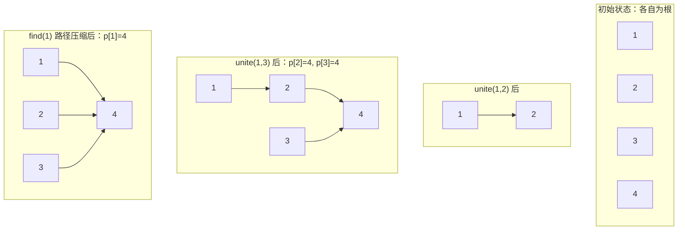

# 并查集 DSU

## 复杂度（带路径压缩 + 按秩合并）

**O(α(n)) 近似常数**。α 是阿克曼函数的逆，增长极慢，实际可看作 O(1)。

## 核心思想

把 n 个元素分成若干集合。支持：
- `find(x)`：查询 x 所属集合的根
- `union(a, b)`：把 a 和 b 所在集合合并

### 图解：路径压缩 + 按秩合并

```
初始状态：每个点自己是根

  1   2   3   4   5   6   7   8
  p[1]=1  p[2]=2  ...  p[8]=8

合并 unite(1,2), unite(3,4), unite(5,6)（假设每次都让后者当根）:

  1 → 2        3 → 4        5 → 6        7    8
  根=2         根=4          根=6        根=7  根=8

再合并 unite(1,3):
  find(1) = 2
  find(3) = 4
  
  把秩小的挂到秩大的下面（2 和 4 秩相同，任选一个当根）
  假设 p[2] = 4（4 变成根）

      4              6
    /   \            |
   2     3           5
   |
   1

  即 p[2]=4, p[3]=4, p[1]=2

find 的路径压缩（关键！）:
  
  find(1): 1 → 2 → 4，找到根 4
  
  压缩前:  1 的父节点是 2，2 的父节点是 4
  压缩后:  直接把 1 挂到根上，p[1] = 4

      4              6
    / | \            |
   1  2  3           5

  下次 find(1): 直接返回 p[1]=4，O(1)
```



## 模板（最常用路径压缩 + 按秩合并）

```cpp
int p[N], rk[N];   // rk = 秩（树高的上界）

void init(int n)
{
    for(int i = 1; i <= n; i++) { p[i] = i; rk[i] = 0; }
}

int find(int x)
{
    if(p[x] != x) p[x] = find(p[x]);   // 路径压缩
    return p[x];
}

// 按秩合并：把秩小的挂到秩大的下面
void unite(int a, int b)
{
    a = find(a); b = find(b);
    if(a == b) return;
    if(rk[a] < rk[b]) swap(a, b);
    p[b] = a;
    if(rk[a] == rk[b]) rk[a]++;
}

bool same(int a, int b) { return find(a) == find(b); }
```

## 简化版（只路径压缩）

```cpp
int p[N];
void init(int n) { for(int i = 1; i <= n; i++) p[i] = i; }
int find(int x) { return p[x] != x ? p[x] = find(p[x]) : x; }
void unite(int a, int b) { p[find(a)] = find(b); }
```

**效果**：路径压缩已经够快了，大多数 OJ 数据下 O(1)。按秩合并让理论更完美。

## 常见应用

### 1. 连通性问题

```cpp
// 判断 n 个人 m 对朋友，有多少独立朋友圈
int main()
{
    int n, m;
    cin >> n >> m;
    init(n);
    while(m--)
    {
        int a, b; cin >> a >> b;
        unite(a, b);
    }
    int cnt = 0;
    for(int i = 1; i <= n; i++) if(find(i) == i) cnt++;
    cout << cnt << endl;
}
```

### 2. Kruskal 最小生成树

```cpp
struct Edge { int u, v, w; };
vector<Edge> edges;

pair<bool, ll> kruskal(int n)
{
    sort(edges.begin(), edges.end(), [](const Edge& a, const Edge& b){ return a.w < b.w; });
    init(n);
    ll res = 0; int cnt = 0;
    for(auto& e : edges)
    {
        if(find(e.u) != find(e.v))
        {
            unite(e.u, e.v);
            res += e.w;
            cnt++;
            if(cnt == n-1) break;
        }
    }
    if(cnt != n-1) return {false, 0};   // 不连通
    return {true, res};                 // bool 区分不连通与合法负权 MST
}
```

### 3. 食物链 / 种类并查集（扩展域）

> 经典：动物有 3 类，A 吃 B，B 吃 C，C 吃 A。给出一些真话/假话，判断哪些假。

**技巧**：开 3 倍并查集空间。`x` 自己域、`x + n` 食物域、`x + 2n` 天敌域。

```cpp
int p[N * 3];   // N 倍空间

void init(int n) { for(int i = 1; i <= 3*n; i++) p[i] = i; }
int find(int x) { return p[x] != x ? p[x] = find(p[x]) : x; }
void unite(int a, int b) { p[find(a)] = find(b); }

// 判断 x 和 y 是否同类
bool same(int x, int y, int n) { return find(x) == find(y); }

// 主逻辑
int op, x, y;
cin >> op >> x >> y;
if(op == 1)   // 说 x 和 y 同类
{
    if(same(x, y+n, n) || same(x, y+2*n, n)) ans++;   // 假
    else
    {
        unite(x, y);
        unite(x+n, y+n);
        unite(x+2*n, y+2*n);
    }
}
else          // 说 x 吃 y
{
    if(same(x, y, n) || same(x+2*n, y, n)) ans++;    // 假
    else
    {
        unite(x+n, y);       // x 的食物 = y
        unite(x+2*n, y+n);   // x 的天敌 = y 的食物
        unite(x, y+2*n);     // x = y 的天敌
    }
}
```

### 4. 带权并查集（种类并查集增强版）

每个点维护到根的相对权值 `rel[x]`，合并时做权值运算。

```cpp
int p[N];
int rel[N];   // rel[x] = x 和父亲的相对关系（0 同类 / 1 吃父 / 2 被父吃）

void init(int n)
{
    for(int i = 1; i <= n; i++) { p[i] = i; rel[i] = 0; }
}

int find(int x)
{
    if(p[x] != x)
    {
        int t = p[x];
        p[x] = find(p[x]);
        rel[x] = (rel[x] + rel[t]) % 3;   // 路径压缩时合并权值
    }
    return p[x];
}

void unite(int a, int b, int k)   // k = rel[a] - rel[b]
{
    int ra = find(a), rb = find(b);
    if(ra != rb)
    {
        p[ra] = rb;
        rel[ra] = (rel[b] + k - rel[a] + 3) % 3;
    }
}
```

## 易错点

1. **数组大小**：并查集数组要开到元素总数（或扩展域时 2N/3N），不要只开 N
2. **路径压缩递归深度**：N 大时 `find` 递归可能栈溢出，写成迭代版
3. **并查集没有删除**：只能合不能分！分拆并查集需要"时间轴 + 撤销"（见可回滚并查集）
4. **种类并查集的域**：扩展域记清楚！`x` 的域、`x+n` 的域、`x+2n` 的域，不同题可能换顺序
5. **Kruskal 的边数**：最后选中 `n-1` 条边时可以 `break`，不用全遍历

## 真题演练

### 【2025 CCPC 郑州 M - 川陀航空学院】

**原题**：[Codeforces Gym 105941 M](https://codeforces.com/gym/105941/problem/M)

**简述**：有 n 个城市、m 条航线。每次可以删除一条已有航线，或在没有航线的城市间添加一条航线。要使所有城市连通且没有多余边，求最少操作次数。

**思路**：用并查集维护每个连通块的点数 size 和边数 cnt。每个连通块先删到 size-1 条边，再把 blocks 个连通块用 blocks-1 条边连起来，答案为删除次数与添加次数之和。

**复杂度**：O(n α(n))

```cpp
#include<bits/stdc++.h>
using namespace std;

const int N = 100005;
int fa[N], sz[N], cnt[N];

int find(int x)
{
    if(fa[x] != x) fa[x] = find(fa[x]);
    return fa[x];
}

int main()
{
    ios::sync_with_stdio(false);
    cin.tie(0);

    int n, m;
    cin >> n >> m;
    for(int i = 1; i <= n; i++)
    {
        fa[i] = i;
        sz[i] = 1;
        cnt[i] = 0;
    }

    for(int i = 0; i < m; i++)
    {
        int u, v;
        cin >> u >> v;
        int fu = find(u), fv = find(v);
        if(fu == fv) cnt[fu]++;       // 已连通，边数+1
        else
        {
            fa[fu] = fv;
            sz[fv] += sz[fu];
            cnt[fv] += cnt[fu] + 1;
        }
    }

    // 统计每个连通块需要删多少边
    int blocks = 0, del = 0;
    for(int i = 1; i <= n; i++)
    {
        if(find(i) == i)
        {
            blocks++;
            del += cnt[i] - (sz[i] - 1);   // 树需要 sz-1 条，多的都删
        }
    }
    int add = blocks - 1;   // 把 blocks 棵树连成一棵树需要 blocks-1 条边
    cout << del + add << '\n';
    return 0;
}
```

**对应知识点**：并查集维护**连通块属性**（size + cnt）。模板里 find/union 同时维护多个数组，合并时累加。这是并查集最常见的扩展用法——不止合集合，还要维护集合的统计量。

---
