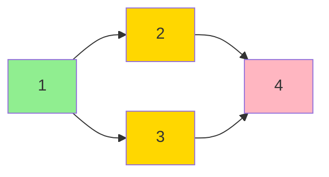

# 拓扑排序

## 核心思想

对 DAG（有向无环图）的所有顶点排成一个线性序列，使得每条边 `(u, v)` 都满足 u 在 v 前面。

### 图解：Kahn 算法过程

```
初始图:
  1 ──→ 2 ──→ 4
  │      ↓     ↑
  └──→ 3 ──────┘

各点入度:
  in[1] = 0  ✓ 入队
  in[2] = 1  (来自 1)
  in[3] = 1  (来自 1)
  in[4] = 2  (来自 2, 3)

Step 1: 处理节点 1 (入队唯一起点)
  去掉 1 的出边: 1→2, 1→3
  in[2]-- → 0 ✓ 入队
  in[3]-- → 0 ✓ 入队
  topo = [1]

Step 2: 处理节点 2 (和 3 都可选)
  去掉 2 的出边: 2→4
  in[4]-- → 1
  topo = [1, 2]

Step 3: 处理节点 3
  去掉 3 的出边: 3→4
  in[4]-- → 0 ✓ 入队
  topo = [1, 2, 3]

Step 4: 处理节点 4
  topo = [1, 2, 3, 4]

完成！所有 4 个点都入队 → 无环 ✓
如果最后 topo 长度 < n → 有环
```



## 复杂度

O(n + m)。每个点入队一次，每条边遍历一次。

## Kahn 算法（BFS + 入度）

```cpp
vector<int> G[N];
int in[N];          // 每个点的入度
vector<int> topo;   // 拓扑序结果

bool kahn(int n)
{
    topo.clear();
    vector<int> indeg(in, in + n + 1);   // 保留原入度，重复调用仍可得到合法拓扑序
    queue<int> q;
    for(int i = 1; i <= n; i++)
        if(indeg[i] == 0) q.push(i);
    while(!q.empty())
    {
        int u = q.front();
        q.pop();
        topo.push_back(u);
        for(int v : G[u])
        {
            if(--indeg[v] == 0) q.push(v);
        }
    }
    return (int)topo.size() == n;   // 等于 n 说明无环，否则有环
}
```

**判环**：如果 topo 序列长度 < n，说明有环，返回 false。

## DFS 拓扑排序

```cpp
vector<int> G[N];
bool vis[N], on_stk[N];   // on_stk = 当前栈中（判环）
vector<int> topo;         // 逆后序 = 拓扑序

bool dfs(int u)
{
    vis[u] = 1;
    on_stk[u] = 1;
    for(int v : G[u])
    {
        if(!vis[v]) { if(!dfs(v)) return false; }
        else if(on_stk[v]) return false;   // 有环
    }
    on_stk[u] = 0;
    topo.push_back(u);   // 逆后序
    return true;
}

bool topo_dfs(int n)
{
    topo.clear();
    memset(vis, 0, sizeof(vis));
    memset(on_stk, 0, sizeof(on_stk));
    for(int i = 1; i <= n; i++)
        if(!vis[i])
            if(!dfs(i)) return false;
    reverse(topo.begin(), topo.end());   // 逆后序反过来 = 拓扑序
    return true;
}
```

## 拓扑排序的应用

### 1. 判断 DAG 是否有环

```cpp
if(topo.size() != n) cout << "有环";
else cout << "无环";
```

### 2. 动态规划在 DAG 上做

```cpp
// 最长路径（有权图版本，G[u] 的元素为 {v, w}）
int dp[N];

int longest_path(int n)
{
    memset(dp, 0, sizeof(dp));
    int ans = 0;
    for(int u : topo)   // 按拓扑序推
    {
        for(auto& [v, w] : G[u])
            dp[v] = max(dp[v], dp[u] + w);
        ans = max(ans, dp[u]);
    }
    return ans;
}
```

### 3. 字典序最小拓扑（优先队列）

```cpp
priority_queue<int, vector<int>, greater<int>> pq;
for(int i = 1; i <= n; i++) if(in[i] == 0) pq.push(i);
// 后面一样，只是用小根堆每次取编号最小的
```

### 4. 课程安排（必须先修）

```cpp
// 经典应用：选修课程有先后，求合法的选课顺序
// 就是拓扑排序
```

## 易错点

1. **Kahn vs DFS**：Kahn 更容易理解和写，竞赛优先用 Kahn
2. **DFS 拓扑要 reverse**：逆后序才是拓扑序（因为要等所有子节点处理完才 push_back）
3. **入度数组要清零**：多组数据时记得 `memset(in, 0, sizeof(in))`
4. **多起点**：初始入度为 0 的点可能有多个，都入队
