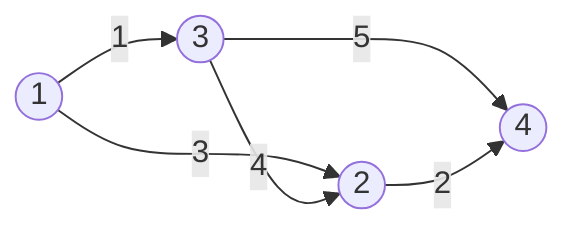

# 最短路径

## 四种算法对比

| 算法 | 适用 | 复杂度 | 空间 | 多源 | 判负环 |
|------|------|--------|------|------|--------|
| **Dijkstra + 堆** | 非负权 | **O((n+m)log n)** | O(n+m) | ✗ | ✗ |
| **SPFA** | 可有负权 | O(nm) 最坏 | O(n+m) | ✗ | ✓ |
| **Bellman-Ford** | 可有负权 | O(nm) | O(n) | ✗ | ✓ |
| **Floyd** | 多源 | O(n³) | O(n²) | ✓ | ✓ (对角线<0) |

**竞赛选择**：
- n ≤ 500 且要求多源 → **Floyd** 最方便
- n ≤ 1e5，非负权 → **Dijkstra + 堆**
- 有负权 → **SPFA** 或 **Bellman-Ford**（判负环）
- 稠密图（m ≈ n²） → Dijkstra 线性版或 Floyd

## Dijkstra（堆优化）

### 核心思想

贪心 + BFS。每次从 dist 数组中选一个最近未确定点 u，用 u 去松弛它的邻居。

### 图解：松弛过程

```
图:
  1 ──3──→ 2
  │  ↑     │
  1  │4    │2
  ↓  │     ↓
  3 ──5──→ 4

起点 s = 1

初始: dist[] = [0, ∞, ∞, ∞]
                1  2  3  4

第一轮: 选 dist 最小的未确定点 = 1
  用 1 松弛邻居:
    1→2: 3 → dist[2] = 3 (∞ → 3, 更新)
    1→3: 1 → dist[3] = 1 (∞ → 1, 更新)
  
  dist[] = [0, 3, 1, ∞]
  vis = [1, 0, 0, 0]  (1 确定)

第二轮: 选 dist 最小的未确定点 = 3
  用 3 松弛邻居:
    3→2: 4 → dist[2] = min(3, 1+4) = 3 (没变)
    3→4: 5 → dist[4] = 6 (∞ → 6)
  
  dist[] = [0, 3, 1, 6]
  vis = [1, 0, 1, 0]  (3 确定)

第三轮: 选 dist 最小的未确定点 = 2
  用 2 松弛邻居:
    2→4: 2 → dist[4] = min(6, 3+2) = 5 ✓ (更新)
  
  dist[] = [0, 3, 1, 5]
  vis = [1, 1, 1, 0]  (2 确定)

第四轮: 选点 4，没邻居要松弛
  dist[] = [0, 3, 1, 5] ✓

最终: 1→2 最短 3, 1→3 最短 1, 1→4 最短 5
```



### 模板

```cpp
typedef pair<int, int> pii;   // {距离, 点}

vector<pii> G[N];              // 邻接表：G[u] = [{v, w}, ...]
int dist[N];
bool vis[N];

void dijkstra(int s)
{
    memset(dist, 0x3f, sizeof(dist));   // INF = 0x3f3f3f3f
    memset(vis, 0, sizeof(vis));
    dist[s] = 0;
    priority_queue<pii, vector<pii>, greater<pii>> pq;  // 小根堆
    pq.push({0, s});
    while(!pq.empty())
    {
        auto [d, u] = pq.top();
        pq.pop();
        if(vis[u]) continue;              // 旧的、更大的距离跳过
        vis[u] = 1;
        for(auto& [v, w] : G[u])
        {
            if(dist[v] > dist[u] + w)
            {
                dist[v] = dist[u] + w;
                pq.push({dist[v], v});   // 入堆新的更优值，旧的自然弹出后被 vis 过滤
            }
        }
    }
}
```

### 为什么 O((n+m)log n)

**每个点被确定一次**（出队 vis 标记），但一个点可能入堆**多次**（每次松弛更新更短距离时，入堆新的 pair，旧的出队后被 vis 过滤掉）。

入堆总次数 ≤ **每条边 1 次**（最坏每个邻居都被松弛）→ 入堆 O(m) 次
堆操作每次 O(log n) → 总 O(m log n)
加上 n 次出队 → **O((n+m)log n)**

大多数 OJ 题目 m ≈ n 量级，所以近似 O(n log n)。

### 手写版（线性 O(n²)，稠密图）

```cpp
int d[N][N], dist[N];
bool vis[N];
int n;

void dijkstra_dense(int s)
{
    memset(dist, 0x3f, sizeof(dist));
    memset(vis, 0, sizeof(vis));
    dist[s] = 0;
    for(int i = 0; i < n; i++)     // n 轮，每轮确定一个点
    {
        int u = -1;
        for(int j = 1; j <= n; j++)
            if(!vis[j] && (u == -1 || dist[j] < dist[u])) u = j;
        if(dist[u] == 0x3f3f3f3f) break;   // 剩余点均不可达，避免 INF + w 溢出
        vis[u] = 1;
        for(int v = 1; v <= n; v++)
            if(!vis[v] && d[u][v] != 0x3f3f3f3f)
                dist[v] = min(dist[v], dist[u] + d[u][v]);
    }
}
```

## Bellman-Ford（可判负环）

### 核心思想

对每条边做 n-1 轮松弛。第 i 轮结束后，至多 i 条边的最短路已被覆盖；原地松弛可能在一轮内传播多条边。若要求严格限制边数，每轮必须从上一轮距离的备份转移。

### 模板

```cpp
struct Edge { int u, v, w; };
vector<Edge> edges;
int dist[N];

// 返回 true 表示有从 s 可达的负环（单源最短路无解）
bool bellman(int s, int n)
{
    memset(dist, 0x3f, sizeof(dist));
    dist[s] = 0;
    for(int i = 0; i < n - 1; i++)     // n-1 轮松弛，随后额外一轮判负环
    {
        bool updated = false;
        for(auto& e : edges)
        {
            if(dist[e.u] == 0x3f3f3f3f) continue;   // 不可达点不能参与松弛
            if(dist[e.v] > dist[e.u] + e.w)
            {
                dist[e.v] = dist[e.u] + e.w;
                updated = true;
            }
        }
        if(!updated) break;            // 没变化了，提前退出
    }
    // 再跑一轮，如果还能更新 → 有从 s 可达的负环
    for(auto& e : edges)
        if(dist[e.u] != 0x3f3f3f3f && dist[e.v] > dist[e.u] + e.w) return true;
    return false;
}
```

**判负环原理**：如果 n-1 轮后还能松弛，说明有一条长度 ≥ n 的路径被发现。n 个点的简单路径最多 n-1 条边，所以必然有环。权值能不断变小 → 负环。

## SPFA（队列优化 Bellman-Ford）

### 核心思想

只把那些**距离变小了的点**入队去松弛邻居。比 Bellman 快得多。最坏仍是 O(nm)。

### 模板

```cpp
vector<pii> G[N];
int dist[N];
int cnt[N];          // 每个点入队次数（用来判负环）
bool inq[N];

bool spfa(int s, int n)
{
    memset(dist, 0x3f, sizeof(dist));
    memset(inq, 0, sizeof(inq));
    memset(cnt, 0, sizeof(cnt));
    dist[s] = 0;
    queue<int> q;
    q.push(s);
    inq[s] = 1;
    while(!q.empty())
    {
        int u = q.front();
        q.pop();
        inq[u] = 0;
        for(auto& [v, w] : G[u])
        {
            if(dist[v] > dist[u] + w)
            {
                dist[v] = dist[u] + w;
                if(!inq[v])
                {
                    cnt[v]++;
                    if(cnt[v] >= n) return true;   // 入队 ≥ n 次 = 负环
                    q.push(v);
                    inq[v] = 1;
                }
            }
        }
    }
    return false;
}
```

**判负环另一种写法**：维护当前松弛路径的边数：更新 dist[v] 时令 cnt[v] = cnt[u] + 1，若 cnt[v] >= n 则发现从源点可达的负环。

## Floyd-Warshall（多源全源）

### 核心思想

动态规划：`d[i][j] = 从 i 到 j，经过编号 ≤ k 的点`。

### 模板

```cpp
int d[N][N];
int n;

void floyd()
{
    // 初始化
    for(int i = 1; i <= n; i++)
        for(int j = 1; j <= n; j++)
            if(i == j) d[i][j] = 0;
            else d[i][j] = 0x3f3f3f3f;

    // 读入边
    for(...) { d[u][v] = min(d[u][v], w); /* 无向图再处理 d[v][u] */ }

    // 核心三重循环：k 必须在最外层！
    for(int k = 1; k <= n; k++)
        for(int i = 1; i <= n; i++)
            for(int j = 1; j <= n; j++)
                if(d[i][k] != 0x3f3f3f3f && d[k][j] != 0x3f3f3f3f)
                    d[i][j] = min(d[i][j], d[i][k] + d[k][j]);
}
```

### 判负环

只要某个对角线满足 `d[i][i] < 0`，图中就有负环；但它只表示 i 可达负环并能返回 i，不保证 i 本身在负环上。

### 重建路径

```cpp
int nxt[N][N];    // nxt[i][j] = i 到 j 路径上的下一跳

void floyd_path()
{
    for(int i = 1; i <= n; i++)
        for(int j = 1; j <= n; j++)
            nxt[i][j] = j;   // 直接连边时，下一跳就是 j

    for(int k = 1; k <= n; k++)
        for(int i = 1; i <= n; i++)
            for(int j = 1; j <= n; j++)
                if(d[i][k] != 0x3f3f3f3f && d[k][j] != 0x3f3f3f3f &&
                   d[i][j] > d[i][k] + d[k][j])
                {
                    d[i][j] = d[i][k] + d[k][j];
                    nxt[i][j] = nxt[i][k];   // 下一跳改成走 k 的下一跳
                }
}

// 输出路径
void print_path(int s, int t)
{
    if(d[s][t] == 0x3f3f3f3f) return;   // 不可达时没有路径可输出
    cout << s;
    while(s != t)
    {
        s = nxt[s][t];
        cout << " -> " << s;
    }
}
```

## 最短路常见变体

### 1. 还原路径（Dijkstra）

```cpp
int pre[N];    // pre[v] = v 的最短路径前驱

void dijkstra_path(int s, int t)
{
    memset(dist, 0x3f, sizeof(dist));
    memset(pre, 0, sizeof(pre));
    dist[s] = 0;
    priority_queue<pii, vector<pii>, greater<pii>> pq;
    pq.push({0, s});
    while(!pq.empty())
    {
        auto [d, u] = pq.top(); pq.pop();
        if(d > dist[u]) continue;
        for(auto& [v, w] : G[u])
        {
            if(dist[v] > dist[u] + w)
            {
                dist[v] = dist[u] + w;
                pre[v] = u;
                pq.push({dist[v], v});
            }
        }
    }
    // 重建
    if(dist[t] == 0x3f3f3f3f) return;   // 不可达，由调用者按题意输出
    vector<int> path;
    int cur = t;
    while(cur) { path.push_back(cur); cur = pre[cur]; }
    reverse(path.begin(), path.end());
    for(int x : path) cout << x << ' ';
}
```

### 2. 次短路

```cpp
int dist[N], dist2[N];    // 最短路、次短路
bool vis[N];

void dijkstra_second(int s)
{
    memset(dist, 0x3f, sizeof(dist));
    memset(dist2, 0x3f, sizeof(dist2));
    dist[s] = 0;
    priority_queue<pii, vector<pii>, greater<pii>> pq;
    pq.push({0, s});
    while(!pq.empty())
    {
        auto [d, u] = pq.top(); pq.pop();
        if(d > dist2[u]) continue;
        for(auto& [v, w] : G[u])
        {
            if(dist[v] > d + w)
            {
                dist2[v] = dist[v];
                dist[v] = d + w;
                pq.push({dist[v], v});
            }
            else if(dist2[v] > d + w && d + w != dist[v])
            {
                dist2[v] = d + w;
                pq.push({dist2[v], v});
            }
        }
    }
}
```

### 3. 分层图（k 次免费走最短）

```cpp
// 把图复制 k+1 层，跨层边免费
// dist[i][j] = 用了 j 次免费的情况下到 i 的最短距离
int dist[N][K];
bool vis[N][K];

void dijkstra_layer(int s, int k)
{
    memset(dist, 0x3f, sizeof(dist));
    memset(vis, 0, sizeof(vis));
    dist[s][0] = 0;
    priority_queue<tuple<int,int,int>, vector<tuple<int,int,int>>, greater<>> pq;
    pq.push({0, s, 0});
    while(!pq.empty())
    {
        auto [d, u, used] = pq.top(); pq.pop();
        if(vis[u][used]) continue;
        vis[u][used] = 1;
        for(auto& [v, w] : G[u])
        {
            if(dist[v][used] > d + w) { dist[v][used] = d + w; pq.push({d+w, v, used}); }
            if(used < k && dist[v][used+1] > d) { dist[v][used+1] = d; pq.push({d, v, used+1}); }
        }
    }
}
```

### 4. 最短路径计数（严格正边权）

```cpp
// 0 权边会使同距离点的更新顺序影响计数，需按题意在最短路子图上另行处理
int dist[N], cnt[N];

void dijkstra_cnt(int s)
{
    memset(dist, 0x3f, sizeof(dist));
    memset(cnt, 0, sizeof(cnt));
    dist[s] = 0; cnt[s] = 1;
    priority_queue<pii, vector<pii>, greater<pii>> pq;
    pq.push({0, s});
    while(!pq.empty())
    {
        auto [d, u] = pq.top(); pq.pop();
        if(d > dist[u]) continue;
        for(auto& [v, w] : G[u])
        {
            if(dist[v] > d + w)
            {
                dist[v] = d + w;
                cnt[v] = cnt[u];
                pq.push({d+w, v});
            }
            else if(dist[v] == d + w)
            {
                cnt[v] = (cnt[v] + cnt[u]) % mod;
            }
        }
    }
}
```

## 差分约束

一组形如 x_v - x_u ≤ c 的不等式，转成最短路模型：建边 u → v，边权 c。有负环说明矛盾，无解。

- 求最大解：全部化成 x_i - x_j ≤ c，跑最短路
- 求最小解：全部化成 x_i - x_j ≥ c，跑最长路（或整体取负转最短路）
- 判无解：跑 SPFA 判负环

```cpp
const int N = 10005;
struct Node { int v, w; };
vector<Node> g[N];
int dis[N], cnt[N];
bool vis[N];

bool spfa(int n)
{
    memset(dis, 0x3f, sizeof(dis));
    memset(cnt, 0, sizeof(cnt));
    memset(vis, 0, sizeof(vis));
    queue<int> q;
    for(int i = 1; i <= n; i++)
    {
        q.push(i);
        vis[i] = 1;
        dis[i] = 0;
    }
    while(!q.empty())
    {
        int u = q.front();
        q.pop();
        vis[u] = 0;
        for(auto &e : g[u])
        {
            if(dis[e.v] > dis[u] + e.w)
            {
                dis[e.v] = dis[u] + e.w;
                cnt[e.v] = cnt[u] + 1;
                if(cnt[e.v] >= n) return false;
                if(!vis[e.v])
                {
                    vis[e.v] = 1;
                    q.push(e.v);
                }
            }
        }
    }
    return true;
}
```

**要点**：

- 不等式方向必须统一，`x_v - x_u ≤ c` 建 u → v，边权 c
- `x_v - x_u ≥ c` 两边取负，变成 `x_u - x_v ≤ -c`
- 所有点初始入队、距离置 0，相当于超级源点连 0 权边，同时处理不连通
- 负环 → 矛盾无解；该写法只判断可行性，各点初始基准均为 0，不会留下 INF 距离
- 最坏 O(nm)，n、m 都是 1e5 时慎用，注意题目给的时限

## 易错点

1. **Dijkstra 不能有负权**：哪怕只有一条负边都可能错（贪心假设不成立）
2. **Floyd 的 k 必须最外层**：`k, i, j` 顺序不能反
3. **SPFA 可能超时**：O(nm) 最坏比 Bellman 还慢。图比较稠密或全正权时换 Dijkstra
4. **INF 取 0x3f3f3f3f**：int 数组初始化用 `0x3f` 填充，结果约 1e9，加两次不溢出 int
5. **反向边**：有的题要求从多个终点回一个起点，可以反图 + Dijkstra

## 真题演练

### 【2023 ICPC 杭州 G - 蛇】

**原题**：[Codeforces Gym 104976 G](https://codeforces.com/gym/104976/problem/G)

**简述**：网格图里有一条蛇占据 k 个连续格子（头到尾依次排列）。蛇头可以走四方向：
1. 前方格子是空地（没被蛇身挡住）→ 直接走
2. 前方格子当前被蛇身挡住，但走了之后蛇尾会先离开 → 等蛇尾离开再走
3. 前方被挡住且蛇尾也不离开 → 必须砍断蛇身（增加代价）

**思路**：把 BFS 队列换成**优先队列**，用 Dijkstra 的贪心思想——每个点第一次出队就是到它的合法最短路。`g[x][y]` 存蛇初始状态下 (x,y) 到尾巴的距离，用于判断蛇尾何时会先离开该格子。

**复杂度**：O(nm log nm)（Dijkstra 优先队列）

```cpp
#include<bits/stdc++.h>
using namespace std;
typedef unsigned long long ull;
const int N = 3005;
const int INF = 0x3f3f3f3f;

int g[N][N];       // '#' 表示墙；空地为 0；其余数字为蛇身到尾巴的距离
int d[N][N];       // 到每个空地的最短合法距离
int n, m, k, root, cnt;
int dx[] = {1, -1, 0, 0};
int dy[] = {0, 0, -1, 1};

int idx(int i, int j) { return i * 3010 + j; }
pair<int, int> ridx(int x) { return {x / 3010, x % 3010}; }

void solve()
{
    cin >> n >> m >> k;
    // 读入蛇的位置（从头到尾依次 k 个点）
    for(int i = 1; i <= k; i++)
    {
        int a, b;
        cin >> a >> b;
        g[a][b] = k - i;    // 值 = 到蛇尾的距离
        if(i == 1) root = idx(a, b);   // 蛇头
    }
    cnt = 0;   // 空地总数
    for(int i = 1; i <= n; i++)
        for(int j = 1; j <= m; j++)
        {
            char ch;
            cin >> ch;
            if(ch == '#') g[i][j] = '#';
            else cnt++;       // 空地保留 0；蛇身格保留上面写入的距离
        }

    memset(d, 0x3f, sizeof d);
    priority_queue<pair<int, int>, vector<pair<int, int>>, greater<>> pq;
    d[root / 3010][root % 3010] = 0;
    pq.push({0, root});

    while(pq.size())
    {
        auto [dis, cur] = pq.top();
        pq.pop();
        auto [x, y] = ridx(cur);
        if(dis > d[x][y]) continue;
        if((--cnt) == 0) break;

        for(int dir = 0; dir < 4; dir++)
        {
            int nx = x + dx[dir], ny = y + dy[dir];
            if(nx < 1 || nx > n || ny < 1 || ny > m) continue;
            if(g[nx][ny] == '#') continue;

            // 关键：如果走了之后蛇尾先离开该点，dis+1 即可
            // 否则要等蛇尾离开，即 g[nx][ny]+1 作为代价
            int dd;
            if(dis + 1 > g[nx][ny]) dd = dis + 1;
            else dd = g[nx][ny] + 1;

            if(d[nx][ny] > dd)
            {
                d[nx][ny] = dd;
                pq.push({dd, idx(nx, ny)});
            }
        }
    }

    ull res = 0;
    for(int i = 1; i <= n; i++)
        for(int j = 1; j <= m; j++)
            if(d[i][j] != INF)
                res += (ull)d[i][j] * (ull)d[i][j];
    cout << res << '\n';
}

int main()
{
    ios::sync_with_stdio(false);
    cin.tie(0);
    solve();
    return 0;
}
```

**要点**：BFS 队列换成优先队列，就从"层序最短路"变成了"带权最短路"。蛇身阻挡的问题通过 `g`（到蛇尾距离）转化成了边权代价——走的时候要等蛇尾离开，相当于增加了额外代价。

---
