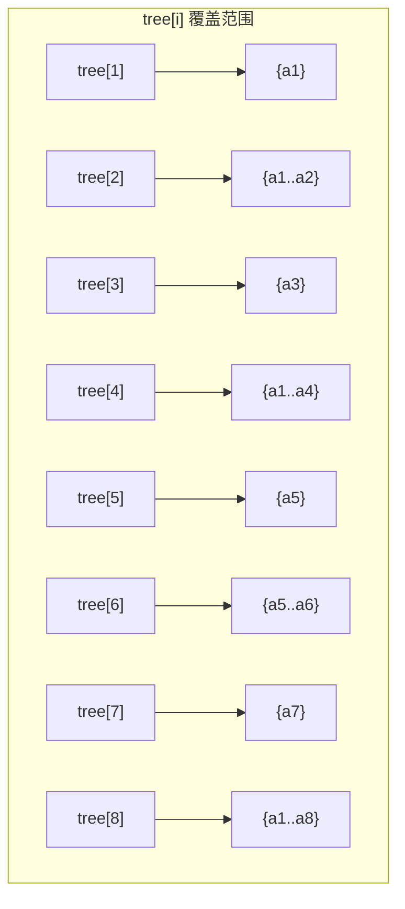

# 树状数组（BIT）

## 复杂度

O(log n)，常数比线段树小得多。但功能有限：
- ✅ 单点修改 + 区间查询
- ✅ 区间修改 + 单点查询（差分数组技巧）
- ❌ 区间修改 + 区间查询（需要两个 BIT）
- ❌ 不能做 min/max（除非静态）
- ❌ 不能做区间赋值（除非配合懒标记）

## 核心思想

把数组中每个位置 i 的二进制分解成若干段区间：
- `i` 表示 `lowbit(i)` 个元素之和

`lowbit(i) = i & (-i)` —— i 的最低位 1 对应的值。

### lowbit 图解

```
位置 i:   1  2  3  4  5  6  7  8
二进制:   1 10 11 100 101 110 111 1000
lowbit:   1  2  1  4  1  2  1   8
          ↑  ↑  ↑  ↑  ↑  ↑  ↑   ↑
tree[i] 包含从 i 往前 lowbit(i) 个数

位置 1 (001): 包含 a[1]        → lowbit=1  → 1 个数
位置 2 (010): 包含 a[1..2]     → lowbit=2  → 2 个数
位置 3 (011): 包含 a[3]        → lowbit=1  → 1 个数
位置 4 (100): 包含 a[1..4]     → lowbit=4  → 4 个数
位置 5 (101): 包含 a[5]        → lowbit=1  → 1 个数
位置 6 (110): 包含 a[5..6]     → lowbit=2  → 2 个数
位置 7 (111): 包含 a[7]        → lowbit=1  → 1 个数
位置 8 (1000):包含 a[1..8]     → lowbit=8  → 8 个数
```

### 查询过程图解（求前缀和 [1..7]）

```
query(7):
  7  = 111  → 减 lowbit(7)=1 → 变成 6
  6  = 110  → 减 lowbit(6)=2 → 变成 4
  4  = 100  → 减 lowbit(4)=4 → 变成 0 (停止)
  
  = tree[7] + tree[6] + tree[4]
  
  tree[7] = a[7]           (lowbit=1, 覆盖 7)
  tree[6] = a[5] + a[6]    (lowbit=2, 覆盖 5-6)
  tree[4] = a[1..4]        (lowbit=4, 覆盖 1-4)
  合计    = a[1..7] ✓ 完整覆盖！

  ---+---+---+---+---+---+---+
  a[1] a[2] a[3] a[4] a[5] a[6] a[7]
  |--- tree[4] ----|
                    |--tree[6]--|
                                  |t[7]|
```

### 更新过程图解（a[5] += val）

```
update(5, val):
  5  = 101  → 加 lowbit(5)=1 → 变成 6
  6  = 110  → 加 lowbit(6)=2 → 变成 8
  8  =1000  → 加 lowbit(8)=8 → 变成 16 (>n, 停止)
  
  tree[5] += val   (覆盖位置 5 的叶子)
  tree[6] += val   (覆盖 5-6 的节点)
  tree[8] += val   (覆盖 1-8 的根)
  
  ---+---+---+---+---+---+---+---+
  a[1] a[2] a[3] a[4] a[5] a[6] a[7] a[8]
  |       tree[8] 覆盖全区间          |
                  | tree[6] |
                      |t[5]|

  5 的祖先链: 5 → 6 → 8 → 16
  每一层都需要更新，才能保证前缀查询正确
```

### 用 Mermaid 画结构



## 模板（单点修改 + 区间查询）

```cpp
ll tree[N];
int n;

int lowbit(int x) { return x & -x; }

// 单点修改：a[i] += val
void update(int i, ll val)
{
    for(; i <= n; i += lowbit(i)) tree[i] += val;
}

// 前缀查询 [1, i]
ll query(int i)
{
    ll res = 0;
    for(; i > 0; i -= lowbit(i)) res += tree[i];
    return res;
}

// 区间查询 [l, r]
ll query_range(int l, int r) { return query(r) - query(l-1); }
```

## 用法示例

```cpp
int main()
{
    cin >> n;
    for(int i = 1; i <= n; i++)
    {
        ll x; cin >> x;
        update(i, x);
    }
    // [2, 5] 求和
    cout << query_range(2, 5) << endl;
    // 把位置 3 的值加 10
    update(3, 10);
}
```

## 树状数组做区间修改（用差分数组）

### 情况 1：区间修改 + 单点查询

对区间 `[l, r]` 整体加 x，单点查询 a[i]。

```cpp
// 思路：维护差分数组 diff[i]
// 区间 [l, r] 加 x → diff[l] += x, diff[r+1] -= x
// 单点查询 a[i] = 前缀和 diff[1..i]

ll tree[N];
int n;

void update(int i, ll val) { for(; i <= n; i += lowbit(i)) tree[i] += val; }
ll query(int i) { ll res = 0; for(; i > 0; i -= lowbit(i)) res += tree[i]; return res; }

// 区间 [l, r] 加 x
void range_add(int l, int r, ll x)
{
    update(l, x);
    update(r + 1, -x);
}
// 单点查询 a[i]
ll point_query(int i) { return query(i); }
```

### 情况 2：区间修改 + 区间查询（两个 BIT）

```cpp
ll t1[N], t2[N];
int n;

int lowbit(int x) { return x & -x; }

void add(int i, ll val)
{
    for(int j = i; j <= n; j += lowbit(j))
    {
        t1[j] += val;
        t2[j] += val * i;
    }
}

// 区间 [l, r] 加 x
void range_add(int l, int r, ll x)
{
    add(l, x);
    add(r + 1, -x);
}

ll sum(int i)
{
    ll res = 0;
    for(int j = i; j > 0; j -= lowbit(j))
        res += t1[j] * (i + 1) - t2[j];
    return res;
}

// 区间 [l, r] 查询
ll range_query(int l, int r) { return sum(r) - sum(l - 1); }
```

## 线段树 vs 树状数组

|     | 树状数组       | 线段树  |
| --- | ---------- | ---- |
| 代码量 | 短          | 长    |
| 速度  | 快（常数小）     | 略慢   |
| 功能  | 有限（和、加、单点） | 全功能  |
| 适用  | 数据结构简单的题   | 复杂操作 |

**选择**：能用树状数组就用（快+短），不行上线段树。

## 真题演练

### 【2024 ICPC 沈阳 D - Dot Product Game】

**原题**：[Codeforces Gym 105578 D](https://codeforces.com/gym/105578/problem/D)

**简述**：给定两个排列 A、B，双方轮流交换同一排列中的两个元素，且交换后两个排列的点积必须严格增大，无法操作者输。随后依次进行 n-1 次修改，每次将 A 或 B 的区间 `[l,r]` 循环左移 d 位，输出初始局面及每次修改后的胜者。

**思路**：合法交换会减少逆序对数，同时改变逆序对数的奇偶性，因此胜者由两个排列的逆序对总数奇偶性决定。区间循环左移 d 位可看作 d*(r-l) 次相邻交换，只需按该值的奇偶性翻转答案。

**复杂度**：O(n log n)

```cpp
#include<bits/stdc++.h>
using namespace std;
typedef long long ll;
const int N = 500005;

ll tr[N];
int n;

void add(int x, int c)
{
    for(int i = x; i <= n; i += i & -i) tr[i] += c;
}

ll query(int x)
{
    ll res = 0;
    for(int i = x; i > 0; i -= i & -i) res += tr[i];
    return res;
}

ll count_inv(vector<int> &a)
{
    memset(tr, 0, sizeof tr);
    ll res = 0;
    for(int i = 1; i <= n; i++)
    {
        res += query(n) - query(a[i]);
        add(a[i], 1);
    }
    return res;
}

int main()
{
    ios::sync_with_stdio(false);
    cin.tie(0);

    int T;
    cin >> T;
    while(T--)
    {
        cin >> n;
        vector<int> a(n + 1), b(n + 1);
        for(int i = 1; i <= n; i++) cin >> a[i];
        for(int i = 1; i <= n; i++) cin >> b[i];

        ll ans = count_inv(a) + count_inv(b);
        string s;
        s += (ans & 1 ? 'A' : 'B');

        for(int i = 1; i < n; i++)
        {
            char c;
            int l, r, d;
            cin >> c >> l >> r >> d;
            ans ^= (1ll * (r - l) * d) & 1;
            s += (ans ? 'A' : 'B');
        }
        cout << s << '\n';
    }
    return 0;
}
```

**要点**：交换影响的是逆序对奇偶性；循环左移不是区间反转，其奇偶变化量为 `d*(r-l)`。修改共有 n-1 次，输入中没有额外的 q。

---
