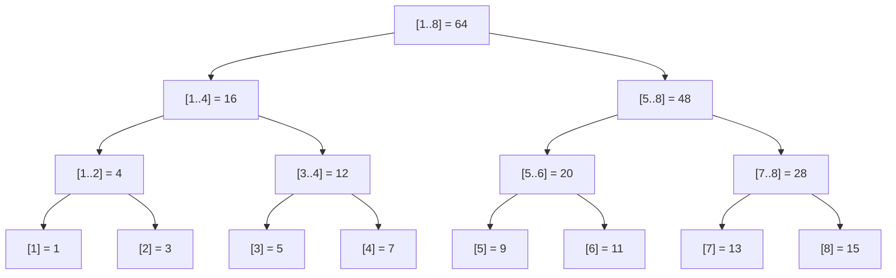

# 线段树

## 核心思想

把数组递归划分成一棵**二叉树**（n 不是 2 的幂时，一般不是完全二叉树），每个节点存一段区间的信息。支持：
- **单点修改**：O(log n)
- **区间查询**：O(log n)
- **区间修改**：O(log n)（用 lazy tag 标记）

### 结构图

```
数组 a[1..8]:
  1  3  5  7  9 11 13 15

建树后（每个节点存区间和）：

                  [1..8] = 64
                 /            \
          [1..4] = 16          [5..8] = 48
         /        \          /         \
    [1..2]=4   [3..4]=12  [5..6]=20   [7..8]=28
    /     \     /     \    /     \     /     \
  [1]=1 [2]=3 [3]=5 [4]=7 [5]=9 [6]=11 [7]=13 [8]=15

节点编号（根为 1，左子 node*2，右子 node*2+1）:
  节点 1: [1..8]        根
  节点 2: [1..4]        节点 1 的左子
  节点 3: [5..8]        节点 1 的右子
  节点 4: [1..2]        节点 2 的左子
  节点 5: [3..4]        节点 2 的右子
  节点 6: [5..6]        节点 3 的左子
  节点 7: [7..8]        节点 3 的右子
  节点 8 ~ 15: 叶子 a[1] ~ a[8]

空间大小: 4N 足够（最坏节点编号 < 4N）
深度: ⌈log2 n⌉ + 1 ≈ 20（n = 1e6）
```



### 区间查询过程（查询 [3, 7]）

```
目标: 求 a[3] + a[4] + a[5] + a[6] + a[7]

从根 [1..8] 开始，和 [3..7] 比：
  [1..8] 和 [3..7] 部分重叠 → 分左右子树
  
  左子 [1..4] 和 [3..7] 部分重叠 → 再分：
    [1..2] 和 [3..7] 不重叠 → 跳过
    [3..4] 和 [3..7] 完全包含 → 返回 12 ✓
  
  右子 [5..8] 和 [3..7] 部分重叠 → 再分：
    [5..6] 和 [3..7] 完全包含 → 返回 20 ✓
    [7..8] 和 [3..7] 部分重叠 → 再分：
      [7] 和 [3..7] 完全包含 → 返回 13 ✓
      [8] 和 [3..7] 不重叠 → 跳过

答案 = 12 + 20 + 13 = 45

图示（✓ 完全包含直接返回，✗ 不重叠跳过）:

              [1..8]
             /      \
        [1..4]        [5..8]
        /    \        /    \
   [1..2]  [3..4]  [5..6]  [7..8]
     ✗      ✓12     ✓20    /    \
                           [7]   [8]
                           ✓13    ✗
  合计: 12 + 20 + 13 = 45
```

### 区间修改 + lazy tag 图解

```
给 [3, 6] 每个数加 2

修改时:
  根 [1..8] 与 [3..6] 部分重叠 → 下传 lazy（但这里根没 tag）
  
  左子 [1..4] 与 [3..6] 部分重叠
    [1..2] 不重叠 → 跳过
    [3..4] 完全被 [3..6] 包含！
      → tree[3..4] += 2 * 2 = 4   (2 个元素)
      → add[3..4] += 2            打标记，暂不下传
      → 不用继续递归！(节省时间)

  右子 [5..8] 与 [3..6] 部分重叠
    [5..6] 完全被包含！
      → tree[5..6] += 2 * 2 = 4
      → add[5..6] += 2
    
    [7..8] 不重叠 → 跳过

查询时遇到 lazy:
  如果要下探到有 lazy 的节点，先 push_down 把 tag 传给子节点
  
  例如后来查询 [3, 4]:
    从根下探到 [3..4] 节点（node = 5）
    发现 add[5] = 2（带 lazy tag）
    → push_down(5): tree[10] += 2, add[10] += 2; tree[11] += 2, add[11] += 2
    → 然后 add[5] 清零
    → 继续下探叶子 [3]（node = 10）、[4]（node = 11）
```

## 适用场景

- 单点修改 + 区间查询（可以用树状数组）
- **区间修改**（树状数组不擅长）
- 操作类型复杂（min/max/gcd/区间赋值/区间加等）

## 基础线段树（单点修改 + 区间查询）

```cpp
int a[N];
int tree[N << 2];   // 4N 空间足够

// 建树
void build(int node, int l, int r)
{
    if(l == r) { tree[node] = a[l]; return; }
    int mid = l + r >> 1;
    build(node*2, l, mid);
    build(node*2+1, mid+1, r);
    tree[node] = tree[node*2] + tree[node*2+1];   // 改成 min/max 等
}

// 单点修改
void update(int node, int l, int r, int pos, int val)
{
    if(l == r) { tree[node] = val; return; }
    int mid = l + r >> 1;
    if(pos <= mid) update(node*2, l, mid, pos, val);
    else update(node*2+1, mid+1, r, pos, val);
    tree[node] = tree[node*2] + tree[node*2+1];
}

// 区间查询 [ql, qr]
int query(int node, int l, int r, int ql, int qr)
{
    if(ql <= l && r <= qr) return tree[node];   // 完全包含
    int mid = l + r >> 1;
    int res = 0;
    if(ql <= mid) res += query(node*2, l, mid, ql, qr);
    if(qr > mid) res += query(node*2+1, mid+1, r, ql, qr);
    return res;
}
```

## 带 lazy tag 的线段树（区间修改 + 区间查询）

```cpp
int tree[N << 2], add[N << 2];

void push_down(int node, int l, int r)
{
    if(add[node])
    {
        int mid = l + r >> 1;
        add[node*2] += add[node];
        tree[node*2] += add[node] * (mid - l + 1);
        add[node*2+1] += add[node];
        tree[node*2+1] += add[node] * (r - mid);
        add[node] = 0;
    }
}

void build(int node, int l, int r)
{
    add[node] = 0; // 多组数据重新建树时重置
    if(l == r) { tree[node] = a[l]; return; }
    int mid = l + r >> 1;
    build(node*2, l, mid);
    build(node*2+1, mid+1, r);
    tree[node] = tree[node*2] + tree[node*2+1];
}

// 区间加
void update_range(int node, int l, int r, int ql, int qr, int val)
{
    if(ql <= l && r <= qr)
    {
        tree[node] += val * (r - l + 1);
        add[node] += val;
        return;
    }
    push_down(node, l, r);
    int mid = l + r >> 1;
    if(ql <= mid) update_range(node*2, l, mid, ql, qr, val);
    if(qr > mid) update_range(node*2+1, mid+1, r, ql, qr, val);
    tree[node] = tree[node*2] + tree[node*2+1];
}

// 区间查询
int query_range(int node, int l, int r, int ql, int qr)
{
    if(ql <= l && r <= qr) return tree[node];
    push_down(node, l, r);
    int mid = l + r >> 1;
    int res = 0;
    if(ql <= mid) res += query_range(node*2, l, mid, ql, qr);
    if(qr > mid) res += query_range(node*2+1, mid+1, r, ql, qr);
    return res;
}
```

## 结构体封装（模板）

```cpp
#include<bits/stdc++.h>
using namespace std;
typedef long long ll;

const int N = 1e5 + 10;
ll a[N];

struct SegTree
{
    int n;
    vector<ll> tree, add;
    SegTree(int n) : n(n), tree(4*n, 0), add(4*n, 0) {}

    void build(vector<ll>& a) {
        fill(add.begin(), add.end(), 0); // 重建时清空上一组的懒标记
        build(1, 1, n, a);
    }
    void build(int node, int l, int r, vector<ll>& a)
    {
        if(l == r) { tree[node] = a[l]; return; }
        int mid = l + r >> 1;
        build(node*2, l, mid, a);
        build(node*2+1, mid+1, r, a);
        tree[node] = tree[node*2] + tree[node*2+1];
    }

    void push_down(int node, int l, int r)
    {
        if(add[node])
        {
            int mid = l + r >> 1;
            add[node*2] += add[node];
            tree[node*2] += add[node] * (mid - l + 1);
            add[node*2+1] += add[node];
            tree[node*2+1] += add[node] * (r - mid);
            add[node] = 0;
        }
    }

    void update_range(int ql, int qr, ll val) { update_range(1, 1, n, ql, qr, val); }
    void update_range(int node, int l, int r, int ql, int qr, ll val)
    {
        if(ql <= l && r <= qr)
        {
            tree[node] += val * (r - l + 1);
            add[node] += val;
            return;
        }
        push_down(node, l, r);
        int mid = l + r >> 1;
        if(ql <= mid) update_range(node*2, l, mid, ql, qr, val);
        if(qr > mid) update_range(node*2+1, mid+1, r, ql, qr, val);
        tree[node] = tree[node*2] + tree[node*2+1];
    }

    ll query_range(int ql, int qr) { return query_range(1, 1, n, ql, qr); }
    ll query_range(int node, int l, int r, int ql, int qr)
    {
        if(ql <= l && r <= qr) return tree[node];
        push_down(node, l, r);
        int mid = l + r >> 1;
        ll res = 0;
        if(ql <= mid) res += query_range(node*2, l, mid, ql, qr);
        if(qr > mid) res += query_range(node*2+1, mid+1, r, ql, qr);
        return res;
    }
};
```

## 易错点

1. **push_down**：查询或修改前记得 push_down！否则子节点的 lazy tag 没往下传
2. **空间 4N**：树节点最多 2^ceil(log2(n)) × 2，开 4N 足够
3. **节点编号**：用 node*2 和 node*2+1 左右子树；node=1 为根
4. **区间赋值 vs 区间加**：tag 类型不同，分别维护。也可以两个 tag 都维护
5. **1-indexed**：线段树数组一般从 1 开始（方便节点编号）
