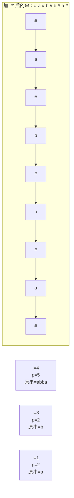

# Trie / KMP / 字符串哈希 / 马拉车

## Trie 树（前缀树）

### 复杂度

插入 / 查询 / 删除：O(L)，L 是字符串长度。

### 核心思想

每个节点存一个字符，从根到某个路径就是一个字符串的前缀。

### 模板

```cpp
struct Trie
{
    int son[26];     // 或 son[256] 存 ASCII
    int cnt;          // 以这个节点结尾的单词数
    int sum;          // 有多少单词经过这个节点（前缀计数）
} trie[300010];

int tot;              // 节点数

void insert(string s)
{
    int p = 0;
    for(char c : s)
    {
        int u = c - 'a';
        if(!trie[p].son[u]) trie[p].son[u] = ++tot;
        p = trie[p].son[u];
        trie[p].sum++;
    }
    trie[p].cnt++;
}

// 以 s 结尾的单词数
int query_word(string s)
{
    int p = 0;
    for(char c : s)
    {
        p = trie[p].son[c - 'a'];
        if(!p) return 0;
    }
    return trie[p].cnt;
}

// 以 s 为前缀的单词数
int query_prefix(string s)
{
    int p = 0;
    for(char c : s)
    {
        p = trie[p].son[c - 'a'];
        if(!p) return 0;
    }
    return trie[p].sum;
}

// 判是否可删除（cnt-- 和 sum--）
void remove(string s)
{
    int p = 0;
    for(char c : s)
    {
        p = trie[p].son[c - 'a'];
        trie[p].sum--;
    }
    trie[p].cnt--;
}
```

### 01 Trie（存二进制）

```cpp
// 存所有数的二进制前缀，求异或最大值
int son[N * 30][2], tot;

void insert(int x)
{
    int p = 0;
    for(int i = 29; i >= 0; i--)   // 30 位整数
    {
        int u = x >> i & 1;
        if(!son[p][u]) son[p][u] = ++tot;
        p = son[p][u];
    }
}

int query_max(int x)
{
    int p = 0, res = 0;
    for(int i = 29; i >= 0; i--)
    {
        int u = x >> i & 1;
        if(son[p][!u]) { res |= 1 << i; p = son[p][!u]; }
        else p = son[p][u];
    }
    return res;
}
```

## KMP 算法（模式匹配）

### 复杂度

O(n + m)。n 主串长，m 模式串长。

### 核心思想

`next[i]` = `pattern[0..i]` 中**最长相等真前缀和真后缀**的长度。

### 模板

```cpp
int nxt[N];

// 预处理 next 数组
void build_next(string& p)
{
    int m = p.size();
    nxt[0] = -1;      // 注意 -1
    int j = -1;
    for(int i = 1; i < m; i++)
    {
        while(j >= 0 && p[j+1] != p[i]) j = nxt[j];
        if(p[j+1] == p[i]) j++;
        nxt[i] = j;
    }
}

// 在 s 中找 p 出现次数
int kmp(string& s, string& p)
{
    build_next(p);
    int n = s.size(), m = p.size();
    int j = -1, cnt = 0;
    for(int i = 0; i < n; i++)
    {
        while(j >= 0 && p[j+1] != s[i]) j = nxt[j];
        if(p[j+1] == s[i]) j++;
        if(j == m - 1)
        {
            cnt++;
            j = nxt[j];   // 找下一个
        }
    }
    return cnt;
}
```

### next 数组图解

```
pattern = "abababc"
next[i] = 最长相等真前缀/真后缀的长度 - 1（长度 0 时 next = -1，与下面模板一致）

i=0: a      空前缀和空前缀相等 → next[0] = -1 (约定)
i=1: ab     前缀: a; 后缀: b   → 不等 → next[1] = -1
i=2: aba    前缀: a, ab; 后缀: ba, a
            最长相等 = "a" → next[2] = 0 (长度 1-1)

i=3: abab   前缀: a, ab, aba; 后缀: bab, ab, b
            最长相等 = "ab" → next[3] = 1 (长度 2-1)

i=4: ababa  前缀: ab, aba, abab; 后缀: baba, aba, ba
            最长相等 = "aba" → next[4] = 2 (长度 3-1)

i=5: ababab 前缀: abab, ababa; 后缀: babab, abab
            最长相等 = "abab" → next[5] = 3 (长度 4-1)

i=6: abababc 前缀都不含末尾 c；后缀开头是 c → 不等 → next[6] = -1

  a  b  a  b  a  b  c
 -1 -1  0  1  2  3 -1   ← next[]

next 数组作用:
  当匹配失败时，跳转到 next[j] 而不是从头开始
  
  s: a b a b a c a b a b a b c
  p:   a b a b a b c
                  ↑ 这里 c≠b，不从头重新！
                  而是用 next[5]=3，把模式串移到
                      a b a b a b c
                          ↑ 从这个位置继续匹配
```

### 手写简化版

```cpp
// next[0] 存 0，避免 -1
int fail[N];   // next 的另一种命名
void build_fail(string& p)
{
    int m = p.size();
    int j = 0;
    for(int i = 1; i < m; i++)
    {
        while(j > 0 && p[j] != p[i]) j = fail[j-1];
        if(p[j] == p[i]) j++;
        fail[i] = j;
    }
}

// 匹配
int kmp(string& s, string& p)
{
    build_fail(p);
    int j = 0, cnt = 0;
    for(int i = 0; i < s.size(); i++)
    {
        while(j > 0 && p[j] != s[i]) j = fail[j-1];
        if(p[j] == s[i]) j++;
        if(j == p.size()) { cnt++; j = fail[j-1]; }
    }
    return cnt;
}
```

## 字符串哈希（快速比较）

### 复杂度

预处理 O(n)，每次查询 O(1)。

### 核心思想

把字符串当成一个 P 进制数，计算 HASH 值。相同字符串有相同哈希。

### 模板

```cpp
typedef unsigned long long ull;
const ull P = 131;       // 常用 131 / 13331 / 998244353
const int N = 1e5 + 10;

ull h[N], p[N];

void init_hash(string& s)
{
    p[0] = 1;
    h[0] = 0;
    for(int i = 1; i <= s.size(); i++)
    {
        h[i] = h[i-1] * P + s[i-1];
        p[i] = p[i-1] * P;
    }
}

// s[l..r] 的哈希值（1-indexed）
ull get_hash(int l, int r)
{
    return h[r] - h[l-1] * p[r - l + 1];
}
```

**双哈希更稳**：用两个 P 算两次，两个哈希都相同才认为相同，避免冲突。

```cpp
struct Hash
{
    ull h1[N], h2[N], p1[N], p2[N];
    static const ull P1 = 131, P2 = 998244353;
    void init(string& s)
    {
        p1[0] = p2[0] = 1;
        h1[0] = h2[0] = 0;
        for(int i = 1; i <= s.size(); i++)
        {
            h1[i] = h1[i-1] * P1 + s[i-1];
            h2[i] = h2[i-1] * P2 + s[i-1];
            p1[i] = p1[i-1] * P1;
            p2[i] = p2[i-1] * P2;
        }
    }
    pair<ull, ull> get(int l, int r)
    {
        return {h1[r] - h1[l-1]*p1[r-l+1], h2[r] - h2[l-1]*p2[r-l+1]};
    }
};
```

## 马拉车（Manacher）——最长回文子串

### 复杂度

O(n)。

### 核心思想

在字符串每两个字符之间加一个特殊字符 `#`，把奇/偶回文统一成**奇数长度回文**。然后维护一个**当前最右边界 max_r** 和对应的**中心 center**，利用对称性跳过已知的扩展。

### 图解

```
p[i] 的定义：加 '#' 后以 i 为中心的回文半径（包含中心本身）

原串: "abba"
加'#':  #  a  #  b  #  b  #  a  #
位置 i:  0  1  2  3  4  5  6  7  8
p[i]  :  1  2  1  2  5  2  1  2  1   ← 回文半径
原串  :  0  1  0  1  4  1  0  1  0   ← p[i] - 1 = 原串回文长度

解读:
  i=4（中心是 '#'）: p[4]=5 → "#a#b#b#a#" → 原串回文 "abba"，长度 4
  i=3（中心是 'b'）: p[3]=2 → "#b#"       → 原串回文 "b"，长度 1
  i=1（中心是 'a'）: p[1]=2 → "#a#"       → 原串回文 "a"，长度 1

  偶回文 "bb" 的中心落在两个 'b' 之间，加 '#' 后对应 i=4 处的 '#'，
  所以奇回文和偶回文被统一处理了。
```

对称复用（马拉车的核心优化）:

```
维护 max_r（当前已扩展到的最右位置）和 center（产生 max_r 的回文中心）

当 i < max_r 时:
    镜像位置 j = 2*center - i
    p[i] 初值 = min(p[j], max_r - i)

然后从初值开始继续向两边暴力扩展，扩展完再更新 max_r 和 center

为什么取 min:
    p[j] 是镜像位置已知的半径，可对称传给 i
    max_r - i 保证不越过已确认的安全区间
    取较小值作为初值才不会漏判或越界
```

**核心要点：**

1. 加 `#` 统一奇偶
2. `p[i]` 是**回文半径**（含中心），不是回文长度
3. 原串回文长度 = `p[i] - 1`



```cpp
int p[N*2 + 5];   // 存每个中心的回文半径（含中心）

int manacher(string& s)
{
    string t = "#";   // 加特殊字符统一奇偶
    for(char c : s) { t += c; t += '#'; }
    int n = t.size();
    int max_r = 0, center = 0, ans = 0;
    for(int i = 1; i < n; i++)
    {
        p[i] = i < max_r ? min(max_r - i, p[2*center - i]) : 1;
        while(i + p[i] < n && i - p[i] >= 0 && t[i+p[i]] == t[i-p[i]]) p[i]++;
        if(i + p[i] > max_r)
        {
            max_r = i + p[i];
            center = i;
        }
        ans = max(ans, p[i] - 1);   // 半径 - 1 = 原串回文长度
    }
    return ans;
}
```

### 手动模拟 i = 4 的扩展

```
t = "# a # b # b # a #"，下标 0 ~ 8，处理到 i = 4（中心是 '#'）时：

  此时 max_r = 5, center = 3
  p[4] 初值 = min(max_r - i, p[2*center - i]) = min(1, p[2]) = 1

  比较 t[5]='b' 与 t[3]='b'   相同 → p[4] = 2
  比较 t[6]='#' 与 t[2]='#'   相同 → p[4] = 3
  比较 t[7]='a' 与 t[1]='a'   相同 → p[4] = 4
  比较 t[8]='#' 与 t[0]='#'   相同 → p[4] = 5
  再往右 t[9] 越界          停止

  ans = max(ans, p[4] - 1) = 4
```
