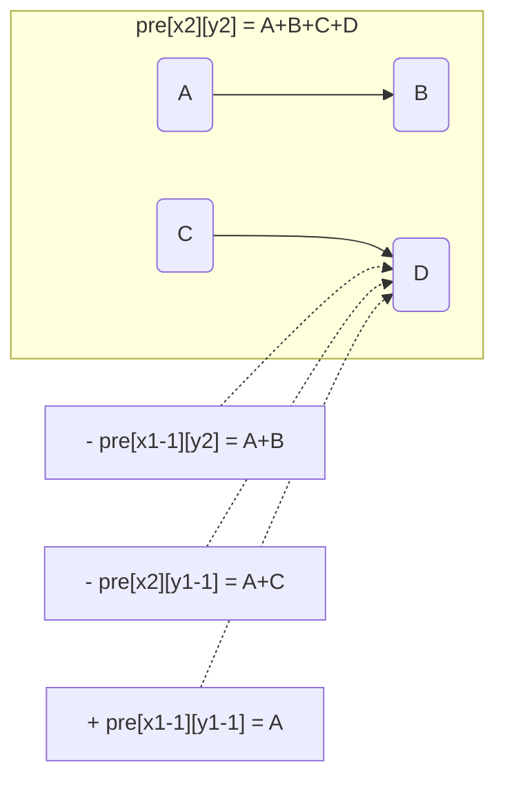
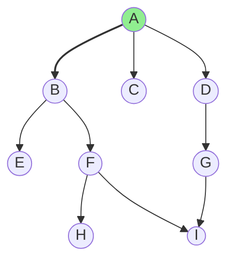
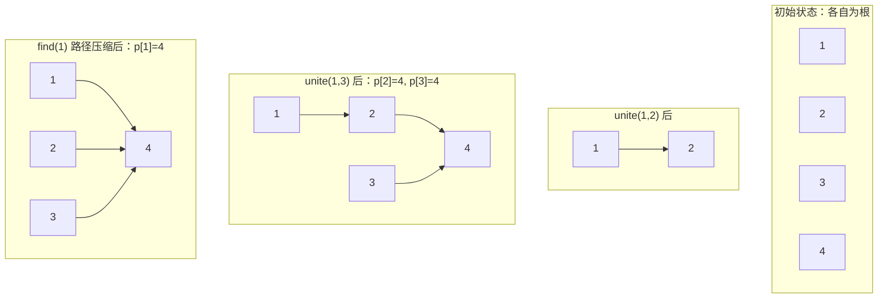
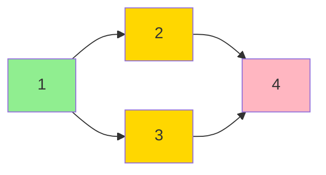
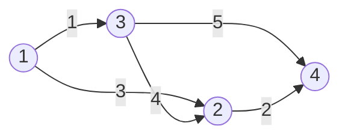
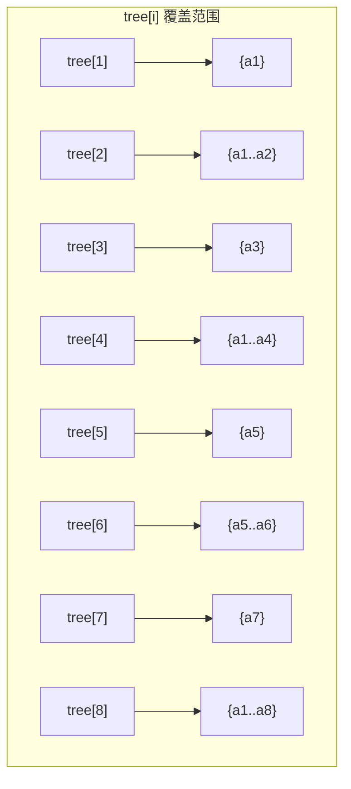
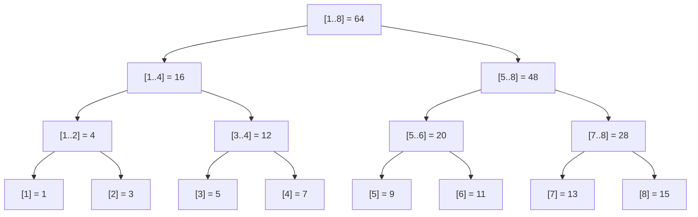
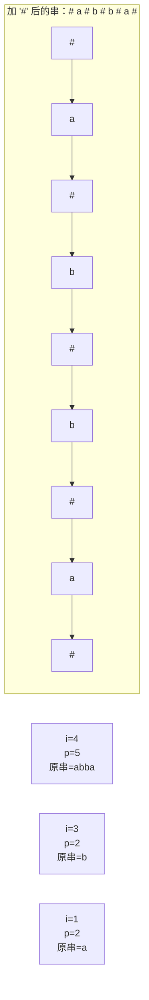

 ACM 笔记汇总

## 目录

### 00-索引
- [[#N01 00-索引 / 索引|00-索引 / 索引]]

### 01-C++基础
- [[#N02 01-C++基础 / STL库|01-C++基础 / STL库]]
- [[#N03 01-C++基础 / 基础知识|01-C++基础 / 基础知识]]

### 02-算法基础
- [[#N04 02-算法基础 / 递归与递推|02-算法基础 / 递归与递推]]
- [[#N05 02-算法基础 / 分治与二分|02-算法基础 / 分治与二分]]
- [[#N06 02-算法基础 / 高精度|02-算法基础 / 高精度]]
- [[#N07 02-算法基础 / 枚举|02-算法基础 / 枚举]]
- [[#N08 02-算法基础 / 排序|02-算法基础 / 排序]]
- [[#N09 02-算法基础 / 前缀和与差分|02-算法基础 / 前缀和与差分]]
- [[#N10 02-算法基础 / 位运算|02-算法基础 / 位运算]]

### 03-搜索
- [[#N11 03-搜索 / BFS广度优先搜索|03-搜索 / BFS广度优先搜索]]
- [[#N12 03-搜索 / DFS深度优先搜索|03-搜索 / DFS深度优先搜索]]

### 04-贪心
- [[#N13 04-贪心 / 贪心算法|04-贪心 / 贪心算法]]

### 05-动态规划
- [[#N14 05-动态规划 / DP基础与线性DP|05-动态规划 / DP基础与线性DP]]
- [[#N15 05-动态规划 / DP优化方法|05-动态规划 / DP优化方法]]
- [[#N16 05-动态规划 / 背包问题|05-动态规划 / 背包问题]]
- [[#N17 05-动态规划 / 区间DP|05-动态规划 / 区间DP]]
- [[#N18 05-动态规划 / 树形DP|05-动态规划 / 树形DP]]
- [[#N19 05-动态规划 / 数位DP|05-动态规划 / 数位DP]]
- [[#N20 05-动态规划 / 状态压缩DP|05-动态规划 / 状态压缩DP]]

### 06-图论
- [[#N21 06-图论 / 并查集|06-图论 / 并查集]]
- [[#N22 06-图论 / 二分图|06-图论 / 二分图]]
- [[#N23 06-图论 / 强连通分量|06-图论 / 强连通分量]]
- [[#N24 06-图论 / 树链剖分与LCA|06-图论 / 树链剖分与LCA]]
- [[#N25 06-图论 / 拓扑排序|06-图论 / 拓扑排序]]
- [[#N26 06-图论 / 图的存储与遍历|06-图论 / 图的存储与遍历]]
- [[#N27 06-图论 / 最短路径|06-图论 / 最短路径]]

### 07-树论
- [[#N28 07-树论 / 基础树论|07-树论 / 基础树论]]

### 08-数论
- [[#N29 08-数论 / 高斯消元|08-数论 / 高斯消元]]
- [[#N30 08-数论 / 矩阵加速|08-数论 / 矩阵加速]]
- [[#N31 08-数论 / 数论入门|08-数论 / 数论入门]]

### 09-数据结构
- [[#N32 09-数据结构 / 尺取与倍增|09-数据结构 / 尺取与倍增]]
- [[#N33 09-数据结构 / 单调队列与栈|09-数据结构 / 单调队列与栈]]
- [[#N34 09-数据结构 / 可持久化数据结构|09-数据结构 / 可持久化数据结构]]
- [[#N35 09-数据结构 / 树状数组|09-数据结构 / 树状数组]]
- [[#N36 09-数据结构 / 线段树|09-数据结构 / 线段树]]
- [[#N37 09-数据结构 / 线性基|09-数据结构 / 线性基]]

### 10-字符串
- [[#N38 10-字符串 / KMP|10-字符串 / KMP]]
- [[#N39 10-字符串 / Trie|10-字符串 / Trie]]
- [[#N40 10-字符串 / 后缀数组|10-字符串 / 后缀数组]]
- [[#N41 10-字符串 / 基础字符串算法|10-字符串 / 基础字符串算法]]
- [[#N42 10-字符串 / 马拉车Manacher|10-字符串 / 马拉车Manacher]]
- [[#N43 10-字符串 / 字符串哈希|10-字符串 / 字符串哈希]]

### 11-数学与几何
- [[#N44 11-数学与几何 / 计算几何|11-数学与几何 / 计算几何]]

### 12-博弈论
- [[#N45 12-博弈论 / 博弈论入门|12-博弈论 / 博弈论入门]]

### 13-综合训练
- [[#N46 13-综合训练 / 综合训练|13-综合训练 / 综合训练]]

---

## N01 00-索引 / 索引

# ACM 竞赛笔记 · 索引

> 目标：**ICPC/CCPC 拿奖**，不追求金牌，不涉及省选/IOI 级高深内容
> 整理日期：2026-10-24（v3 精简拿奖版）
> 代码风格：万能头 + `typedef long long ll;` + 4 空格缩进 + 变量名简洁 + 函数写在 main 外面

---

## 🎯 必背 vs 选学 vs 了解（按考试频率排）

### 🔴 必背（每场比赛 80% 概率考）

| 板块 | 考点 | 对应笔记 |
|------|------|----------|
| **C++ 基础** | 数据类型、STL 容器、时间复杂度、取模 | [[01-C++基础/基础知识]] · [[01-C++基础/STL库]] |
| **算法基础** | 排序、离散化、前缀和差分、二分、递归递推、位运算 | 02-算法基础 全 7 篇 |
| **搜索** | DFS 回溯 / Flood Fill、BFS 最短路径 | 03-搜索 全 2 篇 |
| **贪心** | 排序后选、反证法 | [[04-贪心/贪心算法]] |
| **图论** | Dijkstra、并查集、最小生成树（Kruskal）、拓扑排序、二分图染色 | [[06-图论/最短路径]] · [[06-图论/并查集]] · [[06-图论/拓扑排序]] · [[06-图论/二分图]] |
| **数据结构** | 线段树 + lazy tag、树状数组、单调队列/栈、ST 表 | [[09-数据结构/线段树]] · [[09-数据结构/树状数组]] · [[09-数据结构/单调队列与栈]] · [[09-数据结构/尺取与倍增]] |
| **DP** | 线性、背包（01/完全/多重）、区间、状压、数位、树形 | 05-动态规划 全 7 篇（树形见 [[05-动态规划/树形DP]]） |
| **字符串** | KMP、Trie、双哈希 | [[10-字符串/KMP]] · [[10-字符串/Trie]] · [[10-字符串/字符串哈希]] |
| **数论** | 快速幂、逆元（费马/exgcd）、CRT、组合数、gcd/exgcd | [[08-数论/数论入门]] · [[08-数论/矩阵加速]] |
| **树论** | LCA 倍增、树的直径、树的重心 | [[06-图论/树链剖分与LCA]]（LCA 部分）· [[07-树论/基础树论]] |

### 🟡 选学（20-50% 概率，冲击更高分时补充）

| 考点 | 说明 | 笔记 |
|------|------|------|
| **线性基** | CF 高频（XOR 子集），div.2E/div.3 常考 | [[09-数据结构/线性基]] |
| **强连通分量 + 缩点** | Tarjan，区域赛图论常客 | [[06-图论/强连通分量]] |
| **高斯消元** | 解方程组、异或方程组 | [[08-数论/高斯消元]] |
| **树链剖分** | LCA 够了但路径修改需要 | [[06-图论/树链剖分与LCA]] |
| **DP 优化** | 滚动数组 / 单调队列优化 | [[05-动态规划/DP优化方法]] |
| **差分约束** | 不等式组转最短路，SPFA 判负环 | [[06-图论/最短路径]] |
| **计算几何基础** | 点积/叉积/凸包 Graham | [[11-数学与几何/计算几何]] |
| **高精度** | 大数四则（ICPC 大数题少，但以防万一） | [[02-算法基础/高精度]] |

### 🟢 了解级（10% 以下概率，优先级最低）

| 考点               | 说明                       | 笔记                     |
| ---------------- | ------------------------ | ---------------------- |
| **可持久化线段树（主席树）** | 洛谷省选风格，P3834 已通过，耗时 4420ms | [[09-数据结构/可持久化数据结构]]   |
| **后缀数组 SA**      | ICPC 极少考，SAM 更主流，但本笔记未收录 | [[10-字符串/后缀数组]]        |
| **马拉车**          | 优雅但容易写错，KMP/哈希可替代        | [[10-字符串/马拉车Manacher]] |
| **博弈论 SG 函数**    | 极低频，掌握 Nim 结论即可          | [[12-博弈论/博弈论入门]]       |

---

## 📌 完整目录

| 编号 | 分类 | 笔记数 |
|------|------|--------|
| 00 | 索引 | 1 |
| 01 | C++ 基础 | 2（基础知识、STL） |
| 02 | 算法基础 | 7（排序、前缀差分、位运算、二分、递归递推、枚举、高精度） |
| 03 | 搜索 | 2（DFS、BFS） |
| 04 | 贪心 | 1 |
| 05 | 动态规划 | 7（基础线性、背包、区间、状压、数位、优化、树形） |
| 06 | 图论 | 7（存储遍历、最短路、并查集、拓扑、强连通、二分图、树链剖分+LCA） |
| 07 | 树论 | 1（直径、重心） |
| 08 | 数论 | 3（入门、高斯消元、矩阵加速） |
| 09 | 数据结构 | 6（线段树、树状数组、单调队列栈、尺取倍增、线性基、可持久化） |
| 10 | 字符串 | 6（KMP、Trie、哈希、马拉车、后缀数组、基础字符串算法） |
| 11 | 计算几何 | 1 |
| 12 | 博弈论 | 1 |
| 13 | 综合训练 | 2（训练路线、[[13-综合训练/CCPC 2025 济南站 题解]]） |

---

## 💡 笔记编写规范

- **万能头**：`#include<bits/stdc++.h>`
- **类型别名**：`using namespace std;` + `typedef long long ll;`（不用 `#define ll` 之类的宏）
- **结构**：核心思想 → 复杂度 → 模板代码 → 易错点 → 真题演练
- **码风**：4 空格缩进、变量名简短（i, j, n, m, ans, cnt, vis）、函数定义写在 main 外面
- **Mermaid 流程图**：Obsidian 原生渲染，WPS 看不到属正常

---

## 📈 Vjudge 做题数据

> 用户名：stevensmith | 总提交 450+ | API 获取最近 72 条 | 58 AC / 10 WA / 3 TLE / 1 ILE

### 平台分布

| OJ | AC | 占比 |
|----|-----|------|
| CF | 23 | 42.6%，主力 |
| 洛谷 | 19 | 35.2%，主力 |
| QOJ | 6 | 11.1% |
| AtCoder | 4 | 7.4% |
| UniversalOJ | 1 | 1.9% |
| Gym | 1 | 1.9% |

### WA / TLE 复盘（10 次 WA + 3 次 TLE，涉及 7 道题）

| 题目 | 失败次数 | 对应知识点 |
|------|--------|-----------|
| 洛谷 P3369 平衡树 Treap | WA 3 次 | ⚠️ 平衡树（可跳过，ICPC 极少考） |
| CF 670D1 Magic Powder | WA 2 次 + TLE 3 次 | ✅ 二分 + 前缀和，这是错得最多的一道 |
| QOJ 15321 AGI | WA 1 次 | 已 AC，可回看当时错在哪 |
| QOJ 14941 | WA 1 次 | ❌ **未 AC** → 重点攻坚 |
| QOJ 14948 Volunteer Simulator | WA 1 次 | 已 AC，模拟类 |
| 洛谷 P5414 排序 | WA 1 次 | ✅ 排序/贪心 → 看 [[02-算法基础/排序]] |
| 洛谷 P1883 三分 | WA 1 次 | 单峰函数极值 → 看 [[02-算法基础/分治与二分]] |

### 慢速 AC（已通过但耗时偏长）

| 题目 | 耗时 | 说明 |
|------|------|------|
| 洛谷 P3834 主席树 | 4420ms | ⚠️ 可持久化线段树，省选风格，知道思路即可 |
| 洛谷 P9982 Haybale | 2203ms | ✅ 看 [[09-数据结构/单调队列与栈]] |

### 薄弱点诊断

1. **QOJ 14941 未 AC** — 到 Vjudge 查看题解，区分思路错误与实现错误
2. **CF 670D1 错 5 次（2 WA + 3 TLE）** — 二分边界与前缀和需再练习，见 [[02-算法基础/分治与二分]]
3. **平衡树/主席树** — 有失败记录但 ICPC 极少考，优先级最低
4. **提交月份集中** — 数据里只有 2026-07（28 次 AC）和 2026-10（26 次 AC），其余月份空档，注意保持节奏

---

## 🏆 真题演练（近年 ICPC/CCPC）

每道题嵌入到对应的分类笔记末尾，附原题链接，统一格式：**简述 → 思路 → 复杂度 → 代码 → 要点**。码风遵循：万能头 + `typedef long long ll;` + 4 空格缩进 + 短变量名。

| 赛事 | 年份 | 题目 | 嵌入位置 | 核心考点 |
| --- | --- | --- | --- | --- |
| ICPC 杭州 | 2023 | [G - 蛇](https://codeforces.com/gym/104976/problem/G) | [[06-图论/最短路径]] | Dijkstra + 网格 BFS + 蛇身阻挡 |
| CCPC 郑州站 | 2024 | [B - 扫雷 1](https://codeforces.com/gym/105158/problem/B) | [[04-贪心/贪心算法]] | 排序贪心 + 位置降序技巧 |
| ICPC 杭州 | 2024 | [F - Fuzzy Ranking](https://codeforces.com/gym/105657/problem/F) | [[06-图论/强连通分量]] | Tarjan + 缩点 + 分块查询 |
| CCPC 网络赛 | 2024 | [D - 编码器-解码器](https://codeforces.com/gym/105336/problem/D) | [[05-动态规划/区间DP]] | 区间 DP + 三维状态转移 |
| ICPC 沈阳 | 2024 | [B - Magical Palette](https://codeforces.com/gym/105578/problem/B) | [[08-数论/数论入门]] | gcd 互质 + 构造 |
| ICPC 沈阳 | 2024 | [D - Dot Product Game](https://codeforces.com/gym/105578/problem/D) | [[09-数据结构/树状数组]] | 树状数组求逆序对 + 奇偶性 |
| ICPC 沈阳 | 2025 | [A - Square Kingdom](https://codeforces.com/gym/106252/problem/A) | [[02-算法基础/分治与二分]] | 二分答案 + 数学化简 + __int128 |
| CCPC 郑州邀请赛 | 2025 | [M - 川陀航空学院](https://codeforces.com/gym/105941/problem/M) | [[06-图论/并查集]] | 并查集维护连通块 size+cnt |
| ICPC 西安邀请赛 | 2026 | [D - Qenerals](https://www.luogu.com.cn/problem/P17297) | [[04-贪心/贪心算法]] | 排序贪心 + 取前缀 + 等待时间向上取整 |
| ICPC 西安邀请赛 | 2026 | [J - Would You Make a Convex?](https://www.luogu.com.cn/problem/P17303) | [[11-数学与几何/计算几何]] | 排序 + 双指针 + 三角形判定 |

### 年份分布
- 2023：1 道 | 2024：5 道 | 2025：2 道 | 2026：2 道，共 10 道

### 后续可补
- 线段树 → 2023 ICPC 沈阳 K（权值线段树）
- 线段树 → CF1149C Tree Generator™（括号序列）
- 2026 其他邀请赛（南昌、深圳）可继续补


---

## N02 01-C++基础 / STL库

# STL 容器

## 复杂度一览

| 容器 | 头部 | 尾部 | 中间 | 查找 | 备注 |
|------|------|------|------|------|------|
| vector | O(n) | **O(1) 均摊** | O(n) | O(n) | 动态数组 |
| deque | **O(1)** | **O(1)** | O(n) | O(n) | 双端队列 |
| list | O(1)* | O(1)* | O(1)* | O(n) | 双向链表（少用） |
| stack | — | O(1) | — | — | 适配器 |
| queue | — | O(1) | — | — | 适配器 |
| priority_queue | — | — | — | O(log n) | 堆 |
| set/map | O(log n) | O(log n) | O(log n) | **O(log n)** | 红黑树 |
| unordered_set/map | O(1)* | O(1)* | O(1)* | **O(1)* 均摊** | 哈希表 |

> * 均摊复杂度；中间插入 O(1) 前提是已拿到迭代器。

## 1. vector 动态数组

### 创建

```cpp
vector<int> v;                              // 空
vector<int> v2{1, 2, 3, 4, 5};              // 初始化列表
vector<int> v3(5);                          // 5 个 0
vector<int> v4(5, 10);                      // 5 个 10
vector<int> v5(v4);                         // 拷贝
vector<int> v6(5, 0);                       // 二维的一维先开好
vector<vector<int>> g(n+1);                 // 邻接表常用写法
vector<vector<int>> a(n+1, vector<int>(m+1, 0));  // 二维矩阵
v.assign(n, x);                              // 重新赋值
v.reserve(1000);                             // 预分配容量（减少 vector 重新分配；rehash 是哈希容器的操作）
```

### 增删改查

```cpp
v.push_back(x);                              // 尾部加 O(1) 均摊
v.pop_back();                                // 尾部删 O(1)
v.front();                                   // 首元素
v.back();                                    // 尾元素
v[i];                                        // 随机访问 O(1)
v.insert(v.begin()+2, x);                    // 任意位置插入 O(n)
v.insert(v.begin()+2, 4, 10);               // 插入 4 个 10
v.erase(v.begin()+2);                        // 删除 O(n)
v.erase(v.begin(), v.begin()+4);             // 删除区间 [l, r)
v.clear();                                   // 清空
v.resize(n);                                 // 改大小
v.size();                                    // 元素个数
v.empty();                                   // 是否为空
```

### 遍历

```cpp
// 最常用
for(int x : v) cout << x;
// 带下标
for(int i = 0; i < v.size(); i++) cout << v[i];
// 迭代器
for(auto it = v.begin(); it != v.end(); it++) cout << *it;
// 倒序
for(auto it = v.rbegin(); it != v.rend(); it++) cout << *it;
```

### 排序

```cpp
sort(v.begin(), v.end());                  // 升序
sort(v.begin(), v.end(), greater<int>()); // 降序
sort(v.rbegin(), v.rend());                // 降序（反转迭代器）
```

## 2. stack 栈（后进先出 LIFO）

```cpp
stack<int> s;
stack<string> ss;
stack<pair<int,int>> sp;

s.push(x);    // 入栈
s.pop();      // 出栈（无返回值）
s.top();      // 栈顶
s.empty();
s.size();
```

**应用场景**：表达式求值、括号匹配、单调栈、DFS 辅助。

## 3. queue 队列（先进先出 FIFO）

```cpp
queue<int> q;
q.push(x);   // 队尾入队
q.pop();     // 队首出队
q.front();   // 队首
q.back();    // 队尾
```

**应用场景**：BFS、任务调度、滑动窗口。

## 4. deque 双端队列

支持两端 O(1) 插入删除，兼具 vector 和 queue 的功能。

```cpp
deque<int> dq;
dq.push_back(x);    dq.push_front(x);
dq.pop_back();      dq.pop_front();
dq.back();          dq.front();
dq.erase(it);       dq.erase(first, last);
dq[n];              // 随机访问
```

**应用场景**：滑动窗口、单调队列优化 DP。

## 5. priority_queue 优先队列（堆）

### 默认大根堆

```cpp
priority_queue<int> pq;              // 最大元素在顶
pq.push(x);
pq.pop();
pq.top();
```

### 小根堆

```cpp
priority_queue<int, vector<int>, greater<int>> pq;
```

### 自定义比较

```cpp
struct Node { int x, y; };

struct cmp
{
    bool operator()(const Node& a, const Node& b)
    {
        return a.x > b.x;
    }
};

priority_queue<Node, vector<Node>, cmp> pq;
```

或用 `operator<`：

```cpp
struct Node
{
    int x, y;
    bool operator<(const Node& o) const { return x > o.x; }  // 反号 = 小根堆
};
priority_queue<Node> pq;
```

**复杂度**：push/pop O(log n)，top O(1)。

## 6. set 集合（红黑树，自动去重+升序）

```cpp
set<int> s;
s.insert(x);        // O(log n)
s.erase(x);         // 按值删 O(log n)
s.erase(it);        // 按迭代器删 O(1)
s.find(x);          // 查找，返回迭代器或 end
s.count(x);         // 1 存在 / 0 不存在
s.lower_bound(x);   // 第一个 >= x
s.upper_bound(x);   // 第一个 > x
*(s.begin());       // 最小值
*(s.rbegin());      // 最大值
```

**遍历时删元素**：
```cpp
for(auto it = s.begin(); it != s.end(); )
{
    if(cond) it = s.erase(it);  // erase 返回下一个迭代器
    else it++;
}
```

**应用场景**：贪心调度（按值删）、窗口去重。

## 7. multiset（可重复）

```cpp
multiset<int> ms;
ms.insert(x);       // 可插多个
ms.erase(x);        // 删所有等于 x 的
auto it = ms.find(x);
if(it != ms.end()) ms.erase(it); // 存在时只删一个，不能 erase(end())
```

## 8. map / unordered_map

```cpp
map<int, string> mp;              // 红黑树，按键升序，O(log n)
unordered_map<int, string> um;    // 哈希，O(1) 均摊

mp[key] = value;                  // 插入或覆盖
mp.insert({key, value});          // 插入（不覆盖已存在的）
mp.find(key);                     // 返回迭代器
mp.count(key);                    // 1/0
mp.erase(key);                    // 删

// 遍历
for(auto& [k, v] : mp) cout << k << v;    // C++17 结构化绑定
for(auto& p : mp) cout << p.first << p.second;
```

**易错点**：`mp[key]` 在 key 不存在时会自动创建一个默认值（int 是 0，string 是空串）。如果只想查询是否存在，用 `find` 或 `count`。

## 9. bitset（位集合）

单个位访问为 O(1)；对 B 位整体进行位运算通常需要 O(⌈B / w⌉) 个机器字操作，w 为机器字长。

```cpp
bitset<100> b;                      // 固定大小，100 位
b.set(3);                            // 第 3 位设 1
b.reset(3);                          // 设 0
b[3] = 1;                            // 直接访问
b.test(3);                           // 查第 3 位
b.count();                           // 1 的个数
b.size();
b.reset(); b.set();                  // 全部 0 / 1
// 支持 & | ^ >> << ~ 位运算
bitset<100> c = b1 & b2;
```

**应用场景**：状态压缩（比 int 的 32/64 位宽）、bitset 优化 DP。

## 10. pair / tuple

```cpp
pair<int, int> p = {1, 2};
p.first;    p.second;
// 比较：先 first 再 second

tuple<int, int, int> t = {1, 2, 3};
get<0>(t);   // 取第 0 个
```

## 通用技巧

### 反向迭代器（降序遍历）

```cpp
for(auto it = v.rbegin(); it != v.rend(); it++) cout << *it;
sort(v.rbegin(), v.rend());  // 降序
```

### next_permutation（枚举全排列）

```cpp
int a[] = {1, 2, 3};
sort(a, a+3);                       // 必须先排序
do {
    for(int i = 0; i < 3; i++) cout << a[i];
    cout << endl;
} while(next_permutation(a, a+3));   // O(n·n!)
```

### min/max 的细节

```cpp
min(a, b);            // 返回值（C++11 起可接受初始化列表）
min({a, b, c, d});    // 多个值
min_element(a, a+n);  // 返回迭代器
```

### 不可复制元素的容器

```cpp
// 若使用 unique_ptr、mutex 等不可复制类型
vector<unique_ptr<int>> v;
v.push_back(make_unique<int>(5));       // 只能 move
v.emplace_back(new int(5));              // emplace 直接构造
```

---

## N03 01-C++基础 / 基础知识

# C++ 基础知识

## 万能头与宏定义

```cpp
#include<bits/stdc++.h>
using namespace std;
typedef long long ll;
```

> `bits/stdc++.h` 包含了几乎所有常用头文件（iostream、vector、algorithm、cmath、queue、map、string ...）。缺点：编译稍慢，某些 OJ 不支持（极少）。

## 数据类型

| 类型 | 字节 | 最大值 | 说明 |
|------|------|--------|------|
| bool | 1 | 1 | true/false |
| char | 1 | 127 | ASCII 字符 |
| short | 2 | 32767 | -32768 ~ 32767 |
| int | 4 | 2^31-1 ≈ 2.1×10^9 | 竞赛最常用 |
| unsigned int | 4 | 2^32-1 ≈ 4.2×10^9 | 无符号 |
| long long | 8 | 2^63-1 ≈ 9.2×10^18 | 大整数 |
| unsigned long long | 8 | 2^64-1 | 无符号大整数 |
| float | 4 | ±3.4×10^38 | 单精度，7 位有效数字 |
| double | 8 | ±1.7×10^308 | 双精度，15~16 位有效数字 |
| long double | 8/16 | 视平台 | 扩展精度 |

**易错点**：int 溢出时不报错，用 `long long` 存大结果。`10^5 × 10^5 = 10^10`，int 放不下。

## 输入输出加速

```cpp
ios::sync_with_stdio(0);   // 关 C/C++ IO 同步
cin.tie(0);                // 解绑 cin 和 cout
cout.tie(0);
```

**scanf/printf 与 cin/cout 对比**：
- 不加速时 cin/cout 比 scanf/printf 慢 2~5 倍
- 加速后 cin/cout 接近甚至略快于 scanf/printf
- 不要混用 cin 和 scanf、cout 和 printf

## 格式化输出（printf）

```cpp
printf("%d", a);       // int
printf("%lld", a);     // long long
printf("%u", a);       // unsigned int
printf("%lf", a);      // double
printf("%.6lf", a);    // 保留 6 位小数
printf("%05d", a);     // 补前导零到 5 位
printf("%s", s);       // char* 字符串
printf("%c", c);       // char
printf("%.3f%%\n", x); // 3.142% 格式
```

**易错点**：`long long` 要用 `%lld`，不是 `%d`。

## 常用函数库

### cmath

```cpp
abs(x);        // int 绝对值
fabs(x);       // double 绝对值
sqrt(x);       // 平方根
cbrt(x);       // 立方根 (C++11)
pow(x, y);     // x^y，返回 double
ceil(x);       // 向上取整
floor(x);      // 向下取整
round(x);      // 四舍五入 (C++11)
log(x);        // 自然对数 ln
log10(x);      // 常用对数 log10
log2(x);       // 以 2 为底 (C++11)
sin(x)/cos(x)/tan(x);   // 三角函数（弧度）
asin(x)/acos(x)/atan(x); // 反三角函数（返回弧度）
atan2(y, x);   // 象限正确的反正切
exp(x);        // e^x
```

### algorithm

```cpp
sort(a, a+n);  sort(a, a+n, greater<int>());     // 排序
stable_sort();                                      // 稳定排序
unique(a, a+n);                                     // 去重（需先排序）
reverse(a, a+n);                                    // 反转
rotate(a, a+k, a+n);                                // 循环左移
random_shuffle(a, a+n);                             // 随机打乱
lower_bound(a, a+n, x);                             // 第一个 >= x 的位置
upper_bound(a, a+n, x);                             // 第一个 > x 的位置
min(a, b);  max(a, b);                              // 最值
min_element(a, a+n);  max_element(a, a+n);          // 全局最值
swap(a, b);
count(a, a+n, x);                                   // 统计 x 出现次数
count_if(a, a+n, pred);
find(a, a+n, x);                                    // 查找
fill(a, a+n, x);                                    // 赋值
```

### string

```cpp
string s;
getline(cin, s);                    // 读一行（可含空格）
s.substr(pos, len);                 // 子串
s.find("abc");                      // 查找，返回位置或 npos
s.erase(pos, len);                  // 删除
s.insert(pos, "abc");               // 插入
s.replace(pos, len, "new");         // 替换
s.push_back('c');                    // 尾部加
s.pop_back();                        // 尾部删
s.length();  s.size();              // 长度
s.begin();  s.end();                 // 迭代器
s.c_str();                           // 转 char*
```

## 数组初始化

```cpp
int a[105];
memset(a, 0, sizeof(a));     // 清零（按字节填充）
memset(a, 0x3f, sizeof(a));  // 设为 0x3f3f3f3f（约 1e9，常用作 INF）
fill(a, a+105, 1);           // 赋任意值
```

**memset 按字节赋值**：可以填任意字节，但不能把它当成逐个 int 赋值。常见补码平台上，全 0 得到 0，全 0xff 得到 -1；填 0x3f 可得到常用的 0x3f3f3f3f。给每个元素赋任意整数应使用 fill。

## 结构体与运算符重载

```cpp
struct Node
{
    int x, y;
    bool operator<(const Node& o) const
    {
        if(x != o.x) return x < o.x;
        return y < o.y;
    }
};
// 有了 operator< 就能直接 sort、放 set/map
```

## 时间复杂度速查

**基准**：1 秒内约 **10^8 ~ 10^9** 次基本运算（现代 OJ 机器）

| 操作 | 允许规模 | 说明 |
|------|----------|------|
| O(n) | 10^7 ~ 10^8 | 单遍扫描 |
| O(n log n) | 10^6 ~ 10^7 | sort() 能跑到 n=10^7 |
| O(n²) | 10^3 ~ 3×10^4 | n² ≤ 10^9 |
| O(n³) | 10^2 ~ 10^3 | n³ ≤ 10^9 |
| O(2^n) | n ≤ 20 ~ 25 | 2^20 ≈ 10^6, 2^30 ≈ 10^9 |
| O(n!) | n ≤ 12 | 12! ≈ 4.7×10^8, 13! 就超了 |

**常数影响**：
- 数组顺序访问（缓存友好）→ 常数小，能跑到上限
- 哈希/随机访问 → 常数大，通常只能 1/10 上限
- 递归调用 → 常数比循环大 5~10 倍
- 带 lazy tag 的线段树 → 常数比 BIT 大 3~5 倍

**参考标准**：单次运算次数（忽略常数）控制在 10^9 以内。若估算结果 5×10^9 以上基本超时；5×10^8 左右需看常数。

## 空间复杂度速查

- `int a[N]`：4×N 字节。N=10^6 → 4MB，N=10^7 → 40MB
- 栈空间有限（约 1~4MB），大数组开全局或 static

## 随机数（调试用）

```cpp
#include<cstdlib>
#include<ctime>
srand(time(0));
int x = rand() % 100;     // 0~99
int y = rand() % 100 + 1; // 1~100
```

---

## N04 02-算法基础 / 递归与递推

# 递归与递推

## 递归三要素

1. **边界条件**（终止）
2. **递归公式**
3. **返回值**

写递归前先把这三样写清楚，代码基本不会错。

## 递归转递推

递归从 n 往下拆，递推从 1 往上推。能用递推就用递推：没有函数调用开销，也不会爆栈。

```cpp
// 递归
ll fib(int n)
{
    if(n <= 1) return n;
    return fib(n-1) + fib(n-2);
}

// 递推
ll fib[N];
fib[0] = 0;
fib[1] = 1;
for(int i = 2; i <= n; i++) fib[i] = fib[i-1] + fib[i-2];
```

## 线性递推

当前项只依赖前几项，一维数组从前往后推。

```cpp
// 爬楼梯：每次 1 级或 2 级
ll f[N];
f[0] = 1;
f[1] = 1;
for(int i = 2; i <= n; i++)
    f[i] = f[i-1] + f[i-2];
```

## 二维递推

状态有两个维度时用二维数组，注意枚举顺序：被依赖的维度要先算。

```cpp
// 杨辉三角
ll c[N][N];
for(int i = 0; i <= n; i++)
{
    c[i][0] = c[i][i] = 1;
    for(int j = 1; j < i; j++)
        c[i][j] = c[i-1][j-1] + c[i-1][j];
}
```

网格路径数、区间 DP 的初始化都属于这一类。

## 记忆化搜索

递归写法直观，但会重复计算。加一个 `vis` 数组把算过的状态存下来，复杂度就降到状态数。

```cpp
ll f[N];
bool vis[N];

ll dfs(int n)
{
    if(n <= 1) return 1;
    if(vis[n]) return f[n];
    vis[n] = 1;
    return f[n] = dfs(n-1) + dfs(n-2);
}
```

**适用**：状态转移不好写成循环，或者只有部分状态会被访问（如数位 DP、博弈搜索）。

## 汉诺塔

```cpp
void hanoi(int n, char a, char b, char c)
{
    if(n <= 0) return;
    if(n == 1)
    {
        cout << a << " -> " << c << endl;
        return;
    }
    hanoi(n-1, a, c, b);                // n-1 个从 a 移到 b
    cout << a << " -> " << c << endl;   // 第 n 个从 a 移到 c
    hanoi(n-1, b, a, c);                // n-1 个从 b 移到 c
}
```

移动次数为 2^n - 1。

## 易错点

1. **边界写错**：n = 0、n = 1 要单独处理，否则死递归或答案偏一位
2. **递归太深**：深度到 1e5 会爆栈，改递推或手写栈
3. **忘记取模**：递推增长很快，该取模的地方每一步都要取
4. **记忆化数组没初始化**：多组数据要清空 vis
5. **递推顺序**：二维递推依赖的方向必须先算，比如区间 DP 先枚举长度

---

---

## N05 02-算法基础 / 分治与二分

# 分治与二分

## 核心思想

**二分**：在有序空间里每次砍掉一半范围。**O(log n)**。
**分治**：把大问题拆成同构的小问题，分别求解后合并。

## 二分查找（在有序数组中）

### 模板一：lower_bound 风格

```cpp
// 找第一个 >= target 的下标
// 区间 [l, r) 左闭右开（推荐）
int lower_bound(int a[], int n, int target)
{
    int l = 0, r = n;
    while(l < r)
    {
        int mid = (l + r) >> 1;
        if(a[mid] >= target) r = mid;
        else l = mid + 1;
    }
    return l;
}

// 找第一个 > target 的下标
int upper_bound(int a[], int n, int target)
{
    int l = 0, r = n;
    while(l < r)
    {
        int mid = (l + r) >> 1;
        if(a[mid] > target) r = mid;
        else l = mid + 1;
    }
    return l;
}
```

### 模板二：check(mid) 风格（更通用）

```cpp
// 找最后一个 <= target 的位置（带 check），不存在返回 -1
int upper_bound_last(int a[], int n, int target)
{
    int l = 0, r = n - 1;
    while(l < r)
    {
        int mid = (l + r + 1) >> 1;   // 注意 +1
        if(a[mid] <= target) l = mid;
        else r = mid - 1;
    }
    if(n == 0 || a[0] > target) return -1;
    return l;
}
```

### 两套模板的区别

| | 模板一 | 模板二 |
|--|--------|--------|
| mid 计算 | `(l+r)>>1` | `(l+r+1)>>1` |
| 循环内 | `r = mid` / `l = mid+1` | `l = mid` / `r = mid-1` |
| 防死循环 | ✓ | ✓ |
| 适用 | 找**第一个**满足条件 | 找**最后一个**满足条件 |

**关键**：mid 的加不加 1 取决于缩左还是缩右，避免 `l=r` 后死循环。记法：
- 缩左时用 `mid = (l+r+1)>>1`，因为 `l = mid`，而如果 `mid=(l+r)>>1`，`mid` 可能等于 `l`
- 缩右时用 `mid = (l+r)>>1`，因为 `r = mid`，而如果 `mid=(l+r+1)>>1`，`mid` 可能等于 `r`

### STL 直接用

```cpp
int a[] = {1, 2, 3, 3, 3, 4, 5};
int n = sizeof(a)/sizeof(a[0]);
auto it1 = lower_bound(a, a+n, 3);   // 第一个 >= 3
auto it2 = upper_bound(a, a+n, 3);   // 第一个 > 3
int cnt = it2 - it1;                 // 3 出现次数
```

## 二分答案（**最常用**！）

不是在数组里找，而是在**答案可能的范围**里二分。适用于：
- "最大满足..." → 缩左
- "最小满足..." → 缩右

### 图解：二分答案的单调性前提

```
check(x) 必须满足单调性：
  如果 check(x) 成立，那么所有 x' ≥ x 也成立
  或者所有 x' ≤ x 也成立

例：抄书最短时间
  check(time) = 能否在 time 内抄完？
  
  time=20 → 需要 3 人 ✓ (成立)
  time=18 → 需要 4 人 ✓
  time=15 → 需要 5 人 ✓
  time=10 → 需要 8 人 ✗ (不成立!)
  
  答案就在 ✗ 和 ✓ 的交界处！

时间: 10 11 12 13 14 15 16 17 18 19 20 21 22
结果:  ✗  ✗  ✗  ✗  ✗  ✓  ✓  ✓  ✓  ✓  ✓  ✓  ✓
                         ↑
                      最小的 ✓ (答案)

二分过程:
  l=10, r=22, mid=16 → check(16)=✓ → r=16
  l=10, r=16, mid=13 → check(13)=✗ → l=14
  l=14, r=16, mid=15 → check(15)=✓ → r=15
  l=14, r=15, mid=14 → check(14)=✗ → l=15
  l=15, r=15 → 答案是 15 ✓
```

### 模板 1：找最小的 L 使得成立

```cpp
// 题意：把 n 本书 k 个抄手分工，每人速度相同，书不能拆分。
// 求最短时间的最大值。
int a[N], n, k;

bool check(ll limit)    // 能否在 limit 时间内抄完？
{
    int cnt = 1;
    ll sum = 0;
    for(int i = 0; i < n; i++)
    {
        if(a[i] > limit) return false;    // 单本就超了
        if(sum + a[i] > limit)
        {
            cnt++;
            sum = a[i];
        }
        else sum += a[i];
    }
    return cnt <= k;
}

int main()
{
    cin >> n >> k;
    for(int i = 0; i < n; i++) cin >> a[i];
    ll l = *max_element(a, a+n), r = accumulate(a, a+n, 0LL);
    while(l < r)
    {
        ll mid = (l + r) >> 1;
        if(check(mid)) r = mid;      // 能成，试试更小
        else l = mid + 1;            // 不够，加大
    }
    cout << l << endl;
    return 0;
}
```

### 模板 2：找最大的 R 使得成立

```cpp
// 题意：把 n 个数分成 k 段，求每段和的最大值的最小值（同上题）
// 同上题代码，只是语义上"最大的成立值"
```

## 浮点二分

```cpp
double l = 0, r = 1e18;
for(int i = 0; i < 100; i++)          // 迭代 100 次，精度 1e-30 足够
{
    double mid = (l + r) / 2;
    if(f(mid) > 0) r = mid;
    else l = mid;
}
// 也可以：while(r - l > eps)
```

## 快速幂（分治思想）

### 复杂度

O(log b)，把 b 拆成二进制位，每一位决定是否乘入结果。

### 模板

```cpp
ll qpow(ll a, ll b, ll mod)
{
    ll res = 1;
    a %= mod;
    while(b)
    {
        if(b & 1) res = (__int128)res * a % mod;
        a = (__int128)a * a % mod;      // 底数平方：a^(2i) = (a^i)^2
        b >>= 1;
    }
    return res;
}

// 示例：a^b mod p，qpow(a, b, p)
```

### 龟速乘（防止 a*a 溢出 long long）

```cpp
ll qmul(ll a, ll b, ll mod)
{
    ll res = 0;
    while(b)
    {
        if(b & 1) res = ((__int128)res + a) % mod;
        a = (__int128)a * 2 % mod;
        b >>= 1;
    }
    return res;
}
// 用法：把 qpow 里的 res*a 和 a*a 改成 qmul
// 现在 C++20 有 __int128，可以直接：
// res = (__int128)res * a % mod;
```

## 归并排序 + 逆序对

```cpp
int a[N], tmp[N];
ll cnt;

// 每组数据调用 merge_sort 前执行 cnt = 0，不要在递归内部清零
void merge_sort(int l, int r)
{
    if(l >= r) return;
    int mid = l + r >> 1;
    merge_sort(l, mid);
    merge_sort(mid + 1, r);
    int i = l, j = mid + 1, k = l;
    while(i <= mid && j <= r)
    {
        if(a[i] <= a[j]) tmp[k++] = a[i++];
        else
        {
            cnt += mid - i + 1;   // a[i] 后面都比 a[j] 大
            tmp[k++] = a[j++];
        }
    }
    while(i <= mid) tmp[k++] = a[i++];
    while(j <= r) tmp[k++] = a[j++];
    for(i = l; i <= r; i++) a[i] = tmp[i];
}
```

## 快速排序（手写版 + topK 快速选择）

```cpp
void quick_sort(int q[], int l, int r)
{
    if(l >= r) return;
    int i = l - 1, j = r + 1, x = q[l + r >> 1];
    while(i < j)
    {
        do i++; while(q[i] < x);
        do j--; while(q[j] > x);
        if(i < j) swap(q[i], q[j]);
    }
    quick_sort(q, l, j);
    quick_sort(q, j + 1, r);
}

// 快速选择：平均 O(n) 找第 k 小，最坏 O(n²)
int quick_select(int q[], int l, int r, int k)
{
    if(l == r) return q[l];
    int i = l - 1, j = r + 1, x = q[l + r >> 1];
    while(i < j)
    {
        do i++; while(q[i] < x);
        do j--; while(q[j] > x);
        if(i < j) swap(q[i], q[j]);
    }
    int left_cnt = j - l + 1;
    if(k <= left_cnt) return quick_select(q, l, j, k);
    else return quick_select(q, j + 1, r, k - left_cnt);
}
```

## 易错点

1. **mid 溢出**：`(l+r)/2` 可能溢出 int（当 l 和 r 都接近 2e9）。写成 `l + (r-l)/2` 更安全
2. **实数精度**：浮点二分时用迭代次数（100 次）而不是 `eps` 判断更可靠
3. **check 函数**：二分答案题的 check 函数必须满足"单调性"——如果 mid 成立，那么所有小于/大于 mid 的值也都成立
4. **快速排序递归边界**：不要写成 `quick_sort(q, l, i-1)` 和 `quick_sort(q, i, r)`，否则可能死循环（i 和 j 交换后 i≠j 的情况）。**用 j 做分界**
5. **快速选择递归优化**：如果用了快速选择，`quick_sort` 调用两次，但 `quick_select` 只需要递归一次

## 二分答案常见题目

| 题目 | check 条件 | 缩 |
|------|-----------|----|
| 抄书最短时间 | 时间 ≤ limit 能抄完 | 缩左 |
| 二分图最小生成树最小边权 | 权值 ≤ mid 时连通 | 缩左 |
| 平方根整数部分 | mid*mid <= x | 缩左 |
| 最大化最小值（多段和） | 和 ≤ mid 能分段 | 缩左 |
| 最小的满足条件的数 | f(mid) 成立 | 缩右 |

## 真题演练

### 【2025 ICPC 沈阳 A - Square Kingdom】

**原题**：[Codeforces Gym 106252 A](https://codeforces.com/gym/106252/problem/A)

**简述**：有 n 根柱子，高度为 (i + b/a)²。任意两根柱子间梯子长 = 高度差。求第 k 短的梯子长度，输出 p/q 最简分数。n ≤ 10¹²，k ≤ 10¹²。

**思路**：二分答案 L，check(L) 统计长度 ≤ L 的梯子数是否 ≥ k。关键数学化简：令 d = i - j，Li,j = d × (i+j + 2b/a) ≤ L，化简后对每个 d 直接 O(1) 算 j 的范围。二分 50 次就够了（范围到 5×10¹⁸）。

**复杂度**：O(log(10¹⁸) × √n)（实际上远远不到，大部分 d 很快 break）

```cpp
#include<bits/stdc++.h>
using namespace std;
typedef long long ll;

ll n, k, a, b;

bool check(ll L)
{
    ll s = 0;
    for(ll d = 1; d < n; d++)
    {
        ll t = (min(2*n - d, (L / d - b) / a) - d) >> 1;
        if(t <= 0) break;
        s += t;
        if(s >= k) return true;
    }
    return false;
}

int main()
{
    ios::sync_with_stdio(false);
    cin.tie(0);

    cin >> n >> k >> a >> b;
    b *= 2;

    ll l = 1, r = 5e18;
    while(l + 1 < r)
    {
        ll mid = ((unsigned __int128)l + r) >> 1;   // 防溢出
        if(check(mid)) r = mid;
        else l = mid;
    }
    ll g = __gcd(r, a);
    cout << r / g << ' ' << a / g << '\n';
    return 0;
}
```

**要点**：二分答案 + 数学化简把 O(n²) 的计数问题降到 O(√n)。n 和 k 都是 10¹² 不能枚举，但 d 最多 √(2L/a) 就 break 了。__int128 用来算 mid 防溢出。

---

---

## N06 02-算法基础 / 高精度

# 高精度运算

## 什么时候需要高精度

- Python 天然支持任意大整数，C/C++ 不行
- 竞赛中当题目数据范围超过 `unsigned long long`（约 1.8×10^19）时必须上高精度
- 常见场景：阶乘（100! 有 158 位）、大数乘除、组合数 C(n, m)

---

## 先试 __int128

### 什么是 __int128

GCC/Clang 在 64 位平台提供的 128 位整数扩展，范围 ±2^127-1 ≈ **1.7×10^38**。MSVC 不支持，但绝大多数 OJ 都支持。

### 运算

直接加减乘除取模，跟普通 int 一模一样：

```cpp
__int128 a = 1234567890123456789LL;
__int128 b = 9876543210987654321LL;
__int128 c = a * b;          // 直接乘
__int128 d = a + b;          // 直接加
__int128 e = a % b;          // 直接取模
```

### 不能直接 cin/cout，要手写读写

```cpp
inline __int128 read()
{
    __int128 x = 0, f = 1;
    char ch = getchar();
    while(ch < '0' || ch > '9') { if(ch == '-') f = -1; ch = getchar(); }
    while(ch >= '0' && ch <= '9') { x = x * 10 + (ch - '0'); ch = getchar(); }
    return x * f;
}

inline void print(__int128 x)
{
    if(x < 0) { putchar('-'); x = -x; }
    if(x > 9) print(x / 10);
    putchar(x % 10 + '0');
}
```

### 什么时候用 __int128 vs 高精度 vs Python

| 范围 | 方案 |
|------|------|
| ≤ 1.8×10^19 | `unsigned long long` 够用 |
| **≤ 1.7×10^38** | **__int128**（首选，最方便） |
| > 1.7×10^38 或有其他操作 | Python 或 C++ 高精度 |

---

## 存储方式

### 倒序存

个位在下标 0：`1234` → `[4, 3, 2, 1]`

**为什么倒序？** 从低位开始运算，进位自然加到数组末尾，不需要移动整个数组。

### vector 实现（推荐）

- 动态大小，不会溢出
- 加减乘除都返回新 vector

## 高精度加法

### 复杂度

O(max(len(a), len(b)))

### 模板（vector 版）

```cpp
#include<vector>
#include<string>
using namespace std;

// A + B，两个都是倒序 vector<int>
vector<int> add(const vector<int>& A, const vector<int>& B)
{
    vector<int> C;
    int t = 0;
    for(int i = 0; i < A.size() || i < B.size() || t; i++)
    {
        if(i < A.size()) t += A[i];
        if(i < B.size()) t += B[i];
        C.push_back(t % 10);
        t /= 10;
    }
    return C;
}

// 使用示例
vector<int> A = {4, 3, 2, 1};    // 1234
vector<int> B = {8, 7, 6};       // 678
auto C = add(A, B);               // 1912 → {2, 1, 9, 1}
```

### 字符串版

```cpp
string add(string a, string b)
{
    vector<int> A, B;
    for(int i = a.size()-1; i >= 0; i--) A.push_back(a[i]-'0');
    for(int i = b.size()-1; i >= 0; i--) B.push_back(b[i]-'0');
    auto C = add(A, B);
    string res;
    for(int i = C.size()-1; i >= 0; i--) res += (char)('0'+C[i]);
    return res;
}
```

## 高精度减法

### 前提

A >= B（可以先比较大小，不够减加负号）

### 模板

```cpp
// 比较两个大整数（正整数，string 版）
bool cmp(const string& a, const string& b)
{
    if(a.size() != b.size()) return a.size() > b.size();
    return a >= b;   // 字符串比较字典序 = 数值大小（长度相同时）
}

vector<int> sub(const vector<int>& A, const vector<int>& B)
{
    vector<int> C;
    int t = 0;
    for(int i = 0; i < A.size(); i++)
    {
        t = A[i] - t;
        if(i < B.size()) t -= B[i];
        C.push_back((t + 10) % 10);
        t = (t < 0 ? 1 : 0);
    }
    // 去除前导零
    while(C.size() > 1 && C.back() == 0) C.pop_back();
    return C;
}

// 完整字符串版（自动处理负号）
string sub(string a, string b)
{
    bool neg = false;
    if(!cmp(a, b)) { swap(a, b); neg = true; }
    vector<int> A, B;
    for(int i = a.size()-1; i >= 0; i--) A.push_back(a[i]-'0');
    for(int i = b.size()-1; i >= 0; i--) B.push_back(b[i]-'0');
    auto C = sub(A, B);
    string res = neg ? "-" : "";
    for(int i = C.size()-1; i >= 0; i--) res += (char)('0'+C[i]);
    return res;
}
```

## 高精度乘低精度

### 复杂度

O(len(a))

### 模板

```cpp
vector<int> mul(const vector<int>& A, int b)
{
    vector<int> C;
    long long t = 0;
    for(int i = 0; i < A.size() || t; i++)
    {
        if(i < A.size()) t += (long long)A[i] * b;
        C.push_back(t % 10);
        t /= 10;
    }
    while(C.size() > 1 && C.back() == 0) C.pop_back();
    return C;
}
```

## 高精度乘高精度

### 朴素版 O(n·m)

```cpp
vector<int> mul(const vector<int>& A, const vector<int>& B)
{
    vector<int> C(A.size() + B.size(), 0);
    for(int i = 0; i < A.size(); i++)
        for(int j = 0; j < B.size(); j++)
            C[i + j] += A[i] * B[j];
    // 处理进位
    for(int i = 0; i < C.size()-1; i++)
    {
        C[i+1] += C[i] / 10;
        C[i] %= 10;
    }
    while(C.size() > 1 && C.back() == 0) C.pop_back();
    return C;
}
```

## 高精度除以低精度

### 复杂度

O(len(a))

### 关键点

除法要**正序**处理（从高位到低位），和加减法相反。

### 模板

```cpp
// A / b，返回商，r 存余数
vector<int> div(const vector<int>& A, int b, int& r)
{
    vector<int> C;
    long long t = 0;
    for(int i = A.size()-1; i >= 0; i--)
    {
        t = t * 10 + A[i];
        C.push_back(t / b);
        t %= b;
    }
    r = t;
    reverse(C.begin(), C.end());
    while(C.size() > 1 && C.back() == 0) C.pop_back();
    return C;
}
```

## 高精度完整模板

```cpp
#include<bits/stdc++.h>
using namespace std;

struct BigInt
{
    vector<int> d;
    bool neg = false;

    BigInt() {}
    BigInt(const string& s)
    {
        int i = 0;
        if(s[0] == '-') { neg = true; i = 1; }
        for(int j = s.size()-1; j >= i; j--) d.push_back(s[j]-'0');
    }
    BigInt(long long x)
    {
        if(x < 0) { neg = true; x = -x; }
        if(x == 0) d.push_back(0);
        while(x) { d.push_back(x%10); x /= 10; }
    }

    void trim()
    {
        while(d.size() > 1 && d.back() == 0) d.pop_back();
        if(d.size() == 1 && d[0] == 0) neg = false;
    }
    bool abs_less(const BigInt& o) const
    {
        if(d.size() != o.d.size()) return d.size() < o.d.size();
        for(int i = d.size()-1; i >= 0; i--)
            if(d[i] != o.d[i]) return d[i] < o.d[i];
        return false;
    }

    BigInt operator+(const BigInt& o) const
    {
        BigInt res;
        if(neg == o.neg)
        {
            res.neg = neg;
            int t = 0;
            for(int i = 0; i < d.size() || i < o.d.size() || t; i++)
            {
                if(i < d.size()) t += d[i];
                if(i < o.d.size()) t += o.d[i];
                res.d.push_back(t % 10);
                t /= 10;
            }
        }
        else
        {
            const BigInt* big = this;
            const BigInt* small = &o;
            if(abs_less(o)) { big = &o; small = this; }
            res.neg = big->neg;
            int t = 0;
            for(int i = 0; i < big->d.size(); i++)
            {
                t = big->d[i] - t;
                if(i < small->d.size()) t -= small->d[i];
                res.d.push_back((t + 10) % 10);
                t = (t < 0 ? 1 : 0);
            }
        }
        res.trim();
        return res;
    }

    BigInt operator-(const BigInt& o) const
    {
        BigInt tmp = o;
        tmp.neg = !tmp.neg;
        return *this + tmp;
    }

    BigInt operator*(int x) const
    {
        BigInt res;
        res.neg = neg ^ (x < 0);
        if(x < 0) x = -x;
        long long t = 0;
        for(int i = 0; i < d.size() || t; i++)
        {
            if(i < d.size()) t += (long long)d[i] * x;
            res.d.push_back(t % 10);
            t /= 10;
        }
        res.trim();
        return res;
    }

    BigInt operator/(int b) const
    {
        BigInt res;
        res.neg = neg ^ (b < 0);
        if(b < 0) b = -b;
        long long r = 0;
        for(int i = d.size()-1; i >= 0; i--)
        {
            r = r * 10 + d[i];
            res.d.push_back(r / b);
            r %= b;
        }
        reverse(res.d.begin(), res.d.end());
        res.trim();
        return res;
    }

    int operator%(int b) const
    {
        long long r = 0;
        for(int i = d.size()-1; i >= 0; i--)
            r = (r * 10 + d[i]) % b;
        return r;
    }

    friend ostream& operator<<(ostream& os, const BigInt& x)
    {
        if(x.neg) os << '-';
        for(int i = x.d.size()-1; i >= 0; i--) os << x.d[i];
        return os;
    }
};

// 使用
int main()
{
    BigInt a("123456789012345678901234567890");
    BigInt b("987654321098765432109876543210");
    cout << a + b << endl;
    cout << a - b << endl;
    cout << a * 5 << endl;
    cout << a / 3 << endl;
    return 0;
}
```

## 常见应用

| 题目 | 操作 |
|------|------|
| 大数加法 | add |
| 斐波那契第 1000 项 | 高精度加法 |
| n! 的精确值 | 高精度乘低精度 |
| 大整数取模 | 高精度 % mod（线性扫描） |
| 组合数 C(n,m) 精确值 | 高精度乘高精度（或 Python） |

## Python 大数与常用语法

Python 的 `int` 原生支持**任意精度**，溢出自动变高精度。

### 通用开头（必背）

```python
import math
import sys
sys.set_int_max_str_digits(1000000)   # 允许大整数转字符串（Python 3.11+ 默认限制 4300 位）
```

### 1. 变量与数据类型

```python
name = "Alice"       # 字符串
age = 25             # 整数（无溢出！）
height = 1.75        # 浮点数
is_student = False   # 布尔值
```

### 2. 输入与格式化输出

```python
a = input()                          # 读一行，默认是 string
n = int(input())                     # 转整数
x = float(input())                   # 转浮点数

# 多个输入（最常用）
a1, a2, a3 = map(int, input().split())     # 空格隔开
nums = list(map(int, input().split()))     # 存成列表

# f-string 格式化
print(f"n = {n}, a = {a}")
print(f"{x:.2f}")                    # 保留 2 位小数
print(f"{age:03d}")                  # 补前导零到 3 位
```

### 3. 列表（数组）操作

```python
fruits = ["Apple", "Banana", "Orange", "Grape"]
fruits.append("Mango")               # 末尾加元素
print(fruits[2])                     # 下标 2（第 3 个）
print(fruits[1:4])                   # 切片 [1, 4) → ["Banana", "Orange", "Grape"]
print(fruits[-2:])                   # 最后两个
print(fruits[::-1])                  # 反转
```

### 4. 基本运算（含 Python 特有）

```python
a, b = 10, 3

print(a + b)        # 13    加法
print(a - b)        # 7     减法
print(a * b)        # 30    乘法
print(a / b)        # 3.333...  除法（自动变浮点）
print(a // b)       # 3     整除（关键！Python 3 用 //）
print(a % b)        # 1     取余
print(a ** b)       # 1000  幂运算（直接大数幂）
print(pow(a, b, mod))   # 幂模（推荐，内部快速幂）

import math
print(math.log10(1000))   # 对数
print(math.sqrt(144))     # 开方
print(math.factorial(100))   # 阶乘（大数直接出！）
print(math.comb(5, 2))    # 组合数 C(5,2)（Python 3.10+）
```

### 5. 循环

```python
# for 循环（range 是 [start, end)）
for i in range(1, n + 1):    # 1 到 n
    ans += i

# 遍历列表
for fruit in fruits:
    print(fruit)

# while 循环
count = 0
while count < 3:
    count += 1

# 列表推导式
squares = [x**2 for x in range(1, 6)]   # [1, 4, 9, 16, 25]
```

### 6. 分支

```python
score = 85
if score >= 90:
    grade = "A"
elif score >= 80:
    grade = "B"
elif score >= 70:
    grade = "C"
else:
    grade = "D"
```

### 7. 函数（可返回多个值！）

```python
def solve(n, m):
    ans = n + m
    return ans, ans * 2      # 返回多个值

result, doubled = solve(3, 5)
```

### 8. 字典（键值对）与集合（去重）

```python
# 字典（类似 C++ map）
person = {"name": "Alice", "age": 30}
print(person["name"])           # 取值
person["city"] = "Beijing"      # 加/改

# 集合（自动去重，类似 C++ unordered_set）
unique = {1, 2, 2, 3, 4, 4, 5}  # {1, 2, 3, 4, 5}
```

### 9. 大数题模板

```python
# 大数加法
a = int(input())
b = int(input())
print(a + b)

# 大数阶乘
import math
print(math.factorial(int(input())))

# 组合数 C(n, m)
import math
n, m = map(int, input().split())
print(math.comb(n, m))

# 大数幂模
a, b, mod = map(int, input().split())
print(pow(a, b, mod))
```

### 什么时候用 Python vs C++

| 场景 | 选哪个 |
|------|--------|
| 大数加减乘除阶乘组合数 | **Python**（实现最短） |
| 大数取模 / 幂模 | **Python** 或 C++（都快） |
| unsigned long long 不够但 ≤ 1.7×10^38 | **__int128**（C++ 更方便） |
| 高精度 + 其他算法（线段树/图论） | **C++** |
| 模板未写完、临近超时 | 先交一版 Python 拿部分分 |

---

## 易错点

1. **C++ 前导零**：减法、乘法结果可能有，必须 `trim()`
2. **负号**：减法不够减要处理负号
3. **除法方向**：除法是正序处理，和加减法相反，容易写反
4. **数据范围**：高精度乘法中 `d[i] * b` 可能超过 int，用 `long long` 存中间结果

---

## N07 02-算法基础 / 枚举

# 枚举

## 枚举排列

### 下一个排列（STL）

```cpp
int a[] = {1, 2, 3};
do
{
    for(int i = 0; i < 3; i++) cout << a[i] << ' ';
    cout << endl;
} while(next_permutation(a, a+3));
```

### 手写全排列（回溯）

见 [[03-搜索/DFS深度优先搜索]]

## 枚举子集

### 二进制枚举

```cpp
int n = 3;
for(int mask = 0; mask < (1<<n); mask++)
{
    // mask 的每一位代表第 i 个元素选/不选
    for(int i = 0; i < n; i++)
    {
        if(mask & (1<<i)) cout << i << ' ';
    }
    cout << endl;
}
```

### 枚举非空子集

```cpp
for(int sub = (1<<n) - 1; sub > 0; sub = (sub-1) & ((1<<n)-1))
{
    // 处理 sub
}
```

## 枚举约数

```cpp
vector<int> get_divisors(int x)
{
    vector<int> res;
    for(int i = 1; i <= x/i; i++)
    {
        if(x % i == 0)
        {
            res.push_back(i);
            if(i != x/i) res.push_back(x/i);
        }
    }
    return res;
}
```

---

## N08 02-算法基础 / 排序

# 排序

## 复杂度与稳定性

| 算法 | 平均 | 最坏 | 空间 | 稳定 |
|------|------|------|------|------|
| 冒泡 | O(n²) | O(n²) | O(1) | ✓ |
| 选择 | O(n²) | O(n²) | O(1) | ✗ |
| 插入 | O(n²) | O(n²) | O(1) | ✓ |
| **快速排序** | **O(n log n)** | O(n²) | O(log n) | ✗ |
| **归并排序** | **O(n log n)** | O(n log n) | O(n) | ✓ |
| 堆排序 | O(n log n) | O(n log n) | O(1) | ✗ |
| 计数排序 | O(n+k) | O(n+k) | O(n+k) | ✓ |
| 桶排序 | O(n+k) | O(n²) | O(n+k) | ✓ |
| 基数排序 | O(k·(n+r)) | O(k·(n+r)) | O(n+r) | ✓ |

**`std::sort`** 内部是 **introsort**（快排+堆排+插入排混合），O(n log n) 保证。竞赛直接用。

## std::sort 用法

### 基本

```cpp
int a[100];
vector<int> v(100);

sort(a, a+100);               // [a, a+100) 升序
sort(v.begin(), v.end());     // vector 升序
sort(a+1, a+n+1);             // 下标 [1, n] 升序
sort(a, a+n, greater<int>()); // 降序
sort(v.rbegin(), v.rend());   // 降序
```

### 自定义比较函数

```cpp
// 全局函数（老式）
bool cmp(int a, int b)
{
    return a > b;   // 返回 true 表示 a 排在 b 前面
}
sort(a, a+n, cmp);

// lambda（C++11，推荐）
sort(a, a+n, [](int a, int b){ return a > b; });

// 结构体多关键字
struct Node
{
    int x, y;
};
sort(v.begin(), v.end(), [](const Node& a, const Node& b) {
    if(a.x != b.x) return a.x < b.x;   // x 升序
    return a.y > b.y;                  // y 降序
});
```

**易错点**：比较函数必须满足**严格弱序**（strict weak ordering）。反例：
```cpp
bool cmp(int a, int b) { return a >= b; }  // ❌ 不允许！a >= a 返回 true，违反自反性
// 应该写成
bool cmp(int a, int b) { return a > b; }   // ✓
```

## 常用配套函数

### lower_bound / upper_bound（二分查找）

```cpp
int a[] = {1, 2, 3, 3, 3, 4, 5};
int n = sizeof(a)/sizeof(a[0]);

// 必须先有序

// 找第一个 >= x 的位置
int* p1 = lower_bound(a, a+n, 3);          // 指向 a[2]
cout << (p1 - a);                          // 2

// 找第一个 > x 的位置
int* p2 = upper_bound(a, a+n, 3);          // 指向 a[5]
cout << (p2 - a);                          // 5

// x 出现次数
int cnt = upper_bound(a, a+n, 3) - lower_bound(a, a+n, 3);  // 3

// 在 vector 中写法相同
auto it1 = lower_bound(v.begin(), v.end(), x);
auto it2 = upper_bound(v.begin(), v.end(), x);
```

### unique（去重）

```cpp
sort(a, a+n);
int new_n = unique(a, a+n) - a;    // 去重后的长度
// a[0..new_n-1] 是去重后的序列
```

### nth_element（快速选择第 k 大）

```cpp
// 只保证 a[k] 是排序后的位置，左边都 <=，右边都 >=
// O(n)
nth_element(a, a+k, a+n);            // 第 k 小
nth_element(a, a+n-k-1, a+n);        // 第 k 大
```

## 手写快速排序

```cpp
void quick_sort(int q[], int l, int r)
{
    if(l >= r) return;
    int i = l - 1, j = r + 1, x = q[l + r >> 1];
    while(i < j)
    {
        do i++; while(q[i] < x);
        do j--; while(q[j] > x);
        if(i < j) swap(q[i], q[j]);
    }
    quick_sort(q, l, j);
    quick_sort(q, j + 1, r);
}
```

**易错点**：mid 的选择决定了后续递归边界。
- 用 `q[l + r >> 1]` 做 pivot → 递归 `(l, j)` 和 `(j+1, r)`
- 用 `q[(l+r+1) >> 1]` 做 pivot → 递归 `(l, i-1)` 和 `(i, r)`
- 写反会无限递归栈溢出

## 手写归并排序

```cpp
int a[N], tmp[N];
void merge_sort(int q[], int l, int r)
{
    if(l >= r) return;
    int mid = l + r >> 1;
    merge_sort(q, l, mid);
    merge_sort(q, mid + 1, r);
    // 合并
    int k = 0, i = l, j = mid + 1;
    while(i <= mid && j <= r)
        if(q[i] <= q[j]) tmp[k++] = q[i++];
        else tmp[k++] = q[j++];
    while(i <= mid) tmp[k++] = q[i++];
    while(j <= r) tmp[k++] = q[j++];
    for(i = l, j = 0; i <= r; i++, j++) q[i] = tmp[j];
}
```

**应用**：求逆序对数量 = 归并时 `q[i] > q[j]` 的对数。

## 计数排序（小范围整数）

```cpp
int cnt[1000001];       // 值的范围 [0, 10^6]
for(int i = 0; i < n; i++) cnt[a[i]]++;
for(int i = 1; i <= max_val; i++) cnt[i] += cnt[i-1];   // 前缀和
int res[N];
for(int i = n-1; i >= 0; i--) res[cnt[a[i]]--] = a[i];  // 倒序遍历保稳定
```

**适用条件**：数据范围 k ≤ n 时 O(n+k) 比 O(n log n) 快。

## 离散化

值域很大（如 1e9）但数据只有 n 个时，先排序去重映射到 1~m，再用树状数组、线段树或前缀和。

```cpp
// b 是 a 的副本，a 保持不变
sort(b + 1, b + n + 1);
int m = unique(b + 1, b + n + 1) - b - 1;

// 单个值的离散化编号（1~m）
int id = lower_bound(b + 1, b + m + 1, x) - b;

// 整体离散化
for(int i = 1; i <= n; i++)
    a[i] = lower_bound(b + 1, b + m + 1, a[i]) - b;
```

**要点**：

- `unique` 只是把重复元素移到末尾，必须先 `sort`，并返回去重后的尾指针
- 编号从 1 开始，配合树状数组更方便
- 要保留原值就另开副本，不要直接覆盖原数组
- 需要按大小关系比较的题（逆序对、区间第 k 小）都靠离散化

## 常见题目模式

| 题目 | 排序方式 |
|------|----------|
| 找中位数 | nth_element / sort 取中间 |
| 区间调度 | 按右端点升序 |
| 任务惩罚最小化 | 按惩罚降序贪心 |
| 分数背包 | 按性价比降序 |
| 找众数 | 排序后统计连续段 |
| 去重 | sort + unique |

---

## N09 02-算法基础 / 前缀和与差分

# 前缀和与差分

## 复杂度

| 操作 | 朴素 | 前缀和/差分 |
|------|------|------------|
| 查询区间和 | O(r-l+1) | **O(1)** 预处理 O(n) |
| 区间整体加 x | O(r-l+1) | **O(1)** 差分数组 |
| 二维查询矩形和 | O((x2-x1)(y2-y1)) | **O(1)** 预处理 O(nm) |
| 二维矩形加 x | O(面积) | **O(1)** 二维差分 |

## 一维前缀和

### 核心思想

把"多次区间查询"预处理成前缀和数组，O(n) 预处理后每次查询 O(1)。

### 模板

```cpp
int a[N], pre[N];

// 预处理
for(int i = 1; i <= n; i++) pre[i] = pre[i-1] + a[i];

// 查询 [l, r] 的和（1-indexed）
int sum = pre[r] - pre[l-1];
```

### 常见应用

```cpp
// 1. 快速求一段区间的最大值（RMQ）
// 用前缀和 + 单调队列（见尺取法章节）

// 2. 快速求区间 gcd（ST 表或线段树）
// ST 表：O(n log n) 预处理，O(1) 查询

// 3. 前缀和求异或（前缀异或 = 前缀和改加号为异或）
int xorsum[N];
for(int i = 1; i <= n; i++) xorsum[i] = xorsum[i-1] ^ a[i];
int segment_xor = xorsum[r] ^ xorsum[l-1];
```

## 二维前缀和

### 公式推导

```
pre[i][j] = pre[i-1][j]      // 上半部分
          + pre[i][j-1]      // 左半部分
          - pre[i-1][j-1]    // 减去重复的左上角
          + a[i][j]          // 加当前格
```

### 图解

```
pre[x2][y2] 的矩形区域 = 整个大矩形 (A+B+C+D)

要得到 D 区域，需要减去：
  - pre[x1-1][y2]  → 去掉 A+B （上半部分）
  - pre[x2][y1-1]  → 去掉 A+C （左半部分）
  + pre[x1-1][y1-1] → 加回 A   （左上角被减了两次）

     y1-1  y1  y2
   ┌─────┬───────┐
x1-1│  A │   B   │
   ├─────┼───────┤
x1  │  C │   D   │  ← 我们要的区域
   └─────┴───────┘

  D = pre[x2][y2] - pre[x1-1][y2] - pre[x2][y1-1] + pre[x1-1][y1-1]
```



### 模板

```cpp
int a[N][N], pre[N][N];

void init(int n, int m)
{
    for(int i = 1; i <= n; i++)
        for(int j = 1; j <= m; j++)
            pre[i][j] = pre[i-1][j] + pre[i][j-1] - pre[i-1][j-1] + a[i][j];
}

// 查询 (x1,y1) 到 (x2,y2) 的矩形和（左上角到右下角）
int query(int x1, int y1, int x2, int y2)
{
    return pre[x2][y2] - pre[x1-1][y2] - pre[x2][y1-1] + pre[x1-1][y1-1];
}
```

### 图解

```
pre[x2][y2] = 整个大矩形
- pre[x1-1][y2]   // 去掉上面
- pre[x2][y1-1]   // 去掉左边
+ pre[x1-1][y1-1] // 加回多减的左上角
```

## 差分数组（区间修改，单点查询）

### 核心思想

差分是前缀和的逆操作。对区间 `[l, r]` 加 x，只需要改两个端点。

### 图解

```
原数组:     [a1, a2, a3, a4, a5, a6, a7, a8]
差分数组:   [d1, d2, d3, d4, d5, d6, d7, d8]
还原: a[i] = a[i-1] + d[i]（前缀和还原原数组）

区间 [3, 6] 每个数加 5:
          
原:    a1  a2  a3  a4  a5  a6  a7  a8
          ┌──────────────┐
改:    a1  a2  a3+5 a4+5 a5+5 a6+5 a7  a8
          └──────────────┘

只需改差分数组 2 个端点:
d[3] += 5    ← 起点：标记"开始加"
d[7] -= 5    ← r+1：标记"结束加"

然后做前缀和还原：
  a1 = d1
  a2 = d1 + d2
  a3 = d1 + d2 + d3          ← 含了 +5
  a4 = d1 + d2 + d3 + d4     ← 含了 +5
  ...
  a7 = d1 + d2 + d3 + d4 + d5 + d6 + d7   ← d7 是 -5，抵消了 ✓
  a8 = 同上但 d8 没动

一个区间修改 = 两次单点修改！
```

### 模板

```cpp
int d[N];

// 对 [l, r] 每个数加 x
void add(int l, int r, int x)
{
    d[l] += x;
    d[r+1] -= x;   // r+1 可能等于 n+1，数组开 N+2 防止越界
}

// 做完全部修改后，前缀和还原原数组
int a[N];
for(int i = 1; i <= n; i++) a[i] = a[i-1] + d[i];
```

### 初始值怎么来？

```cpp
// 方法 1：d[1] = a[1], d[i] = a[i] - a[i-1]
d[1] = a[1];
for(int i = 2; i <= n; i++) d[i] = a[i] - a[i-1];

// 方法 2：全 0 开始，把初始值也当作单点修改
memset(d, 0, sizeof(d));
for(int i = 1; i <= n; i++) add(i, i, a[i]);
// 做所有 add(l, r, x)
for(int i = 1; i <= n; i++) d[i] += d[i-1];
// 此时 d[i] = 原 a[i] + 所有修改
```

### 例题

> 给定长度 n 的数组，q 次操作 `[l, r]` 每个数加 x，最后输出数组。

```cpp
#include<bits/stdc++.h>
using namespace std;
typedef long long ll;

const int N = 1e6 + 10;
ll a[N], d[N];

int main()
{
    int n, q;
    cin >> n >> q;
    for(int i = 1; i <= n; i++) cin >> a[i];
    // 初始差分
    d[1] = a[1];
    for(int i = 2; i <= n; i++) d[i] = a[i] - a[i-1];
    while(q--)
    {
        int l, r; ll x;
        cin >> l >> r >> x;
        d[l] += x;
        d[r+1] -= x;
    }
    // 还原
    for(int i = 1; i <= n; i++)
    {
        d[i] += d[i-1];
        cout << d[i] << ' ';
    }
    return 0;
}
```

## 二维差分（矩形加 x）

### 模板

```cpp
int d[N][N];

// 矩形 (x1,y1) 到 (x2,y2) 加 x
void add(int x1, int y1, int x2, int y2, int x)
{
    d[x1][y1]     += x;
    d[x2+1][y1]   -= x;
    d[x1][y2+1]   -= x;
    d[x2+1][y2+1] += x;
}

// 还原：二维前缀和
for(int i = 1; i <= n; i++)
    for(int j = 1; j <= m; j++)
        d[i][j] += d[i-1][j] + d[i][j-1] - d[i-1][j-1];
```

### 原理

类似一维差分，4 个点标记矩形边界。

## 易错点

1. **数组下标**：差分 `r+1` 可能等于 `n+1`，数组要开 `N+2` 防止越界
2. **前缀和方向**：前缀和是 `pre[i] = pre[i-1] + a[i]`，不要写成 `pre[i] = pre[i+1]`
3. **1-indexed vs 0-indexed**：上面模板全是 1-indexed。0-indexed 时 `[l, r]` 求和公式改成 `pre[r+1] - pre[l]`
4. **数据范围**：前缀和可能溢出 int，用 `long long`

## 常见题目模式

| 题目 | 方法 |
|------|------|
| 多次区间求和 | 前缀和 |
| 多次区间加 + 最后看数组 | 差分数组 |
| 多次区间加 + 多次区间求和 | 用树状数组/线段树（单点修改+区间查询） |
| 最大子数组和（k 长度） | 前缀和 + 滑窗 |
| 区间和是否等于目标 | 前缀和 + 哈希表 |

---

## N10 02-算法基础 / 位运算

# 位运算

## 常用操作

```cpp
// 判断第 i 位是否为 1
if(x & (1 << i))

// 将第 i 位设为 1
x |= (1 << i)

// 将第 i 位设为 0
x &= ~(1 << i)

// 翻转第 i 位
x ^= (1 << i)

// 取最低位的 1
int lowbit = x & (-x)

// 统计 1 的个数
__builtin_popcount(x);       // int
__builtin_popcountll(x);    // ll

// 取反
~x

// 左移 / 右移
x << 1;    // 相当于 *2
x >> 1;    // 相当于 /2
```

## 常见应用

### 1. 枚举子集（状态压缩）

```cpp
// 枚举 mask 的所有子集（含空集）
for(int sub = mask; ; sub = (sub-1) & mask)
{
    // 处理 sub
    if(sub == 0) break;
}
```

### 2. 汉明距离

```cpp
int hamming(int a, int b)
{
    return __builtin_popcount(a ^ b);
}
```

---

## N11 03-搜索 / BFS广度优先搜索

# BFS 广度优先搜索

## 核心思想

一层一层从起点向外扩展，用**队列**实现。扩展顺序保证了先被访问到的节点**距离最小**。

**BFS 一定能找到**最短步数（无权图），DFS 不保证。

### 图解：BFS vs DFS 搜索顺序对比

```
图:
        A
       /|\
      B C D
     /|   \
    E F    G
       \   /
        H I

BFS 从 A 出发（层序）:
  Level 0: [A]
  Level 1: [B, C, D]      ← 第一层邻居
  Level 2: [E, F, G]      ← 第二层
  Level 3: [H, I]         ← 第三层
  
  访问顺序: A B C D E F G H I
  距离 A=0, B/C/D=1, E/F/G=2, H/I=3
  
  最短路径保证：第一次到达的就是最短距离！

DFS 从 A 出发（深度优先）:
  A → B → E (回溯)
  A → B → F → H (回溯)
  A → B → F → I (回溯)
  A → C (回溯)
  A → D → G → H (已访问，跳过)
  A → D → G → I (已访问，跳过)
  
  访问顺序: A B E F H I C D G
  到达 H 可能路径长也可能短，不保证首次到达就是最短！
```



## 时间复杂度

O(n + m)，n 点数 m 边数。每个点只入队一次，每条边只遍历一次。

## 网格 BFS（最常见）

### 四方向模板

```cpp
int n, m;
int g[N][N];          // 地图：0 可走，1 障碍
int dist[N][N];       // 距离，-1 表示未访问
int dx[4] = {1, -1, 0, 0};
int dy[4] = {0, 0, 1, -1};

int bfs(int sx, int sy, int ex, int ey)
{
    queue<pair<int, int>> q;
    memset(dist, -1, sizeof(dist));
    q.push({sx, sy});
    dist[sx][sy] = 0;
    while(!q.empty())
    {
        auto [x, y] = q.front();
        q.pop();
        if(x == ex && y == ey) return dist[x][y];   // 提前找到
        for(int i = 0; i < 4; i++)
        {
            int nx = x + dx[i], ny = y + dy[i];
            if(nx >= 0 && nx < n && ny >= 0 && ny < m   // 边界
                && dist[nx][ny] == -1                   // 未访问
                && g[nx][ny] != 1)                      // 无障碍
            {
                dist[nx][ny] = dist[x][y] + 1;
                q.push({nx, ny});
            }
        }
    }
    return -1;   // 到不了
}
```

### 八方向（含对角线）

```cpp
int dx[8] = {1, 1, 1, -1, -1, -1, 0, 0};
int dy[8] = {1, -1, 0, 1, -1, 0, 1, -1};
```

### 保存路径（parent 数组）

```cpp
pair<int, int> pre[N][N];   // 前驱节点
int dist[N][N];

void bfs(int sx, int sy, int ex, int ey)
{
    queue<pair<int, int>> q;
    memset(dist, -1, sizeof(dist));
    q.push({sx, sy});
    dist[sx][sy] = 0;
    pre[sx][sy] = {sx, sy};
    while(!q.empty())
    {
        auto [x, y] = q.front();
        q.pop();
        if(x == ex && y == ey) break;
        for(int i = 0; i < 4; i++)
        {
            int nx = x + dx[i], ny = y + dy[i];
            if(nx >= 0 && nx < n && ny >= 0 && ny < m && dist[nx][ny] == -1 && g[nx][ny] != 1)
            {
                dist[nx][ny] = dist[x][y] + 1;
                pre[nx][ny] = {x, y};
                q.push({nx, ny});
            }
        }
    }
    if(dist[ex][ey] == -1) return;   // 终点不可达
    // 回溯路径
    vector<pair<int, int>> path;
    auto cur = make_pair(ex, ey);
    while(cur != make_pair(sx, sy))
    {
        path.push_back(cur);
        cur = pre[cur.first][cur.second];
    }
    path.push_back({sx, sy});
    reverse(path.begin(), path.end());
}
```

## 图的 BFS（邻接表）

```cpp
vector<int> G[N];
int dist[N];

void bfs(int s)
{
    queue<int> q;
    memset(dist, -1, sizeof(dist));
    dist[s] = 0;
    q.push(s);
    while(!q.empty())
    {
        int u = q.front();
        q.pop();
        for(int v : G[u])
        {
            if(dist[v] == -1)
            {
                dist[v] = dist[u] + 1;
                q.push(v);
            }
        }
    }
}
```

## 多源 BFS（洪水填充）

### 核心思想

把所有起点同时入队，每次扩展一层。等价于"离最近起点的距离"。

### 模板

```cpp
int dist[N][N];
queue<pair<int, int>> q;

void multi_bfs()
{
    memset(dist, -1, sizeof(dist));
    // 把所有起点都入队
    for(int i = 0; i < n; i++)
        for(int j = 0; j < m; j++)
            if(g[i][j] == 1)   // 起点
            {
                dist[i][j] = 0;
                q.push({i, j});
            }
    while(!q.empty())
    {
        auto [x, y] = q.front();
        q.pop();
        for(int i = 0; i < 4; i++)
        {
            int nx = x + dx[i], ny = y + dy[i];
            if(nx >= 0 && nx < n && ny >= 0 && ny < m && dist[nx][ny] == -1)
            {
                dist[nx][ny] = dist[x][y] + 1;
                q.push({nx, ny});
            }
        }
    }
}
```

### 例题

> 给定 n×m 地图，若干格子是火源，求每个格子到最近火源的距离。

```cpp
#include<bits/stdc++.h>
using namespace std;
typedef long long ll;
#define P pair<int,int>

const int N = 1005;
int n, m;
int g[N][N], dist[N][N];
int dx[4] = {1, -1, 0, 0}, dy[4] = {0, 0, 1, -1};

int main()
{
    cin >> n >> m;
    queue<P> q;
    memset(dist, -1, sizeof(dist));
    for(int i = 0; i < n; i++)
        for(int j = 0; j < m; j++)
        {
            cin >> g[i][j];
            if(g[i][j] == 1)
            {
                q.push({i, j});
                dist[i][j] = 0;
            }
        }
    while(!q.empty())
    {
        auto [x, y] = q.front(); q.pop();
        for(int i = 0; i < 4; i++)
        {
            int nx = x + dx[i], ny = y + dy[i];
            if(nx >= 0 && nx < n && ny >= 0 && ny < m && dist[nx][ny] == -1 && g[nx][ny] != 2)
            {
                dist[nx][ny] = dist[x][y] + 1;
                q.push({nx, ny});
            }
        }
    }
    for(int i = 0; i < n; i++)
    {
        for(int j = 0; j < m; j++) cout << dist[i][j] << ' ';
        cout << endl;
    }
    return 0;
}
```

## 双向 BFS

### 核心思想

从起点和终点**同时**向外扩展，相遇时停止。适用于状态空间较大的搜索。

### 时间复杂度

O(√N)，比单向 BFS 的 O(N) 快得多。

### 模板

```cpp
int bfs_bi(string start, string target)
{
    if(start == target) return 0;
    unordered_map<string, int> da, db;   // 两个方向的 dist
    da[start] = 0; db[target] = 0;
    queue<string> qa, qb;
    qa.push(start); qb.push(target);

    // 每次扩展较小的那个方向
    while(!qa.empty() && !qb.empty())
    {
        if(da.size() <= db.size())
        {
            // 扩展 start 方向一层
            for(int sz = qa.size(); sz--;)
            {
                auto s = qa.front(); qa.pop();
                for(auto& t : get_neighbors(s))   // 所有合法下一步
                {
                    if(db.count(t)) return da[s] + db[t] + 1;   // 相遇
                    if(!da.count(t))
                    {
                        da[t] = da[s] + 1;
                        qa.push(t);
                    }
                }
            }
        }
        else
        {
            // 扩展 target 方向一层
            for(int sz = qb.size(); sz--;)
            {
                auto s = qb.front(); qb.pop();
                for(auto& t : get_neighbors(s))
                {
                    if(da.count(t)) return db[s] + da[t] + 1;
                    if(!db.count(t))
                    {
                        db[t] = db[s] + 1;
                        qb.push(t);
                    }
                }
            }
        }
    }
    return -1;
}
```

### 八数码双向 BFS

```cpp
#include<bits/stdc++.h>
using namespace std;

int dx[4] = {0, 0, 1, -1}, dy[4] = {1, -1, 0, 0};

int bfs_bi(string start, string target)
{
    if(start == target) return 0;
    unordered_map<string, int> da, db;
    queue<string> qa, qb;
    da[start] = 0; db[target] = 0;
    qa.push(start); qb.push(target);
    while(!qa.empty() && !qb.empty())
    {
        if(da.size() <= db.size())
        {
            for(int sz = qa.size(); sz--;)
            {
                auto s = qa.front(); qa.pop();
                int k = s.find('x');
                int x = k/3, y = k%3;
                for(int i = 0; i < 4; i++)
                {
                    int nx = x + dx[i], ny = y + dy[i];
                    if(nx < 0 || nx >= 3 || ny < 0 || ny >= 3) continue;
                    string t = s;
                    swap(t[k], t[nx*3+ny]);
                    if(db.count(t)) return da[s] + db[t] + 1;
                    if(!da.count(t)) { da[t] = da[s] + 1; qa.push(t); }
                }
            }
        }
        else
        {
            for(int sz = qb.size(); sz--;)
            {
                auto s = qb.front(); qb.pop();
                int k = s.find('x');
                int x = k/3, y = k%3;
                for(int i = 0; i < 4; i++)
                {
                    int nx = x + dx[i], ny = y + dy[i];
                    if(nx < 0 || nx >= 3 || ny < 0 || ny >= 3) continue;
                    string t = s;
                    swap(t[k], t[nx*3+ny]);
                    if(da.count(t)) return db[s] + da[t] + 1;
                    if(!db.count(t)) { db[t] = db[s] + 1; qb.push(t); }
                }
            }
        }
    }
    return -1;
}

int main()
{
    string start = "", target = "12345678x";
    for(int i = 0; i < 9; i++) { string c; cin >> c; start += c; }
    cout << bfs_bi(start, target) << endl;
    return 0;
}
```

## A* 启发式搜索（进阶）

### 核心思想

BFS 的智能版。用 `f(n) = g(n) + h(n)` 优先级排序，g 是已经走的，h 是到终点的**估计**。

h 的选择决定效率：
- h=0 → 退化为 Dijkstra（BFS）
- h=曼哈顿距离 等 → 八数码常用

```cpp
typedef tuple<int,int,int> T;  // f, dist, pos
priority_queue<T, vector<T>, greater<T>> pq;
// pq.push({f, d, pos});
// while(!pq.empty()) { auto [fd, dd, u] = pq.top(); pq.pop(); ... }
```

## 易错点

1. **入队时标记**：`dist[nx][ny] = dist[x][y] + 1` 必须在入队时就做，不能出队才做，否则会重复入队
2. **提前返回**：BFS 一扩展到终点就可以返回了，不用等队空
3. **多源 BFS**：起点全部入队，dist 初始化为 0，不是 -1
4. **双向 BFS 相遇检测**：扩展当前方向时，检查邻居在不在另一个方向的 dist 里
5. **状态表示**：如果状态不止一个数，用 string / pair / struct 做 key（unordered_map 需要自定义哈希）

## BFS vs DFS 选择指南

| 场景 | 选哪个 |
|------|--------|
| 求最短步数 | **BFS** |
| 求所有可行解 | **DFS**（回溯） |
| 求一个可行解 | 都行，DFS 代码短 |
| 深度很大（n 大） | 用 BFS 或非递归 DFS，防栈溢出 |
| 状态空间大 | **双向 BFS** |
| 有启发式信息 | **A*** |
| 图不连通 | 都需要 `for` 循环所有点作为起点 |

---

## N12 03-搜索 / DFS深度优先搜索

# DFS 深度优先搜索

## 核心思想

一条路走到黑，走不通就**回溯**（退一步换方向）。用**栈**实现（或调用栈）。

**与 BFS 的区别**：DFS 找**所有可能解**或**一个可行解**，BFS 找**最短步数**。

## 时间复杂度

- 图的 DFS：O(n + m)，n 点数 m 边数
- 全排列：O(n · n!)
- 子集和：O(2^n)
- n 皇后：O(n!)

## 递归 DFS 模板

### 有约束的枚举

```cpp
void dfs(int state)
{
    if(到达终点/满足条件)
    {
        更新全局答案;
        return;
    }
    for(每个可能的选择 next)
    {
        if(合法条件 check(state, next))
        {
            做选择（如 vis[next] = 1, path.push_back(next)）;
            dfs(next);
            撤销选择（如 vis[next] = 0, path.pop_back()）;   // 回溯
        }
    }
}
```

### 图的 DFS（不需要回溯）

```cpp
vector<int> G[N];
bool vis[N];

void dfs(int u)
{
    vis[u] = 1;
    处理 u;
    for(int v : G[u])
        if(!vis[v]) dfs(v);
}
```

## 常见 DFS 应用

### 1. 全排列

```cpp
int n, path[10];
bool vis[10];

void dfs(int k)
{
    if(k == n)
    {
        for(int i = 0; i < n; i++) cout << path[i] << ' ';
        cout << endl;
        return;
    }
    for(int i = 1; i <= n; i++)
    {
        if(!vis[i])
        {
            vis[i] = 1;
            path[k] = i;
            dfs(k + 1);
            vis[i] = 0;
        }
    }
}

// 调用：dfs(0)
```

**去重版**（有重复元素时）：先排序，跳过相同元素且前一个没选的情况
```cpp
int a[10], n, path[10];
bool vis[10];

void dfs(int k)
{
    if(k == n) { /* 输出 path */ return; }
    for(int i = 0; i < n; i++)
    {
        if(i && a[i] == a[i-1] && !vis[i-1]) continue;   // 去重关键
        if(!vis[i])
        {
            vis[i] = 1;
            path[k] = a[i];
            dfs(k + 1);
            vis[i] = 0;
        }
    }
}
sort(a, a+n);
dfs(0);
```

### 2. n 皇后

```cpp
int n, ans;
bool col[15], dg[30], udg[30];   // 列、主对角线、副对角线

void dfs(int r)
{
    if(r == n) { ans++; return; }
    for(int c = 0; c < n; c++)
    {
        if(!col[c] && !dg[r+c] && !udg[n-1+r-c])   // 三个方向都没被占
        {
            col[c] = dg[r+c] = udg[n-1+r-c] = 1;
            dfs(r + 1);
            col[c] = dg[r+c] = udg[n-1+r-c] = 0;
        }
    }
}

// 调用：dfs(0); cout << ans;
```

**对角线编号**：
- 主对角线（左上→右下）：`r + c` 相同
- 副对角线（右上→左下）：`(n-1) + r - c` 相同（保证非负）

### 3. 子集和（选一些数凑成目标）

```cpp
int a[N], n, target;
bool found;

void dfs(int k, int sum)
{
    if(found) return;
    if(sum == target) { found = true; return; }
    if(k == n) return;
    // 选
    dfs(k + 1, sum + a[k]);
    // 不选
    dfs(k + 1, sum);
}
```

### 4. 树的 DFS（求深度、子树大小、直径）

```cpp
vector<int> G[N];
int fa[N], depth[N], sz[N];

void dfs(int u, int f)
{
    fa[u] = f;
    depth[u] = depth[f] + 1;
    sz[u] = 1;
    for(int v : G[u])
    {
        if(v == f) continue;
        dfs(v, u);
        sz[u] += sz[v];
    }
}

// 求直径（两次 DFS）
int far, max_d;
void dfs_diam(int u, int f, int d)
{
    if(d > max_d) { max_d = d; far = u; }
    for(int v : G[u])
        if(v != f) dfs_diam(v, u, d + 1);
}
// 第一次：从任意点出发找最远点 far
// 第二次：从 far 出发找最远点，距离就是直径
```

### 5.  Flood Fill（连通块染色）

```cpp
int n, m;
char g[N][N];
bool vis[N][N];
int dx[4] = {1, -1, 0, 0}, dy[4] = {0, 0, 1, -1};

int dfs(int x, int y)
{
    vis[x][y] = 1;
    int cnt = 1;
    for(int i = 0; i < 4; i++)
    {
        int nx = x + dx[i], ny = y + dy[i];
        if(nx >= 0 && nx < n && ny >= 0 && ny < m && g[nx][ny] == g[x][y] && !vis[nx][ny])
            cnt += dfs(nx, ny);
    }
    return cnt;
}

// 统计所有连通块
int block_cnt = 0, max_size = 0;
for(int i = 0; i < n; i++)
    for(int j = 0; j < m; j++)
        if(!vis[i][j])
        {
            max_size = max(max_size, dfs(i, j));
            block_cnt++;
        }
```

## 剪枝技巧

### 1. 可行性剪枝

当前状态明显不合法时提前终止：
```cpp
if(当前已超过目标值) return;
if(剩余步数不可能达到最好结果) return;
```

### 2. 最优性剪枝（可行性剪枝的进阶）

维护当前最优解 `best`，如果当前解不可能比它好就剪掉：
```cpp
if(cur_cost >= best) return;
// 或估一个下界 lower_bound，如果 cur_cost + lower_bound >= best 则剪
```

### 3. 顺序剪枝

对选择按影响排序，让好的选择先搜（更快找到可行解 + 触发剪枝）。

### 4. 迭代加深（IDA*/IDDFS）

当深度过大无法直接 DFS 时，限制深度逐层加深：
```cpp
bool dfs(int depth, int limit)
{
    if(已到达) return true;
    if(depth == limit) return false;
    for(...) if(dfs(depth+1, limit)) return true;
    return false;
}
// 调用：for(int lim = 0; lim <= 最大深度; lim++)
//       if(dfs(0, lim)) { cout << lim; break; }
```

## 非递归 DFS（手动栈）

适用于递归深度过大导致栈溢出的情况：

```cpp
stack<int> st;
bool vis[N];
st.push(start);
while(!st.empty())
{
    int u = st.top(); st.pop();
    if(vis[u]) continue;
    vis[u] = 1;
    for(int v : G[u])
        if(!vis[v]) st.push(v);
}
```

**注意**：非递归 DFS 的访问顺序和递归版不完全相同（取决于入栈顺序）。

## 例题精讲

### 例 1 求树的最大深度

```cpp
#include<bits/stdc++.h>
using namespace std;
typedef long long ll;

vector<int> p;
int dfs(int u, int len)
{
    if(u == -1) return len;
    return dfs(p[u], len + 1);
}

int main()
{
    int n;
    cin >> n;
    p.assign(n, 0);
    for(int i = 0; i < n; i++)
    {
        cin >> p[i];
        if(p[i] != -1) p[i]--;
    }
    int ans = 0;
    for(int i = 0; i < n; i++)
        ans = max(ans, dfs(i, 1));
    cout << ans - 1 << endl;
    return 0;
}
```

**思路**：每个节点向上递归到根，返回深度。根节点的父是 -1 时返回当前深度。

### eg.2 棋盘放国王（互不攻击）

> n×n 棋盘放 k 个国王，每个国王周围 8 格不能有国王，求方案数。

```cpp
#include<bits/stdc++.h>
using namespace std;
typedef long long ll;

int n, k;
ll ans;

void dfs(int r, int cnt, int prev)
{
    if(cnt == k) { ans++; return; }
    if(r == n) return;
    for(int mask = 0; mask < (1 << n); mask++)
    {
        if(mask & (mask << 1)) continue;   // 同一行不能相邻
        if((mask & prev) || ((mask << 1) & prev) || ((mask >> 1) & prev)) continue;
        int add = __builtin_popcount(mask);
        if(cnt + add > k) continue;
        dfs(r + 1, cnt + add, mask);
    }
}

int main()
{
    cin >> n >> k;
    dfs(0, 0, 0);
    cout << ans << endl;
    return 0;
}
```

**剪枝优化**：若 `cnt + __builtin_popcount(mask) > k`，直接跳过该行状态。

### eg.3 八数码（状态压缩 + DFS）

```cpp
#include<bits/stdc++.h>
using namespace std;
typedef long long ll;

string start = "", target = "12345678x";
int dx[4] = {0, 0, 1, -1}, dy[4] = {1, -1, 0, 0};
int bound;
string path;

int h(const string& s)   // 曼哈顿距离和（启发式）
{
    int cnt = 0;
    for(int i = 0; i < 9; i++)
    {
        if(s[i] == 'x') continue;
        int j = s[i] - '1';
        cnt += abs(i/3 - j/3) + abs(i%3 - j%3);
    }
    return cnt;
}

bool dfs(int depth, int f, int x, int y, string s)
{
    if(s == target) return true;
    if(depth + f > bound) return false;   // 迭代加深边界
    for(int i = 0; i < 4; i++)
    {
        int nx = x + dx[i], ny = y + dy[i];
        if(nx < 0 || nx >= 3 || ny < 0 || ny >= 3) continue;
        string t = s;
        swap(t[x*3+y], t[nx*3+ny]);
        int nh = h(t);
        path.push_back("rldu"[i]);
        if(dfs(depth+1, nh, nx, ny, t)) return true;
        path.pop_back();
    }
    return false;
}

int main()
{
    for(int i = 0; i < 9; i++)
    {
        string c; cin >> c;
        start += c;
    }
    int sx, sy;
    for(int i = 0; i < 9; i++)
        if(start[i] == 'x') { sx = i/3; sy = i%3; }
    bound = h(start);
    while(bound <= 31)
    {
        path.clear();
        if(dfs(0, bound, sx, sy, start)) { cout << path.size() << endl; return 0; }
        bound++;
    }
    cout << -1 << endl;
    return 0;
}
```

## 易错点

1. **递归深度**：默认栈深约 1~4MB，约能支撑 10^4~10^5 层递归。n 太大要改用非递归或迭代加深
2. **回溯漏撤销**：`vis[u] = 0` 不能忘！否则后面的组合会乱
3. **剪枝方向**：有时从终点往起点搜（逆向 DFS）剪枝效率更高
4. **状态表示**：n 皇后用 `dg[r+c]` 和 `udg[n-1+r-c]` 编号，确保不越界

---

## N13 04-贪心 / 贪心算法

# 贪心算法

## 核心思想

每一步都做**当前最优**选择。目光短浅——只看眼前，不回溯。

## 适用条件（两个必须同时满足）

1. **最优子结构**：大问题的最优解包含子问题的最优解（能用 DP）
2. **贪心选择性质**：局部最优能导出全局最优（比 DP 快一个数量级）

**怎么证明贪心正确？** 反证法：假设当前选择不是最优，则存在更优选择，由此推出矛盾。或调整法：把任意最优解逐步调整为贪心解，每一步都不更差。

## 常见贪心策略分类

### 1. 排序策略（绝大多数）

按某个关键字排序后直接顺/逆序处理。

| 题目 | 排序依据 | 选择 |
|------|----------|------|
| 区间调度（最多区间不重叠） | **右端点升序** | 选最早结束的 |
| 任务惩罚最小化 | **惩罚降序** | 优先安排惩罚大的 |
| 分数背包 | **性价比 (v/w) 降序** | 优先选最划算的 |
| 霍夫曼编码 | **权值升序** | 合并最小的两个 |
| 星球探索 | 赚钱的按消耗升序 | 先用钱 |
| 拼接数最大 | **拼接后字典序** | 自定义 cmp |

### 2. 堆/优先队列策略

适合动态加入、实时取最/最值。

| 题目 | 做法 |
|------|------|
| 数据流中位数 | 大根堆存左半，小根堆存右半 |
| K 个最大/最小 | 维护一个大小为 K 的堆 |
| 并查集 + 贪心 | 如星球探索里"亏损段"的贪心 |

### 3. 反证策略

"要让 X 最大，Y 必须最小"——从结果倒推决策。

### 4. 调整策略

把任意可行解调整到最优解，每步调整都不劣。证明贪心正确的重要方法。

## 经典模型

### 区间调度（最多不重叠区间）

```cpp
struct Line { int l, r; };
bool cmp(const Line& a, const Line& b) { return a.r < b.r; }

int main()
{
    int n;
    cin >> n;
    vector<Line> v(n);
    for(int i = 0; i < n; i++) cin >> v[i].l >> v[i].r;
    sort(v.begin(), v.end(), cmp);         // 按右端点升序
    int cnt = 0, cur_r = -1e9;
    for(auto& line : v)
    {
        if(cnt == 0 || line.l >= cur_r)      // 直接选首个；之后只选不重叠区间
        {
            cnt++;
            cur_r = line.r;
        }
    }
    cout << cnt << endl;
    return 0;
}
```

**正确性**：选右端点最早的，给后面留最大空间。反证法可证。

### 任务分配（最少超时数 / 最少罚款）

见下方例 1。

### 分数背包

```cpp
struct Item { int v, w; double ratio; };
bool cmp(const Item& a, const Item& b) { return a.ratio > b.ratio; }

double frac_knapsack(int n, int W, vector<Item>& items)
{
    for(auto& it : items) it.ratio = (double)it.v / it.w;
    sort(items.begin(), items.end(), cmp);
    double res = 0;
    for(auto& it : items)
    {
        if(W >= it.w) { res += it.v; W -= it.w; }
        else { res += it.ratio * W; break; }    // 可以按比例选
    }
    return res;
}
```

### 拼接数最大（自定义排序 trick）

```cpp
bool cmp(const string& a, const string& b)
{
    return a + b > b + a;   // 拼接后字典序大的在前
}

int main()
{
    int n;
    cin >> n;
    vector<string> v(n);
    for(int i = 0; i < n; i++) cin >> v[i];
    sort(v.begin(), v.end(), cmp);
    string ans;
    for(auto& s : v) ans += s;
    if(ans[0] == '0') cout << 0;   // 前导零
    else cout << ans;
}
```

### 霍夫曼编码（合并最小的）

```cpp
ll huffman(int n, ll w[])
{
    if(n == 1) return 0;
    priority_queue<ll, vector<ll>, greater<ll>> pq;
    for(int i = 0; i < n; i++) pq.push(w[i]);
    ll res = 0;
    while(pq.size() > 1)
    {
        ll a = pq.top(); pq.pop();
        ll b = pq.top(); pq.pop();
        res += a + b;
        pq.push(a + b);
    }
    return res;
}
```

### 分发饼干（双指针贪心）

```cpp
// 每个孩子有胃口 g[i]，饼干有大小 s[i]。求最多满足数
sort(g.begin(), g.end());
sort(s.begin(), s.end());
int kids = 0;
int i = 0, j = 0;
while(i < g.size() && j < s.size())
{
    if(s[j] >= g[i]) { kids++; i++; }
    j++;
}
```

## 贪心 DP 的关系

很多贪心题也能用 DP 做，只是 DP 慢。

| 贪心 | 对应 DP |
|------|--------|
| 区间调度 | DP[i][j] 选/不选 |
| 分数背包（可按比例选） | 贪心（分数性质） |
| 01 背包（不能拆） | 只能 DP |
| 任务惩罚 | DP + 贪心优化 |

**区别**：如果状态只依赖"最好一个选择"，用贪心即可。如果状态依赖"多个选择的组合"，必须用 DP。

## 例题精讲

### 例 1 任务调度

```cpp
#include<bits/stdc++.h>
using namespace std;
typedef long long ll;

struct game
{
    int t, w;
} g[505];

bool cmp(game a, game b) { return a.w > b.w; }

int main()
{
    ios::sync_with_stdio(0);
    cin.tie(0), cout.tie(0);
    int m, n;
    cin >> m >> n;
    for(int i = 1; i <= n; i++) cin >> g[i].t;
    for(int i = 1; i <= n; i++)
    {
        cin >> g[i].w;
        m -= g[i].w;
    }
    vector<int> v(n+1, 0);
    sort(g+1, g+n+1, cmp);
    for(int i = 1; i <= n; i++)
    {
        for(int j = g[i].t; j >= 1; j--)
        {
            if(v[j] == 0)
            {
                v[j] = g[i].w;
                m += g[i].w;
                break;
            }
        }
    }
    cout << m << endl;
    return 0;
}
```

**思路**：按罚款降序，从截止日期往回找第一个空位放。贪心正确性：罚款大的不安排损失更大。

### 例 2 拼接数最大

> 给定 n 位数，拆成两部分拼接最大。

```cpp
#include<bits/stdc++.h>
using namespace std;
typedef long long ll;

int main()
{
    ll n;
    cin >> n;
    ll temp = n;
    int cnt = 0;
    while(temp) { temp /= 10; cnt++; }
    ll a = 1;
    for(int i = 1; i < cnt; i++) a *= 10;
    if(a + a/10 <= n) cout << n - a << a << endl;
    else cout << n - a/10 << a/10 << endl;
    return 0;
}
```

**思路**：高位量级优先拆出当低位（拼到低位等于自己），剩下的当高位。

### 例 3 星球探索

```cpp
#include<bits/stdc++.h>
using namespace std;
typedef long long ll;

struct Star { int a, b; };
bool cmp1(Star x, Star y) { return x.b < y.b; }
bool cmp2(Star x, Star y) { return (x.a - x.b) > (y.a - y.b); }

int main()
{
    int n, p;
    cin >> n >> p;
    p--;
    vector<Star> s(n);
    for(int i = 0; i < n; i++) cin >> s[i].a >> s[i].b;
    ll fuel = s[p].a;
    int cnt = 1;
    vector<Star> profit, loss;
    for(int i = 0; i < n; i++)
    {
        if(i == p) continue;
        if(s[i].a > s[i].b) profit.push_back(s[i]);
        else loss.push_back(s[i]);
    }
    sort(profit.begin(), profit.end(), cmp1);
    for(int i = 0; i < profit.size(); i++)
    {
        if(fuel >= profit[i].b)
        {
            fuel += profit[i].a - profit[i].b;
            cnt++;
        }
    }
    ll maxfuel = fuel;
    int maxcnt = cnt;
    sort(loss.begin(), loss.end(), cmp2);
    for(int i = 0; i < loss.size(); i++)
    {
        if(fuel >= loss[i].b)
        {
            ll newfuel = fuel + loss[i].a - loss[i].b;
            int newcnt = cnt + 1;
            if(newfuel >= maxfuel)
            {
                fuel = newfuel;
                cnt = newcnt;
                maxfuel = fuel;
                maxcnt = cnt;
            }
            else break;
        }
    }
    cout << maxfuel << endl << maxcnt << endl;
    return 0;
}
```

**贪心策略**：赚钱的先去（消耗 b 小的先），亏钱的后去（净亏少的先）。

### 例 4 双指针贪心

```cpp
bool cmp(double x, double y) { return x > y; }

double a[100005], b[100005];
int main()
{
    int n;
    cin >> n;
    for(int i = 1; i <= n; i++) cin >> a[i] >> b[i];
    sort(a+1, a+n+1, cmp);
    sort(b+1, b+n+1, cmp);
    for(int i = 1; i <= n; i++)
    {
        a[i] = a[i-1] + a[i];
        b[i] = b[i-1] + b[i];
    }
    double ans = 0;
    int i = 1, j = 1;
    while(i <= n && j <= n)
    {
        if(a[i] > b[j]) { ans = max(ans, b[j] - i - j); j++; }
        else { ans = max(ans, a[i] - i - j); i++; }
    }
    cout << fixed << setprecision(4) << ans << endl;
    return 0;
}
```

**思路**：双指针同时向前推进，贪心选当前较大的一边。

## 证明贪心正确性的方法

1. **反证法**：假设贪心不成立，推出矛盾
2. **调整法**：把任意最优解中某一项换成贪心选择，得到不比原解差的解
3. **数学归纳法**：贪心选择性质 + 最优子结构 → 数学归纳成立

**区间调度反证法示例**：假设存在最优解选了 [l1, r1]，而我们贪心选了 [l2, r2] 且 r2 ≤ r1。把 [l1, r1] 换成 [l2, r2]，不影响后续，且占用空间更小，所以 [l2, r2] 也在最优解里。归纳下去贪心 = 最优。

## 易错点

1. **反例：01 背包不能贪心**：按性价比从高到低选并不可行，因为物品不能拆分，必须用 DP
2. **排序 cmp 要严格弱序**：`cmp(a, b)` 不能在 a==b 时返回 true
3. **前缀/后缀贪心**：有时需要前后同时考虑（如星球探索里赚钱先亏先后）
4. **贪心 + DP 混用**：有些题是贪心的 DP 优化，比如"最小费用最大流 + 贪心增广"

## 真题演练

### 【CCPC 2024 郑州站 B - 扫雷 1】

**原题**：[Codeforces Gym 105158 B](https://codeforces.com/gym/105158/problem/B)

**简述**：有 n 个探测仪，每个位置有价格 a_i。手里初始没钱，在位置 i 可以花 a_i 买探测仪（身上有 a_i 元才行）。求最多能买多少个。位置按出现顺序排列。

**思路**：贪心优先买便宜的。把 (价格, 位置) 按价格升序、位置降序排序，然后从前往后尽可能买。位置降序是因为靠后的可以多赚差价。

**复杂度**：O(n log n)

```cpp
#include<bits/stdc++.h>
using namespace std;
typedef long long ll;

int main()
{
    ios::sync_with_stdio(false);
    cin.tie(0);

    int n;
    cin >> n;
    vector<pair<ll, int>> v;
    for(int i = 1; i <= n; i++)
    {
        ll x;
        cin >> x;
        v.push_back({x, -i});    // 位置取负，这样升序排 = 位置降序
    }
    sort(v.begin(), v.end());

    ll ans = 0, cur = 0, pre = 0;
    for(auto &p : v)
    {
        ll a = p.first;
        int b = -p.second;
        if(b >= a && b > pre)
        {
            ans += (b - cur) / a;
            cur += (b - cur) / a * a;
            pre = b;
        }
        if(b == n) break;
    }
    cout << ans << '\n';
    return 0;
}
```

**要点**：按价格升序、位置降序排序，保证便宜且靠后的先买；买得起就买，买不起跳过。

---

### 【2026 ICPC 西安邀请赛 D - Qenerals】

**原题**：[洛谷 P17297](https://www.luogu.com.cn/problem/P17297)

**简述**：第 0 秒有 1 座堡垒、0 个士兵。每秒开始每座已占领堡垒产出 1 个士兵，每秒结束可以花费 a_i 个士兵占领第 i 座未被占领的堡垒（可连续占领多座）。游戏共 m 秒，求结束时最多剩多少士兵。n ≤ 5×10⁵，m ≤ 10⁹。

**思路**：越早买堡垒，后面每秒产出越多，所以按 a 升序买，最优解一定是一个前缀。维护当前时间 t、士兵 x、堡垒数 y。若 x < a_i，需要等 ⌈(a_i - x) / y⌉ 秒再买；买完后更新答案 x + (m - t) × y。超过 m 秒就停止。

**复杂度**：O(n log n)

```cpp
#include<bits/stdc++.h>
using namespace std;
typedef long long ll;

const int N = 500005;
ll a[N];

int main()
{
    ios::sync_with_stdio(false);
    cin.tie(0);

    int t;
    cin >> t;
    while(t--)
    {
        ll n, m;
        cin >> n >> m;
        for(int i = 1; i <= n; i++) cin >> a[i];
        sort(a + 1, a + n + 1);

        ll tim = 0, x = 0, y = 1;
        ll ans = m;
        for(int i = 1; i <= n; i++)
        {
            if(x < a[i])
            {
                ll dt = (a[i] - x + y - 1) / y;
                if(tim + dt > m) break;
                tim += dt;
                x += dt * y;
            }
            x -= a[i];
            y++;
            ans = max(ans, x + (m - tim) * y);
        }
        cout << ans << '\n';
    }
    return 0;
}
```

**要点**：先排序再贪心，买的是一个前缀；等待时间用向上取整 `(a - x + y - 1) / y`；每次买完都更新一次答案，不能只算最后一次。

---

---

## N14 05-动态规划 / DP基础与线性DP

# 动态规划 DP 基础

## 什么是 DP

DP = 分治 + 记忆化。把原问题**拆分**成同构子问题 + **重叠**子问题（能记住避免重算）。

### 适用条件（两个必须同时满足）

1. **最优子结构**：大问题最优解包含子问题最优解（贪心也需要这个）
2. **重叠子问题**：子问题被重复计算很多次（这是 DP 存在的理由）

### DP vs 贪心 vs 分治

| | 贪心 | DP | 分治 |
|--|------|-----|------|
| 重叠子问题 | 不管 | ✓ 记忆化 | 一般没有 |
| 最优子结构 | ✓ | ✓ | ✓ |
| 选择 | 当前最优就好 | 试所有选择 | 直接递归 |
| 例 | 区间调度 | 背包 | 归并排序 |

## DP 五步法（标准流程）

```
① 设计状态 dp[i] 或 dp[i][j]
   ↓
② 写出状态转移方程
   ↓
③ 确定边界（初始值）
   ↓
④ 确定计算顺序（保证用到的子问题已算好）
   ↓
⑤ 确定答案位置
```

## DP 分类总览

| 类型 | 代表 | 维度 | 复杂度 |
|------|------|------|--------|
| 线性 DP | LIS、LCS、数字三角形、打家劫舍 | 1~2 维 | O(n) ~ O(n²) |
| 背包 DP | 01、完全、分组、多重 | 1~2 维 | O(nW) |
| 区间 DP | 石子合并、矩阵链乘、最长回文子串 | 2 维 | O(n³) |
| 状态压缩 DP | TSP、棋盘放置、枚举子集 | 2 维（含 mask） | O(n·2^n) |
| 数位 DP | 统计区间内满足条件的数 | 多维含前缀 | O(len·state) |
| 树形 DP | 树的最大独立集、树的直径、重心 | 1~2 维（含 fa） | O(n) ~ O(n²) |
| 计数 DP | 跳台阶、不同路径、排列数 | 1~2 维 | O(n) ~ O(n²) |
| 概率 DP | 抛硬币、比赛胜负 | 1~2 维 | O(n) |

## 线性 DP 经典模型

### 1. 最长上升子序列 LIS

**状态**：`dp[i] = 以 a[i] 结尾的 LIS 长度`

**转移**：`dp[i] = max(dp[j]+1) 对所有 j<i 且 a[j]<a[i]`

**复杂度**：O(n²)

```cpp
int a[N], dp[N];

int lis_n2(int n)
{
    int ans = 0;
    for(int i = 1; i <= n; i++)
    {
        dp[i] = 1;
        for(int j = 1; j < i; j++)
        {
            if(a[j] < a[i]) dp[i] = max(dp[i], dp[j] + 1);
        }
        ans = max(ans, dp[i]);
    }
    return ans;
}
```

**优化：O(n log n)** —— 贪心 + 二分

```cpp
int lis_fast(int n)
{
    vector<int> tail;     // tail[i] = 长度 i+1 的 LIS 的最小结尾
    for(int i = 1; i <= n; i++)
    {
        auto it = lower_bound(tail.begin(), tail.end(), a[i]);
        if(it == tail.end()) tail.push_back(a[i]);
        else *it = a[i];
    }
    return tail.size();
}
```

**变体**：
- LDS（下降）：把 `<` 改成 `>`，或 `greater`
- 非递减：`lower_bound` 改 `upper_bound` / `<=`
- 同时求 LIS 长度和个数：再加 `cnt[i]` 计数

### 2. 最长公共子序列 LCS

**状态**：`dp[i][j] = a[1..i] 和 b[1..j] 的 LCS 长度`

**转移**：
- 若 `a[i] == b[j]`：`dp[i][j] = dp[i-1][j-1] + 1`
- 否则：`dp[i][j] = max(dp[i-1][j], dp[i][j-1])`

```cpp
int a[N], b[N];
int dp[N][N];

int lcs(int n, int m)
{
    for(int i = 1; i <= n; i++)
        for(int j = 1; j <= m; j++)
        {
            if(a[i] == b[j]) dp[i][j] = dp[i-1][j-1] + 1;
            else dp[i][j] = max(dp[i-1][j], dp[i][j-1]);
        }
    return dp[n][m];
}
```

**空间优化**：LCS 只用到上一行，开两行 `dp[2][N]` 即可。

### 3. 数字三角形 / 最小路径和

```cpp
// 从顶到底，每步可到左下或右下，求最大和
int a[N][N];
int dp[N][N];

int triangle(int n)
{
    for(int j = 1; j <= n; j++) dp[n][j] = a[n][j];   // 最后一行
    for(int i = n-1; i >= 1; i--)
        for(int j = 1; j <= i; j++)
            dp[i][j] = a[i][j] + max(dp[i+1][j], dp[i+1][j+1]);
    return dp[1][1];
}
```

### 4. 打家劫舍（经典线性 DP）

```cpp
// 不能偷相邻房屋
int rob(vector<int>& a)
{
    int n = a.size();
    if(n == 1) return a[0];
    int prev2 = a[0];
    int prev1 = max(a[0], a[1]);
    for(int i = 2; i < n; i++)
    {
        int cur = max(prev1, prev2 + a[i]);
        prev2 = prev1;
        prev1 = cur;
    }
    return prev1;
}
```

**环形版本**：分成两个序列 `[0, n-2]` 和 `[1, n-1]` 分别求 max。

### 5. 爬楼梯（计数 DP）

```cpp
// 每次 1 或 2 阶，n 阶楼梯，多少种爬法？
int climb(int n)
{
    if(n <= 2) return n;
    int a = 1, b = 2;
    for(int i = 3; i <= n; i++)
    {
        int c = a + b;
        a = b; b = c;
    }
    return b;
}
```

### 6. 编辑距离（字符串 DP）

```cpp
// 最少操作把 a 变成 b（插入、删除、替换）
int edit_dist(string& a, string& b)
{
    int n = a.size(), m = b.size();
    vector<vector<int>> dp(n+1, vector<int>(m+1));
    for(int i = 0; i <= n; i++) dp[i][0] = i;    // 删光 a
    for(int j = 0; j <= m; j++) dp[0][j] = j;    // 插光 b
    for(int i = 1; i <= n; i++)
        for(int j = 1; j <= m; j++)
        {
            if(a[i-1] == b[j-1]) dp[i][j] = dp[i-1][j-1];
            else dp[i][j] = 1 + min({dp[i-1][j], dp[i][j-1], dp[i-1][j-1]});
            // 删 a[i] / 插 b[j] / 替换
        }
    return dp[n][m];
}
```

### 7. 最长递增子序列的个数（进阶）

```cpp
int a[N], dp[N], cnt[N];

void lis_cnt(int n)
{
    for(int i = 1; i <= n; i++) { dp[i] = 1; cnt[i] = 1; }
    for(int i = 1; i <= n; i++)
    {
        for(int j = 1; j < i; j++)
        {
            if(a[j] < a[i])
            {
                if(dp[j] + 1 > dp[i]) { dp[i] = dp[j]+1; cnt[i] = cnt[j]; }
                else if(dp[j] + 1 == dp[i]) { cnt[i] += cnt[j]; }
            }
        }
    }
}
```

## 空间优化的原则

**看转移需要用到哪一行/列**：
- 如果 `dp[i]` 只依赖 `dp[i-1]` → O(n)
- 如果 `dp[i][j]` 只依赖 `dp[i-1][j-1] / dp[i-1][j] / dp[i][j-1]`（如 LCS）→ 两行 O(m)
- 如果 `dp[i][j]` 只依赖 `dp[i-1][*]` → 背包优化（见背包章节）
- 如果只依赖 `dp[*][j]`（最长回文）→ O(n)

## 转移方程的对称感

很多方程对称：
```
dp[i][j] = dp[i-1][j-1] + 1    // LCS 两字符相同
dp[i][j] = dp[i-1][j] + dp[i][j-1] - dp[i-1][j-1]  // 二维前缀和
dp[i][j] = max(dp[i-1][j], dp[i][j-1])  // LCS 两字符不同
```

## 易错点

1. **循环顺序**：区间 DP 先枚举长度，再枚举左端点；树形 DP 先 DFS 再合并
2. **边界**：`dp[0]` 一般初始化为 0 或 1（计数），`dp[i][0]` 和 `dp[0][j]` 也要初始化
3. **下标**：1-indexed 还是 0-indexed？要统一
4. **取模**：答案要取模时每步都取，不要最后取
5. **枚举 k 的位置**：区间 DP 分割点 k 枚举 `[l, r)` 或 `(l, r]`？影响转移形式
6. **状态设计**：状态太多会 OOM，要精简维度

---

## N15 05-动态规划 / DP优化方法

# 动态规划优化

## 常见优化方法

| 方法 | 作用 | 典型场景 |
|------|------|----------|
| 滚动数组 | 空间 O(n) → O(k) | 背包、只依赖前一两层的 DP |
| 单调队列 | 时间 O(n²) → O(n) | 转移区间是滑动窗口 |
| 前缀和 | 时间 O(n²) → O(n) | 转移是一段区间的求和 |
| 斜率优化 | 特定形式的 1D/1D | 了解即可，ICPC 低频 |
| 四边形不等式 | Knuth 优化 | 了解即可，区间 DP 少数题 |

拿奖优先掌握前三种，后两种看到题能认出来就够。

## 滚动数组

DP 只依赖前一层时，可以把第一维压掉。空间从 O(n·W) 降到 O(W) 甚至 O(1)。

```cpp
// 背包只保留两行
int dp[2][W+1];
int cur = 0;
for(int i = 1; i <= n; i++)
{
    cur ^= 1;
    for(int j = 0; j <= W; j++)
    {
        dp[cur][j] = dp[cur^1][j];
        if(j >= w[i]) dp[cur][j] = max(dp[cur][j], dp[cur^1][j-w[i]] + v[i]);
    }
}
```

01 背包还可以直接压成一维，但**容量必须倒序**：

```cpp
for(int i = 1; i <= n; i++)
    for(int j = W; j >= w[i]; j--)
        dp[j] = max(dp[j], dp[j-w[i]] + v[i]);
```

**要点**：倒序保证每件物品只用一次；完全背包改成正序就是“可以用多次”。

## 单调队列优化 DP

转移形如 `dp[i] = max(dp[j]) + a[i]`，其中 j 只能取 [i-k, i-1]。用单调队列维护这个窗口的最大值，O(n²) 降到 O(n)。

```cpp
const int N = 100005;
int dp[N], a[N];
deque<int> dq;   // 存下标，dp 值递减

int solve(int n, int k)
{
    dq.clear();
    dp[0] = 0;
    dq.push_back(0);
    for(int i = 1; i <= n; i++)
    {
        while(!dq.empty() && dq.front() < i - k) dq.pop_front();
        dp[i] = dp[dq.front()] + a[i];
        while(!dq.empty() && dp[dq.back()] <= dp[i]) dq.pop_back();
        dq.push_back(i);
    }
    return dp[n];
}
```

**顺序不能反**：先弹掉过期下标，再取队头转移，最后把当前 i 入队。入队太早会让 i 用到自己。

## 前缀和优化 DP

转移是一段区间的和时，用前缀和把枚举 j 的循环省掉。

```cpp
// dp[i] = sum(dp[j]), j ∈ [i-k, i-1]
int dp[N], sum[N];

void solve(int n, int k)
{
    dp[0] = 1;
    sum[0] = 1;
    for(int i = 1; i <= n; i++)
    {
        int l = max(0, i - k);
        dp[i] = sum[i-1] - (l > 0 ? sum[l-1] : 0);
        sum[i] = sum[i-1] + dp[i];
    }
}
```

## 易错点

1. **滚动数组忘记清空**：换层时旧值可能残留，尤其是多组数据
2. **01 背包正序**：写成正序就变成完全背包，每件物品会被重复选
3. **单调队列存值不存下标**：需要下标判断窗口是否过期，只存值无法弹出
4. **前缀和取模**：减法后要 `(x % mod + mod) % mod`，否则出现负数
5. **优化过头**：先写出 O(n²) 的正确转移，再判断能不能优化，不要一开始就套模板

---

---

## N16 05-动态规划 / 背包问题

# 背包问题

## 01 背包（每件物品选或不选）

```cpp
int v[N], w[N];      // 价值、体积
int dp[W+1];

void knapsack01(int n, int W)
{
    memset(dp, 0, sizeof(dp));
    for(int i = 1; i <= n; i++)
    {
        for(int j = W; j >= w[i]; j--)    // 倒序
        {
            dp[j] = max(dp[j], dp[j - w[i]] + v[i]);
        }
    }
    cout << dp[W] << endl;
}
```

## 完全背包（每件物品可无限选）

```cpp
void knapsack_full(int n, int W)
{
    memset(dp, 0, sizeof(dp));
    for(int i = 1; i <= n; i++)
    {
        for(int j = w[i]; j <= W; j++)    // 正序
        {
            dp[j] = max(dp[j], dp[j - w[i]] + v[i]);
        }
    }
    cout << dp[W] << endl;
}
```

## 多重背包（每件物品有数量限制 s[i]）

### 二进制优化

```cpp
int v[N], w[N], s[N];
int nv[N], nw[N], cnt;

void optimize(int n)
{
    cnt = 0;
    for(int i = 1; i <= n; i++)
    {
        int k = 1;
        while(k <= s[i])
        {
            nv[++cnt] = v[i] * k;
            nw[cnt] = w[i] * k;
            s[i] -= k;
            k *= 2;
        }
        if(s[i] > 0)
        {
            nv[++cnt] = v[i] * s[i];
            nw[cnt] = w[i] * s[i];
        }
    }
    // 转化为 01 背包
}
```

## 二维费用背包

```cpp
int dp[W+1][T+1];    // 体积 W，重量 T
for(int i = 1; i <= n; i++)
    for(int j = W; j >= w[i]; j--)
        for(int k = T; k >= t[i]; k--)
            dp[j][k] = max(dp[j][k], dp[j-w[i]][k-t[i]] + v[i]);
```

## 分组背包（每组选一个）

```cpp
vector<pair<int,int>> group[G];   // {价值, 体积}
int dp[W+1];

for(int g = 0; g < G; g++)
    for(int j = W; j >= 0; j--)
        for(auto& [v, w] : group[g])
            if(j >= w) dp[j] = max(dp[j], dp[j-w] + v);
```

---

## N17 05-动态规划 / 区间DP

# 区间 DP

## 核心思想

`dp[i][j]` 表示区间 `[i, j]` 的最优解。枚举分割点 `k`，将区间一分为二。

## 石子合并

```cpp
int a[N], pre[N];   // pre 前缀和
int dp[N][N];

void solve(int n)
{
    for(int len = 2; len <= n; len++)          // 区间长度
    {
        for(int i = 1; i + len - 1 <= n; i++)  // 左端点
        {
            int j = i + len - 1;
            dp[i][j] = 0x3f3f3f3f;
            for(int k = i; k < j; k++)         // 分割点
            {
                dp[i][j] = min(dp[i][j], dp[i][k] + dp[k+1][j] + pre[j] - pre[i-1]);
            }
        }
    }
    cout << dp[1][n] << endl;
}
```

## 矩阵链乘

```cpp
int p[N];          // 维度 p[0] x p[1], p[1] x p[2], ...
int dp[N][N];

void solve(int n)
{
    for(int len = 2; len <= n; len++)
    {
        for(int i = 1; i + len - 1 <= n; i++)
        {
            int j = i + len - 1;
            dp[i][j] = 0x3f3f3f3f;
            for(int k = i; k < j; k++)
            {
                dp[i][j] = min(dp[i][j], dp[i][k] + dp[k+1][j] + p[i-1]*p[k]*p[j]);
            }
        }
    }
}
```

## 真题演练

### 【2024 CCPC 网络赛 D - 编码器-解码器】

**原题**：[Codeforces Gym 105336 D](https://codeforces.com/gym/105336/problem/D)

**简述**：S 逐次编码，第 i 次编码后串 S'_i 由 S'_{i-1} + S[i] + S'_{i-1} 拼接。给定 T，求 S'_n 中 T 作为子序列出现的次数，mod 998244353。

**思路**：区间 DP。dp[i][l][r] 表示 S'_i 中匹配 T[l..r] 的子序列数。转移：空串匹配空串 = 1；S'_i = S'_{i-1} + S[i] + S'_{i-1}，分三段贡献。

**复杂度**：O(n m³)

```cpp
#include<bits/stdc++.h>
using namespace std;
typedef long long ll;
const int N = 105;
const int mod = 998244353;

ll dp[N][N][N];   // dp[i][l][r] = S'_i 中匹配 T[l..r] 的子序列数

int main()
{
    ios::sync_with_stdio(false);
    cin.tie(0);

    string S, T;
    cin >> S >> T;
    int n = S.size(), m = T.size();
    S = ' ' + S;
    T = ' ' + T;

    // 空串边界：T[l..t-1] 为空时 = 1
    for(int i = 0; i <= n; i++)
        for(int j = 1; j <= m + 1; j++)
            for(int t = 0; t < j; t++)
                dp[i][j][t] = 1;

    for(int i = 1; i <= n; i++)
    {
        for(int l = 1; l <= m; l++)
        {
            for(int r = l; r <= m; r++)
            {
                // 主体：S'_{i-1} + S'_{i-1} 两段合并
                for(int k = l - 1; k <= r; k++)
                    dp[i][l][r] = (dp[i][l][r] + dp[i-1][l][k] * dp[i-1][k+1][r]) % mod;
                // 中间 S[i] 刚好匹配 T[k+1] 时多一份贡献
                for(int k = l - 1; k < r; k++)
                    if(S[i] == T[k+1])
                        dp[i][l][r] = (dp[i][l][r] + dp[i-1][l][k] * dp[i-1][k+2][r]) % mod;
            }
        }
    }
    cout << dp[n][1][m] << '\n';
    return 0;
}
```

**区间 DP 为什么能解**：T 的子序列匹配只关心 T 的一个区间 [l, r]。S'_i 由 S'_{i-1} 拼接而成，所以可以从两侧的 [l,k] 和 [k+1,r] 合并得到 [l,r]，中间插入 S[i] 时额外检查是否等于 T 的某一位。

---

---

## N18 05-动态规划 / 树形DP

# 树形 DP

## 核心思想

DP 在树上进行，状态挂在节点上。因为树没有环，从根 DFS 一遍，回溯时把儿子信息合并到父亲，天然满足后序依赖。

标准流程：

1. 任选一个点当根，DFS
2. 先递归所有儿子，再合并
3. 答案在根节点，或对所有节点取 max

适合的题型：最大独立集、树上选点、树的直径、树上背包。

## 模板：树的最大独立集

没有上司的舞会：每个点有权值，选了父亲就不能选儿子，求最大权值和。

```cpp
#include<bits/stdc++.h>
using namespace std;

const int N = 100005;
vector<int> g[N];
int w[N], dp[N][2];

void dfs(int u, int fa)
{
    dp[u][1] = w[u];
    dp[u][0] = 0;
    for(int v : g[u])
    {
        if(v == fa) continue;
        dfs(v, u);
        dp[u][1] += dp[v][0];
        dp[u][0] += max(dp[v][0], dp[v][1]);
    }
}

int main()
{
    int n;
    cin >> n;
    for(int i = 1; i <= n; i++) cin >> w[i];
    for(int i = 1; i < n; i++)
    {
        int u, v;
        cin >> u >> v;
        g[u].push_back(v);
        g[v].push_back(u);
    }
    dfs(1, 0);
    cout << max(dp[1][0], dp[1][1]) << '\n';
    return 0;
}
```

`dp[u][1]` 表示选 u，`dp[u][0]` 表示不选 u。选 u 时儿子只能不选；不选 u 时儿子选不选都行。

## 树的直径（树形 DP 写法）

维护每个点向下的最长链和次长链，两者相加就是经过该点的最长路径。

```cpp
int down[N], ans;

void dfs(int u, int fa)
{
    int mx1 = 0, mx2 = 0;
    for(int v : g[u])
    {
        if(v == fa) continue;
        dfs(v, u);
        int d = down[v] + 1;
        if(d > mx1)
        {
            mx2 = mx1;
            mx1 = d;
        }
        else if(d > mx2) mx2 = d;
    }
    down[u] = mx1;
    ans = max(ans, mx1 + mx2);
}
```

复杂度 O(n)。两遍 DFS 的写法也可以求直径，但树形 DP 不用存距离数组，换根类题目也更容易改。

## 易错点

1. **父节点判重**：DFS 一定要带 `fa`，否则在无向树上会死循环
2. **叶子初始化**：选/不选两种状态的初值要在进入儿子之前设好
3. **合并顺序**：先 `dfs(v, u)` 再合并，不能先合并后递归
4. **递归深度**：链状树深度可达 1e5，必要时手写栈或开大栈空间
5. **根的选择**：普通树形 DP 任选根；换根 DP 要先求一次再二次扫描

---

---

## N19 05-动态规划 / 数位DP

# 数位 DP

## 核心思想

按位枚举数字，用"前缀 + 记忆化"统计区间 [l, r] 内满足条件的数。

## 模板

```cpp
using ll = long long;
string num;
long long dp[20][20];     // dp[pos][state]，状态范围须按题目调整
int a[20];

long long dfs(int pos, int state, bool limit)
{
    if(pos < 0) return 1;          // 找到一个合法数
    if(!limit && dp[pos][state] != -1) return dp[pos][state];
    int up = limit ? a[pos] : 9;
    long long res = 0;
    for(int i = 0; i <= up; i++)
    {
        if(check(state, i))        // 根据题目条件过滤
        {
            res += dfs(pos-1, new_state, limit && (i == up));
        }
    }
    if(!limit) dp[pos][state] = res;
    return res;
}

long long solve(ll x)
{
    if(x < 0) return 0;
    int n = 0;
    while(x) { a[n++] = x % 10; x /= 10; }
    memset(dp, -1, sizeof(dp));
    return dfs(n-1, 0, true);
}

int main()
{
    ll l, r;
    cin >> l >> r;
    cout << solve(r) - solve(l-1) << endl;
    return 0;
}
```

## 经典问题：统计 1 的个数

```cpp
long long dfs(int pos, int cnt, bool limit)
{
    if(pos < 0) return cnt;
    if(!limit && dp[pos][cnt] != -1) return dp[pos][cnt];
    int up = limit ? a[pos] : 9;
    long long res = 0;
    for(int i = 0; i <= up; i++)
    {
        res += dfs(pos-1, cnt + (i==1), limit && (i==up));
    }
    if(!limit) dp[pos][cnt] = res;
    return res;
}
```

---

## N20 05-动态规划 / 状态压缩DP

# 状态压缩 DP

## 核心思想

用一个整数的二进制位表示"选/不选"的状态。

## 旅行商问题 TSP

```cpp
int n;
int dist[N][N];
int dp[1<<N][N];   // dp[mask][i] 表示走过 mask 状态，最后在 i 的最短距离

void solve()
{
    memset(dp, 0x3f, sizeof(dp));
    dp[1][0] = 0;                  // 从 0 出发
    for(int mask = 1; mask < (1<<n); mask++)
    {
        for(int i = 0; i < n; i++)
        {
            if(!(mask & (1<<i))) continue;
            for(int j = 0; j < n; j++)
            {
                if(mask & (1<<j)) continue;
                int nmask = mask | (1<<j);
                dp[nmask][j] = min(dp[nmask][j], dp[mask][i] + dist[i][j]);
            }
        }
    }
    int ans = n == 1 ? 0 : 0x3f3f3f3f;
    for(int i = 1; i < n; i++)
    {
        ans = min(ans, dp[(1<<n)-1][i] + dist[i][0]);
    }
}
```

## 棋盘放置（互不攻击）

```cpp
// 每行放一个，不能同行同列同对角线冲突
int n, ans;

void dfs(int r, int col, int dg, int udg)
{
    if(r == n) { ans++; return; }
    int full = (1 << n) - 1;
    int avail = full & ~(col | dg | udg);
    while(avail)
    {
        int p = avail & -avail;
        avail ^= p;
        dfs(r + 1, col | p, ((dg | p) << 1) & full, (udg | p) >> 1);
    }
}

void solve()
{
    ans = 0;
    dfs(0, 0, 0, 0);
}
```

---

## N21 06-图论 / 并查集

# 并查集 DSU

## 复杂度（带路径压缩 + 按秩合并）

**O(α(n)) 近似常数**。α 是阿克曼函数的逆，增长极慢，实际可看作 O(1)。

## 核心思想

把 n 个元素分成若干集合。支持：
- `find(x)`：查询 x 所属集合的根
- `union(a, b)`：把 a 和 b 所在集合合并

### 图解：路径压缩 + 按秩合并

```
初始状态：每个点自己是根

  1   2   3   4   5   6   7   8
  p[1]=1  p[2]=2  ...  p[8]=8

合并 unite(1,2), unite(3,4), unite(5,6)（假设每次都让后者当根）:

  1 → 2        3 → 4        5 → 6        7    8
  根=2         根=4          根=6        根=7  根=8

再合并 unite(1,3):
  find(1) = 2
  find(3) = 4
  
  把秩小的挂到秩大的下面（2 和 4 秩相同，任选一个当根）
  假设 p[2] = 4（4 变成根）

      4              6
    /   \            |
   2     3           5
   |
   1

  即 p[2]=4, p[3]=4, p[1]=2

find 的路径压缩（关键！）:
  
  find(1): 1 → 2 → 4，找到根 4
  
  压缩前:  1 的父节点是 2，2 的父节点是 4
  压缩后:  直接把 1 挂到根上，p[1] = 4

      4              6
    / | \            |
   1  2  3           5

  下次 find(1): 直接返回 p[1]=4，O(1)
```



## 模板（最常用路径压缩 + 按秩合并）

```cpp
int p[N], rk[N];   // rk = 秩（树高的上界）

void init(int n)
{
    for(int i = 1; i <= n; i++) { p[i] = i; rk[i] = 0; }
}

int find(int x)
{
    if(p[x] != x) p[x] = find(p[x]);   // 路径压缩
    return p[x];
}

// 按秩合并：把秩小的挂到秩大的下面
void unite(int a, int b)
{
    a = find(a); b = find(b);
    if(a == b) return;
    if(rk[a] < rk[b]) swap(a, b);
    p[b] = a;
    if(rk[a] == rk[b]) rk[a]++;
}

bool same(int a, int b) { return find(a) == find(b); }
```

## 简化版（只路径压缩）

```cpp
int p[N];
void init(int n) { for(int i = 1; i <= n; i++) p[i] = i; }
int find(int x) { return p[x] != x ? p[x] = find(p[x]) : x; }
void unite(int a, int b) { p[find(a)] = find(b); }
```

**效果**：路径压缩已经够快了，大多数 OJ 数据下 O(1)。按秩合并让理论更完美。

## 常见应用

### 1. 连通性问题

```cpp
// 判断 n 个人 m 对朋友，有多少独立朋友圈
int main()
{
    int n, m;
    cin >> n >> m;
    init(n);
    while(m--)
    {
        int a, b; cin >> a >> b;
        unite(a, b);
    }
    int cnt = 0;
    for(int i = 1; i <= n; i++) if(find(i) == i) cnt++;
    cout << cnt << endl;
}
```

### 2. Kruskal 最小生成树

```cpp
struct Edge { int u, v, w; };
vector<Edge> edges;

pair<bool, ll> kruskal(int n)
{
    sort(edges.begin(), edges.end(), [](const Edge& a, const Edge& b){ return a.w < b.w; });
    init(n);
    ll res = 0; int cnt = 0;
    for(auto& e : edges)
    {
        if(find(e.u) != find(e.v))
        {
            unite(e.u, e.v);
            res += e.w;
            cnt++;
            if(cnt == n-1) break;
        }
    }
    if(cnt != n-1) return {false, 0};   // 不连通
    return {true, res};                 // bool 区分不连通与合法负权 MST
}
```

### 3. 食物链 / 种类并查集（扩展域）

> 经典：动物有 3 类，A 吃 B，B 吃 C，C 吃 A。给出一些真话/假话，判断哪些假。

**技巧**：开 3 倍并查集空间。`x` 自己域、`x + n` 食物域、`x + 2n` 天敌域。

```cpp
int p[N * 3];   // N 倍空间

void init(int n) { for(int i = 1; i <= 3*n; i++) p[i] = i; }
int find(int x) { return p[x] != x ? p[x] = find(p[x]) : x; }
void unite(int a, int b) { p[find(a)] = find(b); }

// 判断 x 和 y 是否同类
bool same(int x, int y, int n) { return find(x) == find(y); }

// 主逻辑
int op, x, y;
cin >> op >> x >> y;
if(op == 1)   // 说 x 和 y 同类
{
    if(same(x, y+n, n) || same(x, y+2*n, n)) ans++;   // 假
    else
    {
        unite(x, y);
        unite(x+n, y+n);
        unite(x+2*n, y+2*n);
    }
}
else          // 说 x 吃 y
{
    if(same(x, y, n) || same(x+2*n, y, n)) ans++;    // 假
    else
    {
        unite(x+n, y);       // x 的食物 = y
        unite(x+2*n, y+n);   // x 的天敌 = y 的食物
        unite(x, y+2*n);     // x = y 的天敌
    }
}
```

### 4. 带权并查集（种类并查集增强版）

每个点维护到根的相对权值 `rel[x]`，合并时做权值运算。

```cpp
int p[N];
int rel[N];   // rel[x] = x 和父亲的相对关系（0 同类 / 1 吃父 / 2 被父吃）

void init(int n)
{
    for(int i = 1; i <= n; i++) { p[i] = i; rel[i] = 0; }
}

int find(int x)
{
    if(p[x] != x)
    {
        int t = p[x];
        p[x] = find(p[x]);
        rel[x] = (rel[x] + rel[t]) % 3;   // 路径压缩时合并权值
    }
    return p[x];
}

void unite(int a, int b, int k)   // k = rel[a] - rel[b]
{
    int ra = find(a), rb = find(b);
    if(ra != rb)
    {
        p[ra] = rb;
        rel[ra] = (rel[b] + k - rel[a] + 3) % 3;
    }
}
```

## 易错点

1. **数组大小**：并查集数组要开到元素总数（或扩展域时 2N/3N），不要只开 N
2. **路径压缩递归深度**：N 大时 `find` 递归可能栈溢出，写成迭代版
3. **并查集没有删除**：只能合不能分！分拆并查集需要"时间轴 + 撤销"（见可回滚并查集）
4. **种类并查集的域**：扩展域记清楚！`x` 的域、`x+n` 的域、`x+2n` 的域，不同题可能换顺序
5. **Kruskal 的边数**：最后选中 `n-1` 条边时可以 `break`，不用全遍历

## 真题演练

### 【2025 CCPC 郑州 M - 川陀航空学院】

**原题**：[Codeforces Gym 105941 M](https://codeforces.com/gym/105941/problem/M)

**简述**：有 n 个城市、m 条航线。每次可以删除一条已有航线，或在没有航线的城市间添加一条航线。要使所有城市连通且没有多余边，求最少操作次数。

**思路**：用并查集维护每个连通块的点数 size 和边数 cnt。每个连通块先删到 size-1 条边，再把 blocks 个连通块用 blocks-1 条边连起来，答案为删除次数与添加次数之和。

**复杂度**：O(n α(n))

```cpp
#include<bits/stdc++.h>
using namespace std;

const int N = 100005;
int fa[N], sz[N], cnt[N];

int find(int x)
{
    if(fa[x] != x) fa[x] = find(fa[x]);
    return fa[x];
}

int main()
{
    ios::sync_with_stdio(false);
    cin.tie(0);

    int n, m;
    cin >> n >> m;
    for(int i = 1; i <= n; i++)
    {
        fa[i] = i;
        sz[i] = 1;
        cnt[i] = 0;
    }

    for(int i = 0; i < m; i++)
    {
        int u, v;
        cin >> u >> v;
        int fu = find(u), fv = find(v);
        if(fu == fv) cnt[fu]++;       // 已连通，边数+1
        else
        {
            fa[fu] = fv;
            sz[fv] += sz[fu];
            cnt[fv] += cnt[fu] + 1;
        }
    }

    // 统计每个连通块需要删多少边
    int blocks = 0, del = 0;
    for(int i = 1; i <= n; i++)
    {
        if(find(i) == i)
        {
            blocks++;
            del += cnt[i] - (sz[i] - 1);   // 树需要 sz-1 条，多的都删
        }
    }
    int add = blocks - 1;   // 把 blocks 棵树连成一棵树需要 blocks-1 条边
    cout << del + add << '\n';
    return 0;
}
```

**对应知识点**：并查集维护**连通块属性**（size + cnt）。模板里 find/union 同时维护多个数组，合并时累加。这是并查集最常见的扩展用法——不止合集合，还要维护集合的统计量。

---

---

## N22 06-图论 / 二分图

# 二分图与二分最大匹配

## 二分图判定

- **定义**：顶点分成两组，组内无边
- **判定**：染色法（0/1 交替染，出现相邻同色则不是二分图）

```cpp
vector<int> G[N];
int color[N];

bool dfs(int u, int c)
{
    color[u] = c;
    for(int v : G[u])
    {
        if(!color[v])
        {
            if(!dfs(v, 3-c)) return false;
        }
        else if(color[v] == c) return false;
    }
    return true;
}

bool is_bipartite(int n)
{
    memset(color, 0, sizeof(color));
    for(int i = 1; i <= n; i++)
        if(!color[i] && !dfs(i, 1)) return false;   // 不连通图逐块染色
    return true;
}
```

## 二分最大匹配（匈牙利算法）

```cpp
vector<int> G[N];
int match[N];      // 右边每个点匹配到左边谁
bool vis[N];

bool dfs(int u)
{
    for(int v : G[u])
    {
        if(!vis[v])
        {
            vis[v] = 1;
            if(!match[v] || dfs(match[v]))
            {
                match[v] = u;
                return true;
            }
        }
    }
    return false;
}

int hungary(int n)
{
    memset(match, 0, sizeof(match));
    int res = 0;
    for(int i = 1; i <= n; i++)
    {
        memset(vis, 0, sizeof(vis));
        if(dfs(i)) res++;
    }
    return res;
}
```

---

## N23 06-图论 / 强连通分量

# 强连通分量 Tarjan

## 概念

- **强连通图**：任意两点互相可达
- **强连通分量 SCC**：极大的强连通子图

## Tarjan 算法

```cpp
vector<int> G[N];
int dfn[N], low[N], idx;
int stk[N], top;
bool in_stk[N];
int scc_cnt, scc_id[N];

void tarjan(int u)
{
    dfn[u] = low[u] = ++idx;
    stk[top++] = u;
    in_stk[u] = 1;
    for(int v : G[u])
    {
        if(!dfn[v])
        {
            tarjan(v);
            low[u] = min(low[u], low[v]);
        }
        else if(in_stk[v])
        {
            low[u] = min(low[u], dfn[v]);
        }
    }
    if(dfn[u] == low[u])
    {
        scc_cnt++;
        while(top)
        {
            int x = stk[--top];
            in_stk[x] = 0;
            scc_id[x] = scc_cnt;
            if(x == u) break;
        }
    }
}

void tarjan_all(int n)
{
    memset(dfn, 0, sizeof(dfn));
    memset(in_stk, 0, sizeof(in_stk));
    idx = top = scc_cnt = 0;
    for(int i = 1; i <= n; i++)
        if(!dfn[i]) tarjan(i);
}
```

## 真题演练

### 【2024 ICPC 杭州 F - Fuzzy Ranking】

**原题**：[Codeforces Gym 105657 F](https://codeforces.com/gym/105657/problem/F)

**简述**：有 k 个排列，排列里每个数 i 和 j 如果 i 排在 j 前面就意味着 i "优越于" j（优越关系有传递性）。如果 x 能到 y 且 y 能到 x，则 x 和 y 构成模糊对。多次查询区间 [l, r] 内有多少模糊对。

**思路**：优越关系 → 建图（i→j 表示 i 优于 j）。模糊对 = 在同一个强连通分量内。Tarjan 求 SCC 后，每个 SCC 大小 c 贡献 c(c-1)/2 对。然后用分块或莫队维护区间内的贡献之和。

**复杂度**：O(nk + q√n)

```cpp
#include<bits/stdc++.h>
using namespace std;
typedef long long ll;
const int N = 100005;

vector<int> g[N];
int dfn[N], low[N], stk[N], top, tmp;
bool in_stk[N];
int scc_cnt, scc_id[N];

void tarjan(int u)
{
    dfn[u] = low[u] = ++tmp;
    stk[top++] = u;
    in_stk[u] = 1;
    for(int v : g[u])
    {
        if(!dfn[v])
        {
            tarjan(v);
            low[u] = min(low[u], low[v]);
        }
        else if(in_stk[v])
            low[u] = min(low[u], dfn[v]);
    }
    if(dfn[u] == low[u])
    {
        scc_cnt++;
        while(top)
        {
            int x = stk[--top];
            in_stk[x] = 0;
            scc_id[x] = scc_cnt;
            if(x == u) break;
        }
    }
}

// 计数部分：对每个 SCC 算 c*(c-1)/2，再用分块维护区间查询
// （略，实际比赛中需结合题目具体查询方式）

int main()
{
    ios::sync_with_stdio(false);
    cin.tie(0);

    int n, k, q;
    cin >> n >> k >> q;

    // 建图：k 个排列里 i 排在 j 前 → 加边 i→j
    map<pair<int, int>, int> mp;
    for(int i = 1; i <= k; i++)
    {
        vector<int> perm(n + 1);
        for(int j = 1; j <= n; j++)
        {
            cin >> perm[j];
            if(j > 1)
            {
                int u = perm[j-1], v = perm[j];
                if(!mp.count({u, v}))
                {
                    mp[{u, v}] = 1;
                    g[u].push_back(v);
                }
            }
        }
    }

    // Tarjan 求所有强连通分量
    for(int i = 1; i <= n; i++)
        if(!dfn[i]) tarjan(i);

    // 后续查询处理：每个 SCC 内的点两两贡献
    // 实际比赛用分块/莫队维护区间 [l, r] 内各 SCC 出现次数
    return 0;
}
```

**对应知识点**：Tarjan + 缩点。强连通分量里任意两点互相可达 → 两两配对。缩点后的 DAG 性质——强连通分量之间不会互相反向连边，所以可以放心用拓扑序 DP 或分块处理。

---

---

## N24 06-图论 / 树链剖分与LCA

# 树链剖分与 LCA

## 最近公共祖先 LCA

### 倍增法

```cpp
vector<int> G[N];
int fa[N][20], depth[N];
const int LOG = 20;   // 与第二维一致；最大深度达到 2^20 时同步增大

void dfs(int u, int f)
{
    fa[u][0] = f;
    depth[u] = depth[f] + 1;
    for(int i = 1; i < LOG; i++)
        fa[u][i] = fa[fa[u][i-1]][i-1];
    for(int v : G[u])
        if(v != f) dfs(v, u);
}

int lca(int a, int b)
{
    if(depth[a] < depth[b]) swap(a, b);
    // 把 a 抬到 b 的深度
    for(int i = LOG-1; i >= 0; i--)
        if(depth[fa[a][i]] >= depth[b]) a = fa[a][i];
    if(a == b) return a;
    for(int i = LOG-1; i >= 0; i--)
    {
        if(fa[a][i] != fa[b][i])
        {
            a = fa[a][i];
            b = fa[b][i];
        }
    }
    return fa[a][0];
}
```

## 树链剖分（重链剖分）

```cpp
vector<int> G[N];
int fa[N], depth[N], heavy[N], size[N];   // 重儿子
int top[N], id[N], w[N], new_w[N], dfs_cnt;

int dfs1(int u, int f)
{
    fa[u] = f;
    depth[u] = depth[f] + 1;
    size[u] = 1;
    heavy[u] = 0;   // 多测重建树时清除上一棵树的重儿子
    int mx = 0;
    for(int v : G[u])
    {
        if(v == f) continue;
        size[u] += dfs1(v, u);
        if(size[v] > mx) { mx = size[v]; heavy[u] = v; }
    }
    return size[u];
}

void dfs2(int u, int t)
{
    top[u] = t;
    id[u] = ++dfs_cnt;
    new_w[dfs_cnt] = w[u];
    if(!heavy[u]) return;
    dfs2(heavy[u], t);       // 重链延伸
    for(int v : G[u])
        if(v != fa[u] && v != heavy[u]) dfs2(v, v);   // 轻链另起
}

void build_hld()
{
    dfs_cnt = 0;
    dfs1(1, 0);
    dfs2(1, 1);
}

// 路径查询 u-v：拆成重链段
int query_path(int u, int v)
{
    int ans = 0;
    while(top[u] != top[v])
    {
        if(depth[top[u]] < depth[top[v]]) swap(u, v);
        ans += seg_query(id[top[u]], id[u]);
        u = fa[top[u]];
    }
    if(depth[u] > depth[v]) swap(u, v);
    ans += seg_query(id[u], id[v]);
    return ans;
}
```

---

## N25 06-图论 / 拓扑排序

# 拓扑排序

## 核心思想

对 DAG（有向无环图）的所有顶点排成一个线性序列，使得每条边 `(u, v)` 都满足 u 在 v 前面。

### 图解：Kahn 算法过程

```
初始图:
  1 ──→ 2 ──→ 4
  │      ↓     ↑
  └──→ 3 ──────┘

各点入度:
  in[1] = 0  ✓ 入队
  in[2] = 1  (来自 1)
  in[3] = 1  (来自 1)
  in[4] = 2  (来自 2, 3)

Step 1: 处理节点 1 (入队唯一起点)
  去掉 1 的出边: 1→2, 1→3
  in[2]-- → 0 ✓ 入队
  in[3]-- → 0 ✓ 入队
  topo = [1]

Step 2: 处理节点 2 (和 3 都可选)
  去掉 2 的出边: 2→4
  in[4]-- → 1
  topo = [1, 2]

Step 3: 处理节点 3
  去掉 3 的出边: 3→4
  in[4]-- → 0 ✓ 入队
  topo = [1, 2, 3]

Step 4: 处理节点 4
  topo = [1, 2, 3, 4]

完成！所有 4 个点都入队 → 无环 ✓
如果最后 topo 长度 < n → 有环
```



## 复杂度

O(n + m)。每个点入队一次，每条边遍历一次。

## Kahn 算法（BFS + 入度）

```cpp
vector<int> G[N];
int in[N];          // 每个点的入度
vector<int> topo;   // 拓扑序结果

bool kahn(int n)
{
    topo.clear();
    vector<int> indeg(in, in + n + 1);   // 保留原入度，重复调用仍可得到合法拓扑序
    queue<int> q;
    for(int i = 1; i <= n; i++)
        if(indeg[i] == 0) q.push(i);
    while(!q.empty())
    {
        int u = q.front();
        q.pop();
        topo.push_back(u);
        for(int v : G[u])
        {
            if(--indeg[v] == 0) q.push(v);
        }
    }
    return (int)topo.size() == n;   // 等于 n 说明无环，否则有环
}
```

**判环**：如果 topo 序列长度 < n，说明有环，返回 false。

## DFS 拓扑排序

```cpp
vector<int> G[N];
bool vis[N], on_stk[N];   // on_stk = 当前栈中（判环）
vector<int> topo;         // 逆后序 = 拓扑序

bool dfs(int u)
{
    vis[u] = 1;
    on_stk[u] = 1;
    for(int v : G[u])
    {
        if(!vis[v]) { if(!dfs(v)) return false; }
        else if(on_stk[v]) return false;   // 有环
    }
    on_stk[u] = 0;
    topo.push_back(u);   // 逆后序
    return true;
}

bool topo_dfs(int n)
{
    topo.clear();
    memset(vis, 0, sizeof(vis));
    memset(on_stk, 0, sizeof(on_stk));
    for(int i = 1; i <= n; i++)
        if(!vis[i])
            if(!dfs(i)) return false;
    reverse(topo.begin(), topo.end());   // 逆后序反过来 = 拓扑序
    return true;
}
```

## 拓扑排序的应用

### 1. 判断 DAG 是否有环

```cpp
if(topo.size() != n) cout << "有环";
else cout << "无环";
```

### 2. 动态规划在 DAG 上做

```cpp
// 最长路径（有权图版本，G[u] 的元素为 {v, w}）
int dp[N];

int longest_path(int n)
{
    memset(dp, 0, sizeof(dp));
    int ans = 0;
    for(int u : topo)   // 按拓扑序推
    {
        for(auto& [v, w] : G[u])
            dp[v] = max(dp[v], dp[u] + w);
        ans = max(ans, dp[u]);
    }
    return ans;
}
```

### 3. 字典序最小拓扑（优先队列）

```cpp
priority_queue<int, vector<int>, greater<int>> pq;
for(int i = 1; i <= n; i++) if(in[i] == 0) pq.push(i);
// 后面一样，只是用小根堆每次取编号最小的
```

### 4. 课程安排（必须先修）

```cpp
// 经典应用：选修课程有先后，求合法的选课顺序
// 就是拓扑排序
```

## 易错点

1. **Kahn vs DFS**：Kahn 更容易理解和写，竞赛优先用 Kahn
2. **DFS 拓扑要 reverse**：逆后序才是拓扑序（因为要等所有子节点处理完才 push_back）
3. **入度数组要清零**：多组数据时记得 `memset(in, 0, sizeof(in))`
4. **多起点**：初始入度为 0 的点可能有多个，都入队

---

## N26 06-图论 / 图的存储与遍历

# 图的存储与遍历

## 存储方式对比

| 方式 | 空间 | 稠密/稀疏 | 加边 | 查两点连接 | 适合 |
|------|------|-----------|------|-----------|------|
| **邻接矩阵** | O(n²) | 稠密图 | O(1) | O(1) | n ≤ 500 |
| **邻接表** | O(n+m) | 稀疏图 | O(1) | O(deg(u)) | n ≤ 1e5+ |
| 边集数组 | O(m) | 都可以 | O(1) | O(m) | Bellman-Ford、Kruskal |

## 邻接表（竞赛最常用）

```cpp
#include<bits/stdc++.h>
using namespace std;

const int N = 1e5 + 10, M = 2e5 + 10;
int n, m;

// 方式 1：vector 邻接表（方便、现代）
vector<pair<int, int>> G[N];   // G[u] = [{v, w}, ...]
// 无向图加两次
void add(int u, int v, int w = 1)
{
    G[u].push_back({v, w});
    G[v].push_back({u, w});
}

// 方式 2：链式前向星（快、省内存、可重复加边）
int head[N], to[M], nxt[M], edge_w[M], tot;
void init() { memset(head, -1, sizeof(head)); tot = 0; }
void add_edge(int u, int v, int w = 1)
{
    to[tot] = v; nxt[tot] = head[u]; edge_w[tot] = w; head[u] = tot++;
}
// 遍历
for(int i = head[u]; ~i; i = nxt[i])
{
    int v = to[i], w = edge_w[i];
    // ...
}
```

**链式前向星 vs vector**：
- 前向星更快（缓存友好），但写起来麻烦
- vector 更直观，调试方便，绝大多数情况够用

## 邻接矩阵（稠密图）

```cpp
const int MN = 505;       // 不沿用上面稀疏图的 N，避免 N² 数组过大
int d[MN][MN];
void add(int u, int v, int w = 1) { d[u][v] = w; d[v][u] = w; }
// 适合：Floyd、小图 Dijkstra O(n²)、全连通图
```

## 边集数组

```cpp
struct Edge { int u, v, w; };
vector<Edge> edges;
void add(int u, int v, int w = 1) { edges.push_back({u, v, w}); }
// 适合：Kruskal 排序边、Bellman-Ford
```

## 图的遍历

### DFS 遍历

```cpp
vector<int> G[N];
bool vis[N];

void dfs(int u)
{
    vis[u] = 1;
    处理 u;
    for(int v : G[u])
        if(!vis[v]) dfs(v);
}

// 访问所有连通块
for(int i = 1; i <= n; i++)
    if(!vis[i]) dfs(i);
```

**时间**：O(n + m)。每个点被访问一次；无向边被考虑两次，有向边一次。

### BFS 遍历

```cpp
vector<int> G[N];
bool vis[N];

void bfs(int s)
{
    queue<int> q;
    q.push(s);
    vis[s] = 1;
    while(!q.empty())
    {
        int u = q.front(); q.pop();
        处理 u;
        for(int v : G[u])
            if(!vis[v]) { vis[v] = 1; q.push(v); }
    }
}
```

### 连通分量统计

```cpp
int block = 0;
for(int i = 1; i <= n; i++)
{
    if(!vis[i])
    {
        block++;
        dfs(i);
    }
}
```

---

## N27 06-图论 / 最短路径

# 最短路径

## 四种算法对比

| 算法 | 适用 | 复杂度 | 空间 | 多源 | 判负环 |
|------|------|--------|------|------|--------|
| **Dijkstra + 堆** | 非负权 | **O((n+m)log n)** | O(n+m) | ✗ | ✗ |
| **SPFA** | 可有负权 | O(nm) 最坏 | O(n+m) | ✗ | ✓ |
| **Bellman-Ford** | 可有负权 | O(nm) | O(n) | ✗ | ✓ |
| **Floyd** | 多源 | O(n³) | O(n²) | ✓ | ✓ (对角线<0) |

**竞赛选择**：
- n ≤ 500 且要求多源 → **Floyd** 最方便
- n ≤ 1e5，非负权 → **Dijkstra + 堆**
- 有负权 → **SPFA** 或 **Bellman-Ford**（判负环）
- 稠密图（m ≈ n²） → Dijkstra 线性版或 Floyd

## Dijkstra（堆优化）

### 核心思想

贪心 + BFS。每次从 dist 数组中选一个最近未确定点 u，用 u 去松弛它的邻居。

### 图解：松弛过程

```
图:
  1 ──3──→ 2
  │  ↑     │
  1  │4    │2
  ↓  │     ↓
  3 ──5──→ 4

起点 s = 1

初始: dist[] = [0, ∞, ∞, ∞]
                1  2  3  4

第一轮: 选 dist 最小的未确定点 = 1
  用 1 松弛邻居:
    1→2: 3 → dist[2] = 3 (∞ → 3, 更新)
    1→3: 1 → dist[3] = 1 (∞ → 1, 更新)
  
  dist[] = [0, 3, 1, ∞]
  vis = [1, 0, 0, 0]  (1 确定)

第二轮: 选 dist 最小的未确定点 = 3
  用 3 松弛邻居:
    3→2: 4 → dist[2] = min(3, 1+4) = 3 (没变)
    3→4: 5 → dist[4] = 6 (∞ → 6)
  
  dist[] = [0, 3, 1, 6]
  vis = [1, 0, 1, 0]  (3 确定)

第三轮: 选 dist 最小的未确定点 = 2
  用 2 松弛邻居:
    2→4: 2 → dist[4] = min(6, 3+2) = 5 ✓ (更新)
  
  dist[] = [0, 3, 1, 5]
  vis = [1, 1, 1, 0]  (2 确定)

第四轮: 选点 4，没邻居要松弛
  dist[] = [0, 3, 1, 5] ✓

最终: 1→2 最短 3, 1→3 最短 1, 1→4 最短 5
```



### 模板

```cpp
typedef pair<int, int> pii;   // {距离, 点}

vector<pii> G[N];              // 邻接表：G[u] = [{v, w}, ...]
int dist[N];
bool vis[N];

void dijkstra(int s)
{
    memset(dist, 0x3f, sizeof(dist));   // INF = 0x3f3f3f3f
    memset(vis, 0, sizeof(vis));
    dist[s] = 0;
    priority_queue<pii, vector<pii>, greater<pii>> pq;  // 小根堆
    pq.push({0, s});
    while(!pq.empty())
    {
        auto [d, u] = pq.top();
        pq.pop();
        if(vis[u]) continue;              // 旧的、更大的距离跳过
        vis[u] = 1;
        for(auto& [v, w] : G[u])
        {
            if(dist[v] > dist[u] + w)
            {
                dist[v] = dist[u] + w;
                pq.push({dist[v], v});   // 入堆新的更优值，旧的自然弹出后被 vis 过滤
            }
        }
    }
}
```

### 为什么 O((n+m)log n)

**每个点被确定一次**（出队 vis 标记），但一个点可能入堆**多次**（每次松弛更新更短距离时，入堆新的 pair，旧的出队后被 vis 过滤掉）。

入堆总次数 ≤ **每条边 1 次**（最坏每个邻居都被松弛）→ 入堆 O(m) 次
堆操作每次 O(log n) → 总 O(m log n)
加上 n 次出队 → **O((n+m)log n)**

大多数 OJ 题目 m ≈ n 量级，所以近似 O(n log n)。

### 手写版（线性 O(n²)，稠密图）

```cpp
int d[N][N], dist[N];
bool vis[N];
int n;

void dijkstra_dense(int s)
{
    memset(dist, 0x3f, sizeof(dist));
    memset(vis, 0, sizeof(vis));
    dist[s] = 0;
    for(int i = 0; i < n; i++)     // n 轮，每轮确定一个点
    {
        int u = -1;
        for(int j = 1; j <= n; j++)
            if(!vis[j] && (u == -1 || dist[j] < dist[u])) u = j;
        if(dist[u] == 0x3f3f3f3f) break;   // 剩余点均不可达，避免 INF + w 溢出
        vis[u] = 1;
        for(int v = 1; v <= n; v++)
            if(!vis[v] && d[u][v] != 0x3f3f3f3f)
                dist[v] = min(dist[v], dist[u] + d[u][v]);
    }
}
```

## Bellman-Ford（可判负环）

### 核心思想

对每条边做 n-1 轮松弛。第 i 轮结束后，至多 i 条边的最短路已被覆盖；原地松弛可能在一轮内传播多条边。若要求严格限制边数，每轮必须从上一轮距离的备份转移。

### 模板

```cpp
struct Edge { int u, v, w; };
vector<Edge> edges;
int dist[N];

// 返回 true 表示有从 s 可达的负环（单源最短路无解）
bool bellman(int s, int n)
{
    memset(dist, 0x3f, sizeof(dist));
    dist[s] = 0;
    for(int i = 0; i < n - 1; i++)     // n-1 轮松弛，随后额外一轮判负环
    {
        bool updated = false;
        for(auto& e : edges)
        {
            if(dist[e.u] == 0x3f3f3f3f) continue;   // 不可达点不能参与松弛
            if(dist[e.v] > dist[e.u] + e.w)
            {
                dist[e.v] = dist[e.u] + e.w;
                updated = true;
            }
        }
        if(!updated) break;            // 没变化了，提前退出
    }
    // 再跑一轮，如果还能更新 → 有从 s 可达的负环
    for(auto& e : edges)
        if(dist[e.u] != 0x3f3f3f3f && dist[e.v] > dist[e.u] + e.w) return true;
    return false;
}
```

**判负环原理**：如果 n-1 轮后还能松弛，说明有一条长度 ≥ n 的路径被发现。n 个点的简单路径最多 n-1 条边，所以必然有环。权值能不断变小 → 负环。

## SPFA（队列优化 Bellman-Ford）

### 核心思想

只把那些**距离变小了的点**入队去松弛邻居。比 Bellman 快得多。最坏仍是 O(nm)。

### 模板

```cpp
vector<pii> G[N];
int dist[N];
int cnt[N];          // 每个点入队次数（用来判负环）
bool inq[N];

bool spfa(int s, int n)
{
    memset(dist, 0x3f, sizeof(dist));
    memset(inq, 0, sizeof(inq));
    memset(cnt, 0, sizeof(cnt));
    dist[s] = 0;
    queue<int> q;
    q.push(s);
    inq[s] = 1;
    while(!q.empty())
    {
        int u = q.front();
        q.pop();
        inq[u] = 0;
        for(auto& [v, w] : G[u])
        {
            if(dist[v] > dist[u] + w)
            {
                dist[v] = dist[u] + w;
                if(!inq[v])
                {
                    cnt[v]++;
                    if(cnt[v] >= n) return true;   // 入队 ≥ n 次 = 负环
                    q.push(v);
                    inq[v] = 1;
                }
            }
        }
    }
    return false;
}
```

**判负环另一种写法**：维护当前松弛路径的边数：更新 dist[v] 时令 cnt[v] = cnt[u] + 1，若 cnt[v] >= n 则发现从源点可达的负环。

## Floyd-Warshall（多源全源）

### 核心思想

动态规划：`d[i][j] = 从 i 到 j，经过编号 ≤ k 的点`。

### 模板

```cpp
int d[N][N];
int n;

void floyd()
{
    // 初始化
    for(int i = 1; i <= n; i++)
        for(int j = 1; j <= n; j++)
            if(i == j) d[i][j] = 0;
            else d[i][j] = 0x3f3f3f3f;

    // 读入边
    for(...) { d[u][v] = min(d[u][v], w); /* 无向图再处理 d[v][u] */ }

    // 核心三重循环：k 必须在最外层！
    for(int k = 1; k <= n; k++)
        for(int i = 1; i <= n; i++)
            for(int j = 1; j <= n; j++)
                if(d[i][k] != 0x3f3f3f3f && d[k][j] != 0x3f3f3f3f)
                    d[i][j] = min(d[i][j], d[i][k] + d[k][j]);
}
```

### 判负环

只要某个对角线满足 `d[i][i] < 0`，图中就有负环；但它只表示 i 可达负环并能返回 i，不保证 i 本身在负环上。

### 重建路径

```cpp
int nxt[N][N];    // nxt[i][j] = i 到 j 路径上的下一跳

void floyd_path()
{
    for(int i = 1; i <= n; i++)
        for(int j = 1; j <= n; j++)
            nxt[i][j] = j;   // 直接连边时，下一跳就是 j

    for(int k = 1; k <= n; k++)
        for(int i = 1; i <= n; i++)
            for(int j = 1; j <= n; j++)
                if(d[i][k] != 0x3f3f3f3f && d[k][j] != 0x3f3f3f3f &&
                   d[i][j] > d[i][k] + d[k][j])
                {
                    d[i][j] = d[i][k] + d[k][j];
                    nxt[i][j] = nxt[i][k];   // 下一跳改成走 k 的下一跳
                }
}

// 输出路径
void print_path(int s, int t)
{
    if(d[s][t] == 0x3f3f3f3f) return;   // 不可达时没有路径可输出
    cout << s;
    while(s != t)
    {
        s = nxt[s][t];
        cout << " -> " << s;
    }
}
```

## 最短路常见变体

### 1. 还原路径（Dijkstra）

```cpp
int pre[N];    // pre[v] = v 的最短路径前驱

void dijkstra_path(int s, int t)
{
    memset(dist, 0x3f, sizeof(dist));
    memset(pre, 0, sizeof(pre));
    dist[s] = 0;
    priority_queue<pii, vector<pii>, greater<pii>> pq;
    pq.push({0, s});
    while(!pq.empty())
    {
        auto [d, u] = pq.top(); pq.pop();
        if(d > dist[u]) continue;
        for(auto& [v, w] : G[u])
        {
            if(dist[v] > dist[u] + w)
            {
                dist[v] = dist[u] + w;
                pre[v] = u;
                pq.push({dist[v], v});
            }
        }
    }
    // 重建
    if(dist[t] == 0x3f3f3f3f) return;   // 不可达，由调用者按题意输出
    vector<int> path;
    int cur = t;
    while(cur) { path.push_back(cur); cur = pre[cur]; }
    reverse(path.begin(), path.end());
    for(int x : path) cout << x << ' ';
}
```

### 2. 次短路

```cpp
int dist[N], dist2[N];    // 最短路、次短路
bool vis[N];

void dijkstra_second(int s)
{
    memset(dist, 0x3f, sizeof(dist));
    memset(dist2, 0x3f, sizeof(dist2));
    dist[s] = 0;
    priority_queue<pii, vector<pii>, greater<pii>> pq;
    pq.push({0, s});
    while(!pq.empty())
    {
        auto [d, u] = pq.top(); pq.pop();
        if(d > dist2[u]) continue;
        for(auto& [v, w] : G[u])
        {
            if(dist[v] > d + w)
            {
                dist2[v] = dist[v];
                dist[v] = d + w;
                pq.push({dist[v], v});
            }
            else if(dist2[v] > d + w && d + w != dist[v])
            {
                dist2[v] = d + w;
                pq.push({dist2[v], v});
            }
        }
    }
}
```

### 3. 分层图（k 次免费走最短）

```cpp
// 把图复制 k+1 层，跨层边免费
// dist[i][j] = 用了 j 次免费的情况下到 i 的最短距离
int dist[N][K];
bool vis[N][K];

void dijkstra_layer(int s, int k)
{
    memset(dist, 0x3f, sizeof(dist));
    memset(vis, 0, sizeof(vis));
    dist[s][0] = 0;
    priority_queue<tuple<int,int,int>, vector<tuple<int,int,int>>, greater<>> pq;
    pq.push({0, s, 0});
    while(!pq.empty())
    {
        auto [d, u, used] = pq.top(); pq.pop();
        if(vis[u][used]) continue;
        vis[u][used] = 1;
        for(auto& [v, w] : G[u])
        {
            if(dist[v][used] > d + w) { dist[v][used] = d + w; pq.push({d+w, v, used}); }
            if(used < k && dist[v][used+1] > d) { dist[v][used+1] = d; pq.push({d, v, used+1}); }
        }
    }
}
```

### 4. 最短路径计数（严格正边权）

```cpp
// 0 权边会使同距离点的更新顺序影响计数，需按题意在最短路子图上另行处理
int dist[N], cnt[N];

void dijkstra_cnt(int s)
{
    memset(dist, 0x3f, sizeof(dist));
    memset(cnt, 0, sizeof(cnt));
    dist[s] = 0; cnt[s] = 1;
    priority_queue<pii, vector<pii>, greater<pii>> pq;
    pq.push({0, s});
    while(!pq.empty())
    {
        auto [d, u] = pq.top(); pq.pop();
        if(d > dist[u]) continue;
        for(auto& [v, w] : G[u])
        {
            if(dist[v] > d + w)
            {
                dist[v] = d + w;
                cnt[v] = cnt[u];
                pq.push({d+w, v});
            }
            else if(dist[v] == d + w)
            {
                cnt[v] = (cnt[v] + cnt[u]) % mod;
            }
        }
    }
}
```

## 差分约束

一组形如 x_v - x_u ≤ c 的不等式，转成最短路模型：建边 u → v，边权 c。有负环说明矛盾，无解。

- 求最大解：全部化成 x_i - x_j ≤ c，跑最短路
- 求最小解：全部化成 x_i - x_j ≥ c，跑最长路（或整体取负转最短路）
- 判无解：跑 SPFA 判负环

```cpp
const int N = 10005;
struct Node { int v, w; };
vector<Node> g[N];
int dis[N], cnt[N];
bool vis[N];

bool spfa(int n)
{
    memset(dis, 0x3f, sizeof(dis));
    memset(cnt, 0, sizeof(cnt));
    memset(vis, 0, sizeof(vis));
    queue<int> q;
    for(int i = 1; i <= n; i++)
    {
        q.push(i);
        vis[i] = 1;
        dis[i] = 0;
    }
    while(!q.empty())
    {
        int u = q.front();
        q.pop();
        vis[u] = 0;
        for(auto &e : g[u])
        {
            if(dis[e.v] > dis[u] + e.w)
            {
                dis[e.v] = dis[u] + e.w;
                cnt[e.v] = cnt[u] + 1;
                if(cnt[e.v] >= n) return false;
                if(!vis[e.v])
                {
                    vis[e.v] = 1;
                    q.push(e.v);
                }
            }
        }
    }
    return true;
}
```

**要点**：

- 不等式方向必须统一，`x_v - x_u ≤ c` 建 u → v，边权 c
- `x_v - x_u ≥ c` 两边取负，变成 `x_u - x_v ≤ -c`
- 所有点初始入队、距离置 0，相当于超级源点连 0 权边，同时处理不连通
- 负环 → 矛盾无解；该写法只判断可行性，各点初始基准均为 0，不会留下 INF 距离
- 最坏 O(nm)，n、m 都是 1e5 时慎用，注意题目给的时限

## 易错点

1. **Dijkstra 不能有负权**：哪怕只有一条负边都可能错（贪心假设不成立）
2. **Floyd 的 k 必须最外层**：`k, i, j` 顺序不能反
3. **SPFA 可能超时**：O(nm) 最坏比 Bellman 还慢。图比较稠密或全正权时换 Dijkstra
4. **INF 取 0x3f3f3f3f**：int 数组初始化用 `0x3f` 填充，结果约 1e9，加两次不溢出 int
5. **反向边**：有的题要求从多个终点回一个起点，可以反图 + Dijkstra

## 真题演练

### 【2023 ICPC 杭州 G - 蛇】

**原题**：[Codeforces Gym 104976 G](https://codeforces.com/gym/104976/problem/G)

**简述**：网格图里有一条蛇占据 k 个连续格子（头到尾依次排列）。蛇头可以走四方向：
1. 前方格子是空地（没被蛇身挡住）→ 直接走
2. 前方格子当前被蛇身挡住，但走了之后蛇尾会先离开 → 等蛇尾离开再走
3. 前方被挡住且蛇尾也不离开 → 必须砍断蛇身（增加代价）

**思路**：把 BFS 队列换成**优先队列**，用 Dijkstra 的贪心思想——每个点第一次出队就是到它的合法最短路。`g[x][y]` 存蛇初始状态下 (x,y) 到尾巴的距离，用于判断蛇尾何时会先离开该格子。

**复杂度**：O(nm log nm)（Dijkstra 优先队列）

```cpp
#include<bits/stdc++.h>
using namespace std;
typedef unsigned long long ull;
const int N = 3005;
const int INF = 0x3f3f3f3f;

int g[N][N];       // '#' 表示墙；空地为 0；其余数字为蛇身到尾巴的距离
int d[N][N];       // 到每个空地的最短合法距离
int n, m, k, root, cnt;
int dx[] = {1, -1, 0, 0};
int dy[] = {0, 0, -1, 1};

int idx(int i, int j) { return i * 3010 + j; }
pair<int, int> ridx(int x) { return {x / 3010, x % 3010}; }

void solve()
{
    cin >> n >> m >> k;
    // 读入蛇的位置（从头到尾依次 k 个点）
    for(int i = 1; i <= k; i++)
    {
        int a, b;
        cin >> a >> b;
        g[a][b] = k - i;    // 值 = 到蛇尾的距离
        if(i == 1) root = idx(a, b);   // 蛇头
    }
    cnt = 0;   // 空地总数
    for(int i = 1; i <= n; i++)
        for(int j = 1; j <= m; j++)
        {
            char ch;
            cin >> ch;
            if(ch == '#') g[i][j] = '#';
            else cnt++;       // 空地保留 0；蛇身格保留上面写入的距离
        }

    memset(d, 0x3f, sizeof d);
    priority_queue<pair<int, int>, vector<pair<int, int>>, greater<>> pq;
    d[root / 3010][root % 3010] = 0;
    pq.push({0, root});

    while(pq.size())
    {
        auto [dis, cur] = pq.top();
        pq.pop();
        auto [x, y] = ridx(cur);
        if(dis > d[x][y]) continue;
        if((--cnt) == 0) break;

        for(int dir = 0; dir < 4; dir++)
        {
            int nx = x + dx[dir], ny = y + dy[dir];
            if(nx < 1 || nx > n || ny < 1 || ny > m) continue;
            if(g[nx][ny] == '#') continue;

            // 关键：如果走了之后蛇尾先离开该点，dis+1 即可
            // 否则要等蛇尾离开，即 g[nx][ny]+1 作为代价
            int dd;
            if(dis + 1 > g[nx][ny]) dd = dis + 1;
            else dd = g[nx][ny] + 1;

            if(d[nx][ny] > dd)
            {
                d[nx][ny] = dd;
                pq.push({dd, idx(nx, ny)});
            }
        }
    }

    ull res = 0;
    for(int i = 1; i <= n; i++)
        for(int j = 1; j <= m; j++)
            if(d[i][j] != INF)
                res += (ull)d[i][j] * (ull)d[i][j];
    cout << res << '\n';
}

int main()
{
    ios::sync_with_stdio(false);
    cin.tie(0);
    solve();
    return 0;
}
```

**要点**：BFS 队列换成优先队列，就从"层序最短路"变成了"带权最短路"。蛇身阻挡的问题通过 `g`（到蛇尾距离）转化成了边权代价——走的时候要等蛇尾离开，相当于增加了额外代价。

---

---

## N28 07-树论 / 基础树论

# 基础树论

## 树的基本性质

- n 个点的图是树 ⟺ n-1 条边且连通
- 树中任意两点路径唯一
- 叶子节点：度数为 1 的节点

## 树的存储

```cpp
vector<int> tree[N];

void add(int u, int v)
{
    tree[u].push_back(v);
    tree[v].push_back(u);
}
```

## 树的遍历

```cpp
int fa[N], depth[N];

void dfs(int u, int f)
{
    fa[u] = f;
    depth[u] = depth[f] + 1;
    for(int v : tree[u])
    {
        if(v != f) dfs(v, u);
    }
}
```

## 树的直径

```cpp
int diam = 0;

int dfs(int u, int f)
{
    int d1 = 0, d2 = 0;
    for(int v : tree[u])
    {
        if(v == f) continue;
        int d = dfs(v, u) + 1;
        if(d > d1) { d2 = d1; d1 = d; }
        else if(d > d2) d2 = d;
    }
    diam = max(diam, d1 + d2);
    return d1;
}

int get_diameter()
{
    diam = 0;       // 每棵树重新统计
    dfs(1, 0);
    return diam;
}
```

## 树的重心

```cpp
int root, min_bal = 0x3f3f3f3f;
int sz[N];

void dfs(int u, int f)
{
    sz[u] = 1;
    int mx = 0;
    for(int v : tree[u])
    {
        if(v == f) continue;
        dfs(v, u);
        sz[u] += sz[v];
        mx = max(mx, sz[v]);
    }
    mx = max(mx, n - sz[u]);
    if(mx < min_bal) { min_bal = mx; root = u; }
}

int get_centroid()
{
    root = 0;
    min_bal = 0x3f3f3f3f;   // 每棵树重新统计
    dfs(1, 0);
    return root;
}
```

---

## N29 08-数论 / 高斯消元

# 高斯消元

## 核心用途

解线性方程组：

```
a11*x1 + a12*x2 + ... + a1n*xn = b1
a21*x1 + a22*x2 + ... + a2n*xn = b2
...
an1*x1 + an2*x2 + ... + ann*xn = bn
```

## 复杂度

O(n³)，n 一般 ≤ 200。

## 浮点数版（实数解）

```cpp
const double eps = 1e-8;
double a[N][N];   // 增广矩阵，最后一列是 b

int gauss(int n)
{
    int r = 0;   // 当前处理到的行
    for(int c = 0; c < n; c++)   // 枚举每一列
    {
        // 找这一列绝对值最大的行（避免精度问题）
        int t = r;
        for(int i = r; i < n; i++)
            if(fabs(a[i][c]) > fabs(a[t][c])) t = i;
        if(fabs(a[t][c]) < eps) continue;   // 这一列全 0，跳过
        // 交换到当前行
        for(int i = c; i <= n; i++) swap(a[t][i], a[r][i]);
        // 消元
        for(int i = 0; i < n; i++)
        {
            if(i != r && fabs(a[i][c]) > eps)
            {
                double div = a[i][c] / a[r][c];
                for(int j = c; j <= n; j++) a[i][j] -= div * a[r][j];
            }
        }
        r++;
    }
    // 判断无解/无穷解
    if(r < n)
    {
        for(int i = r; i < n; i++)
            if(fabs(a[i][n]) > eps) return -1;   // 无解
        return 0;   // 无穷多解
    }
    // 唯一解：a[i][n] / a[i][i]
    for(int i = 0; i < n; i++)
        a[i][n] /= a[i][i];
    return 1;
}
```

## 模质数版（整数解，mod 是质数）

```cpp
ll a[N][N];   // 增广矩阵，所有元素 mod p
ll mod;

ll qpow(ll a, ll b) { /* 快速幂 */ }
ll inv(ll x) { return qpow(x, mod - 2); }

int gauss(int n)
{
    int r = 0;
    for(int c = 0; c < n; c++)
    {
        int t = r;
        for(int i = r; i < n; i++)
            if(a[i][c]) { t = i; break; }
        if(!a[t][c]) continue;
        for(int i = c; i <= n; i++) swap(a[t][i], a[r][i]);
        ll div = inv(a[r][c]);
        for(int i = 0; i < n; i++)
        {
            if(i != r && a[i][c])
            {
                ll factor = a[i][c] * div % mod;
                for(int j = c; j <= n; j++)
                    a[i][j] = (a[i][j] - a[r][j] * factor % mod + mod) % mod;
            }
        }
        r++;
    }
    if(r < n)
    {
        for(int i = r; i < n; i++)
            if(a[i][n]) return -1;
        return 0;
    }
    for(int i = 0; i < n; i++)
        a[i][n] = a[i][n] * inv(a[i][i]) % mod;
    return 1;
}
```

## 经典场景

| 场景 | 说明 |
|------|------|
| 电路中的电流/电压 | 基尔霍夫定律直接列方程组 |
| 概率 DP 的环 | 列方程解出各状态概率 |
| 异或方程组 | 把 XOR 看成 GF(2) 上的加法，高斯消元解 |
| 二次剩余（模素数开方） | 不是高斯消元，但相关 |

## 异或方程组（mod 2 高斯消元）

```cpp
int a[N][N];   // 0/1 矩阵

int gauss_xor(int n)
{
    int r = 0;
    for(int c = 0; c < n; c++)
    {
        int t = -1;
        for(int i = r; i < n; i++)
            if(a[i][c]) { t = i; break; }
        if(t == -1) continue;
        swap(a[t], a[r]);
        for(int i = 0; i < n; i++)
        {
            if(i != r && a[i][c])
                for(int j = c; j <= n; j++)
                    a[i][j] ^= a[r][j];
        }
        r++;
    }
    if(r < n)
    {
        for(int i = r; i < n; i++)
            if(a[i][n]) return -1;
        return 0;
    }
    return 1;
}
```

## 易错点

1. **精度问题**：浮点数版一定要选列主元（绝对值最大的），否则小主元会放大误差
2. **无解 vs 无穷解**：看 `r < n` 的行是否 `a[i][n] != 0`
3. **模运算**：模版消元时要 `(x + mod) % mod` 保持正数

---

## N30 08-数论 / 矩阵加速

# 矩阵加速（快速幂 + 矩阵）

## 核心用途

求**线性递推**的第 n 项，当 n 极大（10^18）时。

## 原理

把递推式写成矩阵乘法形式，然后用快速幂算矩阵的 n 次幂。

## 复杂度

O(k³ log n)，k 是矩阵大小（递推阶数）。k 通常 ≤ 5。

## 模板

```cpp
const int K = 3;   // 递推阶数
ll mod;

struct Mat
{
    ll m[K][K];
    Mat() { memset(m, 0, sizeof(m)); }
};

Mat mul(Mat& a, Mat& b)
{
    Mat res;
    for(int i = 0; i < K; i++)
        for(int j = 0; j < K; j++)
            for(int k = 0; k < K; k++)
                res.m[i][j] = (res.m[i][j] + (__int128)a.m[i][k] * b.m[k][j]) % mod;
    return res;
}

Mat mat_pow(Mat a, ll b)
{
    Mat res;
    for(int i = 0; i < K; i++) res.m[i][i] = 1 % mod;   // 单位矩阵
    while(b)
    {
        if(b & 1) res = mul(res, a);
        a = mul(a, a);
        b >>= 1;
    }
    return res;
}
```

## 经典例子：斐波那契

递推：`f(n) = f(n-1) + f(n-2)`，f(0)=0, f(1)=1

矩阵形式：

```
[f(n)  ]   = [1 1] [f(n-1)]
[f(n-1)]     [1 0] [f(n-2)]
```

```cpp
ll fib(ll n)
{
    if(n <= 1) return n % mod;
    Mat trans;
    trans.m[0][0] = 1; trans.m[0][1] = 1;
    trans.m[1][0] = 1; trans.m[1][1] = 0;
    Mat res = mat_pow(trans, n - 1);
    return (res.m[0][0] * 1 + res.m[0][1] * 0) % mod;   // 乘上初始向量 [f(1), f(0)]^T
}
```

## 通用构造方法

对于 `f(n) = c1*f(n-1) + c2*f(n-2) + ... + ck*f(n-k)`：

构造 k×k 转移矩阵：
```
[c1 c2 c3 ... ck  ]
[1  0  0  ... 0   ]
[0  1  0  ... 0   ]
...
[0  0  0  ... 1 0 ]
```

第一行是系数，下面 k-1 行是移位（把 f(n-1)→f(n-2)，f(n-2)→f(n-3)...）。

初始向量：`[f(k-1), f(k-2), ..., f(0)]^T`

`f(n) = trans^(n-k+1) * 初始向量` 的第一个元素。

## 带常数项的递推

比如 `f(n) = f(n-1) + f(n-2) + 1`，加一个常数项：

扩展矩阵到 (k+1)×(k+1)：
```
[1 1 1]   ← 转移系数 + 常数项系数
[1 0 0]
[0 0 1]   ← 常数 1 保持不变
```

初始向量 `[f(1), f(0), 1]^T`

## 易错点

1. **矩阵乘法顺序**：`(A*B)*C = A*(B*C)` 成立，但矩阵乘法**不交换**
2. **单位矩阵**：对角线全 1，其他全 0，是乘法的"1"
3. **常数项也要放进矩阵**：不要漏掉 +1 对应的那一维
4. **K 值要开足够大**：不同递推阶数不同，写模板时修改 K 即可

---

## N31 08-数论 / 数论入门

# 数论入门

## 复杂度速查

| 操作 | 复杂度 |
|------|--------|
| gcd / lcm | O(log(min(a,b))) |
| 快速幂 | O(log b) |
| 线性筛质数 | O(n) |
| 单个数因数分解 | O(√n) |
| 欧拉函数 | O(√n) |
| 扩展欧几里得 | O(log(min(a,b))) |
| 线性同余方程 | O(log m) |

## 1. 最大公约数 GCD

```cpp
ll gcd(ll a, ll b) { return b ? gcd(b, a % b) : a; }
ll lcm(ll a, ll b) { return a / gcd(a, b) * b; }   // 先除后乘防溢出

// C++17 有 std::gcd / std::lcm 在 <numeric>
```

**性质**：
- gcd(a, 0) = a
- gcd(a, b) = gcd(b, a)
- gcd(a, b) = gcd(a, -b)（绝对值）

## 2. 质数判断

```cpp
bool is_prime(ll n)
{
    if(n < 2) return false;
    if(n < 4) return true;
    if(n % 2 == 0 || n % 3 == 0) return false;
    for(ll i = 5; i <= n / i; i += 6)   // 只筛 6k±1
        if(n % i == 0 || n % (i+2) == 0) return false;
    return true;
}
```

## 3. 线性筛质数（欧拉筛）

```cpp
int primes[N], cnt;
bool st[N];

void euler(int n)
{
    for(int i = 2; i <= n; i++)
    {
        if(!st[i]) primes[cnt++] = i;
        for(int j = 0; primes[j] <= n / i; j++)
        {
            st[primes[j] * i] = true;
            if(i % primes[j] == 0) break;   // 保证每个合数只被最小质因子筛一次
        }
    }
}
```

**和普通埃氏筛 O(n log log n) 区别**：
- 埃氏筛：每个合数被所有质因子筛多次（浪费）
- 欧拉筛：每个合数只被**最小质因子**筛一次，严格 O(n)

## 4. 因数分解

```cpp
void factorize(ll n, vector<pair<ll,int>>& factors)
{
    for(ll i = 2; i <= n / i; i++)
    {
        if(n % i == 0)
        {
            int cnt = 0;
            while(n % i == 0) { n /= i; cnt++; }
            factors.push_back({i, cnt});
        }
    }
    if(n > 1) factors.push_back({n, 1});
}
// 输出：factors = [(2, 2), (3, 1)] 表示 12 = 2² × 3¹
```

## 5. 欧拉函数 φ

### 定义

φ(n) = 1 到 n 中与 n **互质**的数的个数。

### 公式

$$ \varphi(n) = n \cdot \prod_{p|n} \left(1 - \frac{1}{p}\right) $$

p 是 n 的所有不同质因子。

### 模板

```cpp
ll euler(ll n)
{
    ll res = n;
    for(ll i = 2; i <= n / i; i++)
    {
        if(n % i == 0)
        {
            while(n % i == 0) n /= i;
            res = res / i * (i - 1);   // 先除后乘防溢出
        }
    }
    if(n > 1) res = res / n * (n - 1);
    return res;
}
```

### 批量算欧拉函数（线性筛扩展）

```cpp
int phi[N];
void euler_phi(int n)
{
    for(int i = 1; i <= n; i++) phi[i] = i;
    for(int i = 2; i <= n; i++)
    {
        if(phi[i] == i)   // 质数
        {
            for(int j = i; j <= n; j += i)
                phi[j] = phi[j] / i * (i - 1);
        }
    }
}
```

## 6. 快速幂（见分治二分章节）

```cpp
ll qpow(ll a, ll b, ll mod)
{
    ll res = 1 % mod;
    a %= mod;
    while(b)
    {
        if(b & 1) res = (__int128)res * a % mod;
        a = (__int128)a * a % mod;
        b >>= 1;
    }
    return res;
}
```

## 7. 扩展欧几里得（exgcd）

### 用途

求 `ax + by = gcd(a, b)` 的一组整数解 `(x, y)`。进而可以解一般线性方程。

### 模板

```cpp
ll exgcd(ll a, ll b, ll& x, ll& y)
{
    if(b == 0)
    {
        x = 1; y = 0; return a;
    }
    ll x1, y1;
    ll g = exgcd(b, a % b, x1, y1);
    x = y1;
    y = x1 - a / b * y1;
    return g;
}
```

### 求通解

```cpp
// 特解 (x0, y0)
// 通解：x = x0 + k*b/g,  y = y0 - k*a/g  （k 任意整数）
// 最小正解：x = (x0 % (b/g) + b/g) % (b/g)
```

## 8. 线性同余方程

### 形式

`ax ≡ b (mod m)` → `ax - my = b`

### 模板

```cpp
// 解 ax ≡ b (mod m)，返回最小非负解，无解返回 -1
ll solve_eq(ll a, ll b, ll m)
{
    ll x, y;
    ll g = exgcd(a, m, x, y);
    if(b % g != 0) return -1;
    m /= g;
    x = (__int128)x * (b / g) % m;
    return x < 0 ? x + m : x;
}
```

## 9. 逆元

### 什么是逆元

`a ≡ a⁻¹·b (mod m)` 的乘法逆元就是 `b`，使得 `a·b ≡ 1 (mod m)`。

**除法取模时**：`(a/b) mod m` 不能直接除，要乘 `b` 的逆元：`(a * inv(b)) mod m`。

### 三种求法

```cpp
// 方法 1：费马小定理（m 必须是质数）
ll inv_fermat(ll a, ll mod) { return qpow(a, mod - 2, mod); }

// 方法 2：扩展欧几里得（a 和 m 互质）
ll inv_exgcd(ll a, ll m)
{
    ll x, y;
    exgcd(a, m, x, y);
    return (x % m + m) % m;
}

// 方法 3：线性递推（m 是质数，求 [1, n] 所有逆元）
ll inv[N];
void inv_linear(int n, ll mod)
{
    inv[1] = 1;
    for(int i = 2; i <= n; i++)
        inv[i] = (mod - mod / i * inv[mod % i] % mod) % mod;
}
```

**什么时候用哪个？**
- mod 是素数，只算一次逆元 → 费马小定理最快
- mod 不是素数但互质 → 扩展欧几里得
- mod 是素数，算很多个 → 线性递推

## 10. 中国剩余定理（CRT）

### 形式

```
x ≡ a₁ (mod m₁)
x ≡ a₂ (mod m₂)
...
x ≡ aₖ (mod mₖ)
```

m₁, m₂, ..., mₖ **两两互质**时解唯一。

### 模板

```cpp
ll crt(int n, ll a[], ll m[])
{
    ll M = 1, res = 0;
    for(int i = 1; i <= n; i++) M *= m[i];
    for(int i = 1; i <= n; i++)
    {
        ll Mi = M / m[i];   // Mi 除 m[i] 以外所有模数的乘积
        ll x, y;
        exgcd(Mi, m[i], x, y);   // x 是 Mi 在 mod m[i] 下的逆元
        res = (res + a[i] * Mi % M * x % M) % M;
    }
    return (res + M) % M;
}
```

### 扩展中国剩余定理（模数不互质）

```cpp
// 逐对合并
ll excrt(int n, ll a[], ll m[])
{
    ll M = m[1], x = (a[1] % M + M) % M;
    for(int i = 2; i <= n; i++)
    {
        ll A = m[i], B = (a[i] % A + A) % A, C = (B - x) % A;
        ll g = gcd(M, A);
        if(C % g) return -1;   // 无解
        ll p, q;
        exgcd(M, A, p, q);
        ll lcm = M / g * A;
        x = (x + M * ((__int128)p * (C/g) % (A/g)) % lcm) % lcm;
        M = lcm;
    }
    return (x % M + M) % M;
}
```

## 11. 组合数 C(n, m)

### 三种算资用场景

```cpp
// 1. 小规模（n ≤ 1e3）：直接递推
ll C[N][N];
void init_c(int n)
{
    for(int i = 0; i <= n; i++) C[i][0] = 1;
    for(int i = 1; i <= n; i++)
        for(int j = 1; j <= i; j++)
            C[i][j] = (C[i-1][j-1] + C[i-1][j]) % mod;
}

// 2. 中规模（n ≤ 1e5）：阶乘 + 逆元（mod 是质数，且 n < mod）
ll fac[N], inv_fac[N];
void init_fac(int n, ll mod)
{
    fac[0] = 1;
    for(int i = 1; i <= n; i++) fac[i] = fac[i-1] * i % mod;
    inv_fac[n] = qpow(fac[n], mod - 2, mod);
    for(int i = n-1; i >= 0; i--) inv_fac[i] = inv_fac[i+1] * (i+1) % mod;
}
ll C(ll n, ll m, ll mod)
{
    if(m < 0 || m > n) return 0;
    return fac[n] * inv_fac[m] % mod * inv_fac[n - m] % mod;
}

// 3. 大规模（n ≤ 1e18）：Lucas 定理（mod 是质数，先 init_fac(mod - 1, mod)）
ll lucas(ll n, ll m, ll mod)
{
    if(m == 0) return 1;
    return C(n % mod, m % mod, mod) * lucas(n / mod, m / mod, mod) % mod;
}
```

## 易错点

1. **欧拉函数公式**：先除后乘防溢出 `res / i * (i-1)`，不是 `res * (i-1) / i`
2. **逆元存在条件**：a 和 mod 必须互质。不互质时除法取模没有逆元（此时方程无解）
3. **组合数数组大小**：递推版开 N×N，1e3 级别就够了；阶乘版开 N，1e5 级
4. **快速幂模 1**：`a % 1 = 0`，结果是 0，不是 1（注意特殊情况）

## 真题演练

### 【2024 ICPC 沈阳 B - Magical Palette】

**原题**：[Codeforces Gym 105578 B](https://codeforces.com/gym/105578/problem/B)

**简述**：给定 n、m，构造长度为 n 的序列 a 和长度为 m 的序列 b，使 `c[i][j] = a[i] * b[j] mod (n*m)` 恰好产生 n*m 个互不相同的颜色；无解时输出 No。

**思路**：`gcd(n,m) != 1` 时无解。互质时取 `a[i]=i*m+1`、`b[j]=j*n+1`，乘积模 n*m 后为 `i*m+j*n+1`。两组下标若产生相同余数，分别模 n、模 m 可推出下标相同，因此 n*m 个颜色互不相同。

**复杂度**：每组数据 O(n + m)

```cpp
#include<bits/stdc++.h>
using namespace std;
typedef long long ll;

int main()
{
    ios::sync_with_stdio(false);
    cin.tie(0);

    int T;
    cin >> T;
    while(T--)
    {
        int n, m;
        cin >> n >> m;
        if(__gcd(n, m) != 1)
        {
            cout << "No\n";
            continue;
        }

        cout << "Yes\n";
        ll mod = 1ll * n * m;
        for(int i = 0; i < n; i++)
            cout << (1ll * i * m + 1) % mod << (i == n-1 ? '\n' : ' ');
        for(int j = 0; j < m; j++)
            cout << (1ll * j * n + 1) % mod << (j == m-1 ? '\n' : ' ');
    }
    return 0;
}
```

**要点**：互质条件来自中国剩余定理。最后要对 n*m 取模，避免 n 或 m 为 1 时构造值等于 n*m。

---

---

## N32 09-数据结构 / 尺取与倍增

# 尺取法与倍增

## 尺取法（双指针）

适用于"满足某条件的最小区间"类问题。两个指针同向移动。

```cpp
// 求和 >= target 的最短连续子数组
// 前提：a[i] >= 0 且 target > 0；含负数时需改用前缀和 + 单调队列
int min_len(int a[], int n, int target)
{
    int l = 0, r = 0, sum = 0, ans = n + 1;
    while(r < n)
    {
        sum += a[r];
        r++;
        while(sum >= target)
        {
            ans = min(ans, r - l);
            sum -= a[l];
            l++;
        }
    }
    return ans == n + 1 ? 0 : ans;
}
```

## 三指针（找最长无重复子串）

```cpp
int longest_unique(string s)
{
    int l = 0, r = 0, ans = 0;
    unordered_set<char> st;
    while(r < s.size())
    {
        while(st.count(s[r]))
        {
            st.erase(s[l]);
            l++;
        }
        st.insert(s[r]);
        r++;
        ans = max(ans, r - l);
    }
    return ans;
}
```

## ST 表（区间最值，O(1) 查询）

倍增思想在静态区间查询上的应用。`st[i][j]` 表示从 i 开始、长度 2^j 的区间最值。

```cpp
const int N = 100005;
int st[N][20], lg[N];

void build(int a[], int n)
{
    lg[1] = 0;
    for(int i = 2; i <= n; i++) lg[i] = lg[i/2] + 1;
    for(int i = 1; i <= n; i++) st[i][0] = a[i];
    for(int j = 1; (1 << j) <= n; j++)
        for(int i = 1; i + (1 << j) - 1 <= n; i++)
            st[i][j] = max(st[i][j-1], st[i + (1 << (j-1))][j-1]);
}

int query(int l, int r)
{
    int k = lg[r - l + 1];
    return max(st[l][k], st[r - (1 << k) + 1][k]);
}
```

**要点**：

- 只能处理静态区间，元素修改后必须重建
- 两个长度为 2^k 的区间覆盖 [l, r]，重叠不影响最值
- 求最小值把 `max` 换成 `min`；区间 gcd 也可以这样做
- 空间 O(n log n)，n = 1e5 时约 8 MB

## 倍增

倍增就是每次跳 2^j 步，常见用法：

- 快速 LCA：往上跳 2^j 层，见 [[06-图论/树链剖分与LCA]]
- ST 表：区间长度按 2 的幂拆分
- 快速幂：指数按二进制拆分，见 [[02-算法基础/分治与二分]]

---

## N33 09-数据结构 / 单调队列与栈

# 单调队列与单调栈

## 核心思想

维护一个**单调**（递增或递减）的双端队列/栈，利用元素"出队就不会再回来"的性质，O(n) 解决区间极值/最近更大/更小问题。

## 复杂度

O(n) —— 每个元素最多入队一次出队一次。

---

## 单调队列：滑动窗口最大/最小

### 场景

长度固定的窗口在数组上滑动，每次问窗口内最大/最小值。

### 模板（手写 deque）

```cpp
int a[N];
int n, k;   // 数组长度、窗口大小

// 维护递减队列（队头是窗口最大值）
int mx[N];
int head = 0, tail = -1;
int deq[N];   // 存下标

for(int i = 1; i <= n; i++)
{
    // 1. 去掉超出窗口的队头
    if(head <= tail && deq[head] < i - k + 1) head++;
    // 2. 去掉队尾比当前元素小的（因为永远不会成为最大值）
    while(head <= tail && a[deq[tail]] <= a[i]) tail--;
    // 3. 当前元素入队
    deq[++tail] = i;
    // 4. 窗口形成后记录答案
    if(i >= k) mx[i] = a[deq[head]];
}

// 同理，最小值把 <= 改成 >=
```

### STL deque 版

```cpp
deque<int> q;   // 存下标

for(int i = 0; i < n; i++)
{
    while(!q.empty() && q.front() <= i - k) q.pop_front();   // 过期
    while(!q.empty() && a[q.back()] <= a[i]) q.pop_back();   // 淘汰更小的
    q.push_back(i);
    if(i >= k - 1) cout << a[q.front()] << ' ';
}
```

### 为什么对？

- 队头永远是当前窗口内的最大值下标
- 新元素来时，把队尾所有比它小的都踢走（它们不可能在未来窗口里成为最大，因为新元素比它们大且在它们右边）
- 窗口滑动时，队头如果超出范围就 pop front

---

## 单调栈：最近更大/更小元素

### 场景

对每个位置 i，找左边（或右边）**第一个比它大/小**的位置。

### 模板（找左边第一个比 a[i] 大的）

```cpp
int a[N];
int stk[N], top;
int ans[N];   // ans[i] = 左边第一个比 a[i] 大的下标，没有则 -1

for(int i = 1; i <= n; i++)
{
    while(top && a[stk[top]] <= a[i]) top--;   // 栈顶比当前小，不可能成为"更大"，弹掉
    ans[i] = top ? stk[top] : -1;              // 栈顶就是左边第一个比 a[i] 大的
    stk[++top] = i;                            // 当前元素入栈
}
```

### 常见变种

| 问法 | 栈条件 | 说明 |
|------|--------|------|
| 左边第一个**更大** | `a[stk[top]] <= a[i]` 时弹 | 保持栈严格递减 |
| 左边第一个**更小** | `a[stk[top]] >= a[i]` 时弹 | 保持栈严格递增 |
| 右边第一个更大 | 倒序遍历 i=n→1 | 栈存的是右边元素 |
| 右边第一个更小 | 倒序 + `>=` 弹 | — |

### 经典例题：柱状图最大矩形

> 给 n 个柱子高度，求能框住的最大矩形面积。

关键：对每个柱子 i，找到**左右扩展到哪里**（左边第一个比它矮的位置 L[i]，右边第一个比它矮的位置 R[i]），面积 = `a[i] * (R[i] - L[i] - 1)`。

```cpp
int a[N];
int l[N], r[N];
int stk[N], top;

for(int i = 1; i <= n; i++)
{
    while(top && a[stk[top]] >= a[i]) top--;   // 找左边第一个更矮的
    l[i] = top ? stk[top] : 0;
    stk[++top] = i;
}
top = 0;
for(int i = n; i >= 1; i--)
{
    while(top && a[stk[top]] >= a[i]) top--;
    r[i] = top ? stk[top] : n + 1;
    stk[++top] = i;
}

ll ans = 0;
for(int i = 1; i <= n; i++)
    ans = max(ans, (ll)a[i] * (r[i] - l[i] - 1));
```

---

## 什么时候想到用？

| 信号 | 用什么 |
|------|--------|
| "滑动窗口最大值/最小值" | 单调队列 |
| "左边/右边第一个比我大/小" | 单调栈 |
| "子数组最大值 × 子数组和" | 单调栈 + 前缀和 |
| 窗口大小固定 + 区间极值 | 单调队列 |

## 易错点

1. **队列存下标不存值**：因为需要判断是否过期
2. **方向不可写反**：递减队列 → 队头最大；递增队列 → 队头最小
3. **窗口边界**：`deq[head] < i - k + 1` 是过期条件
4. **栈的初始化**：一般用 `top = 0` 表示空栈，`stk[0]` 可以当哨兵

## 例题

### 例：所有连续子数组的最大值之和

**题意**：给定长度为 n 的数组，求所有连续子数组的最大值之和。

**思路**：计算每个元素作为子数组最大值的贡献。`lf[i]` 是左侧第一个大于等于 `a[i]` 的位置，`rt[i]` 是右侧第一个严格大于 `a[i]` 的位置，则包含 `a[i]` 且由它承担最大值的子数组有 `(i-lf[i])*(rt[i]-i)` 个。

**复杂度**：O(n)

```cpp
#include<bits/stdc++.h>
using namespace std;
typedef long long ll;

const int N = 200005;
int a[N], lf[N], rt[N];

int main()
{
    ios::sync_with_stdio(false);
    cin.tie(0);

    int n;
    cin >> n;
    for(int i = 1; i <= n; i++) cin >> a[i];

    vector<int> stk;
    for(int i = 1; i <= n; i++)
    {
        while(!stk.empty() && a[stk.back()] < a[i]) stk.pop_back();
        lf[i] = stk.empty() ? 0 : stk.back();
        stk.push_back(i);
    }

    stk.clear();
    for(int i = n; i >= 1; i--)
    {
        while(!stk.empty() && a[stk.back()] <= a[i]) stk.pop_back();
        rt[i] = stk.empty() ? n + 1 : stk.back();
        stk.push_back(i);
    }

    ll ans = 0;
    for(int i = 1; i <= n; i++)
        ans += 1ll * a[i] * (i - lf[i]) * (rt[i] - i);
    cout << ans << '\n';
    return 0;
}
```

**要点**：左侧取大于等于、右侧取严格大于，可以在数组有重复值时避免重复计算同一个子数组。

---

---

## N34 09-数据结构 / 可持久化数据结构

# 可持久化数据结构

> ⚠️ **ICPC/CF 极少考，属于洛谷省选/USACO Platinum 风格**。P3834 主席树虽已通过，但耗时 4420ms，优化空间较大，优先级最低。

## 核心思想

每次修改不覆盖历史版本，而是新增路径，保留所有历史版本。

## 可持久化线段树

```cpp
int cnt, root[N];

struct Node { int l, r, v; } tree[20*N];

void pushup(int rt) { tree[rt].v = tree[tree[rt].l].v + tree[tree[rt].r].v; }

int build(int l, int r)
{
    int rt = ++cnt;
    if(l == r) { tree[rt].v = a[l]; return rt; }
    int mid = (l+r) >> 1;
    tree[rt].l = build(l, mid);
    tree[rt].r = build(mid+1, r);
    pushup(rt);
    return rt;
}

int update(int pre, int l, int r, int pos, int val)
{
    int rt = ++cnt;
    tree[rt] = tree[pre];
    if(l == r) { tree[rt].v = val; return rt; }
    int mid = (l+r) >> 1;
    if(pos <= mid) tree[rt].l = update(tree[pre].l, l, mid, pos, val);
    else tree[rt].r = update(tree[pre].r, mid+1, r, pos, val);
    pushup(rt);
    return rt;
}

int query(int rt, int l, int r, int ql, int qr)
{
    if(ql <= l && r <= qr) return tree[rt].v;
    int mid = (l+r) >> 1, res = 0;
    if(ql <= mid) res += query(tree[rt].l, l, mid, ql, qr);
    if(qr > mid) res += query(tree[rt].r, mid+1, r, ql, qr);
    return res;
}
```

---

## N35 09-数据结构 / 树状数组

# 树状数组（BIT）

## 复杂度

O(log n)，常数比线段树小得多。但功能有限：
- ✅ 单点修改 + 区间查询
- ✅ 区间修改 + 单点查询（差分数组技巧）
- ❌ 区间修改 + 区间查询（需要两个 BIT）
- ❌ 不能做 min/max（除非静态）
- ❌ 不能做区间赋值（除非配合懒标记）

## 核心思想

把数组中每个位置 i 的二进制分解成若干段区间：
- `i` 表示 `lowbit(i)` 个元素之和

`lowbit(i) = i & (-i)` —— i 的最低位 1 对应的值。

### lowbit 图解

```
位置 i:   1  2  3  4  5  6  7  8
二进制:   1 10 11 100 101 110 111 1000
lowbit:   1  2  1  4  1  2  1   8
          ↑  ↑  ↑  ↑  ↑  ↑  ↑   ↑
tree[i] 包含从 i 往前 lowbit(i) 个数

位置 1 (001): 包含 a[1]        → lowbit=1  → 1 个数
位置 2 (010): 包含 a[1..2]     → lowbit=2  → 2 个数
位置 3 (011): 包含 a[3]        → lowbit=1  → 1 个数
位置 4 (100): 包含 a[1..4]     → lowbit=4  → 4 个数
位置 5 (101): 包含 a[5]        → lowbit=1  → 1 个数
位置 6 (110): 包含 a[5..6]     → lowbit=2  → 2 个数
位置 7 (111): 包含 a[7]        → lowbit=1  → 1 个数
位置 8 (1000):包含 a[1..8]     → lowbit=8  → 8 个数
```

### 查询过程图解（求前缀和 [1..7]）

```
query(7):
  7  = 111  → 减 lowbit(7)=1 → 变成 6
  6  = 110  → 减 lowbit(6)=2 → 变成 4
  4  = 100  → 减 lowbit(4)=4 → 变成 0 (停止)
  
  = tree[7] + tree[6] + tree[4]
  
  tree[7] = a[7]           (lowbit=1, 覆盖 7)
  tree[6] = a[5] + a[6]    (lowbit=2, 覆盖 5-6)
  tree[4] = a[1..4]        (lowbit=4, 覆盖 1-4)
  合计    = a[1..7] ✓ 完整覆盖！

  ---+---+---+---+---+---+---+
  a[1] a[2] a[3] a[4] a[5] a[6] a[7]
  |--- tree[4] ----|
                    |--tree[6]--|
                                  |t[7]|
```

### 更新过程图解（a[5] += val）

```
update(5, val):
  5  = 101  → 加 lowbit(5)=1 → 变成 6
  6  = 110  → 加 lowbit(6)=2 → 变成 8
  8  =1000  → 加 lowbit(8)=8 → 变成 16 (>n, 停止)
  
  tree[5] += val   (覆盖位置 5 的叶子)
  tree[6] += val   (覆盖 5-6 的节点)
  tree[8] += val   (覆盖 1-8 的根)
  
  ---+---+---+---+---+---+---+---+
  a[1] a[2] a[3] a[4] a[5] a[6] a[7] a[8]
  |       tree[8] 覆盖全区间          |
                  | tree[6] |
                      |t[5]|

  5 的祖先链: 5 → 6 → 8 → 16
  每一层都需要更新，才能保证前缀查询正确
```

### 用 Mermaid 画结构



## 模板（单点修改 + 区间查询）

```cpp
ll tree[N];
int n;

int lowbit(int x) { return x & -x; }

// 单点修改：a[i] += val
void update(int i, ll val)
{
    for(; i <= n; i += lowbit(i)) tree[i] += val;
}

// 前缀查询 [1, i]
ll query(int i)
{
    ll res = 0;
    for(; i > 0; i -= lowbit(i)) res += tree[i];
    return res;
}

// 区间查询 [l, r]
ll query_range(int l, int r) { return query(r) - query(l-1); }
```

## 用法示例

```cpp
int main()
{
    cin >> n;
    for(int i = 1; i <= n; i++)
    {
        ll x; cin >> x;
        update(i, x);
    }
    // [2, 5] 求和
    cout << query_range(2, 5) << endl;
    // 把位置 3 的值加 10
    update(3, 10);
}
```

## 树状数组做区间修改（用差分数组）

### 情况 1：区间修改 + 单点查询

对区间 `[l, r]` 整体加 x，单点查询 a[i]。

```cpp
// 思路：维护差分数组 diff[i]
// 区间 [l, r] 加 x → diff[l] += x, diff[r+1] -= x
// 单点查询 a[i] = 前缀和 diff[1..i]

ll tree[N];
int n;

void update(int i, ll val) { for(; i <= n; i += lowbit(i)) tree[i] += val; }
ll query(int i) { ll res = 0; for(; i > 0; i -= lowbit(i)) res += tree[i]; return res; }

// 区间 [l, r] 加 x
void range_add(int l, int r, ll x)
{
    update(l, x);
    update(r + 1, -x);
}
// 单点查询 a[i]
ll point_query(int i) { return query(i); }
```

### 情况 2：区间修改 + 区间查询（两个 BIT）

```cpp
ll t1[N], t2[N];
int n;

int lowbit(int x) { return x & -x; }

void add(int i, ll val)
{
    for(int j = i; j <= n; j += lowbit(j))
    {
        t1[j] += val;
        t2[j] += val * i;
    }
}

// 区间 [l, r] 加 x
void range_add(int l, int r, ll x)
{
    add(l, x);
    add(r + 1, -x);
}

ll sum(int i)
{
    ll res = 0;
    for(int j = i; j > 0; j -= lowbit(j))
        res += t1[j] * (i + 1) - t2[j];
    return res;
}

// 区间 [l, r] 查询
ll range_query(int l, int r) { return sum(r) - sum(l - 1); }
```

## 线段树 vs 树状数组

|     | 树状数组       | 线段树  |
| --- | ---------- | ---- |
| 代码量 | 短          | 长    |
| 速度  | 快（常数小）     | 略慢   |
| 功能  | 有限（和、加、单点） | 全功能  |
| 适用  | 数据结构简单的题   | 复杂操作 |

**选择**：能用树状数组就用（快+短），不行上线段树。

## 真题演练

### 【2024 ICPC 沈阳 D - Dot Product Game】

**原题**：[Codeforces Gym 105578 D](https://codeforces.com/gym/105578/problem/D)

**简述**：给定两个排列 A、B，双方轮流交换同一排列中的两个元素，且交换后两个排列的点积必须严格增大，无法操作者输。随后依次进行 n-1 次修改，每次将 A 或 B 的区间 `[l,r]` 循环左移 d 位，输出初始局面及每次修改后的胜者。

**思路**：合法交换会减少逆序对数，同时改变逆序对数的奇偶性，因此胜者由两个排列的逆序对总数奇偶性决定。区间循环左移 d 位可看作 d*(r-l) 次相邻交换，只需按该值的奇偶性翻转答案。

**复杂度**：O(n log n)

```cpp
#include<bits/stdc++.h>
using namespace std;
typedef long long ll;
const int N = 500005;

ll tr[N];
int n;

void add(int x, int c)
{
    for(int i = x; i <= n; i += i & -i) tr[i] += c;
}

ll query(int x)
{
    ll res = 0;
    for(int i = x; i > 0; i -= i & -i) res += tr[i];
    return res;
}

ll count_inv(vector<int> &a)
{
    memset(tr, 0, sizeof tr);
    ll res = 0;
    for(int i = 1; i <= n; i++)
    {
        res += query(n) - query(a[i]);
        add(a[i], 1);
    }
    return res;
}

int main()
{
    ios::sync_with_stdio(false);
    cin.tie(0);

    int T;
    cin >> T;
    while(T--)
    {
        cin >> n;
        vector<int> a(n + 1), b(n + 1);
        for(int i = 1; i <= n; i++) cin >> a[i];
        for(int i = 1; i <= n; i++) cin >> b[i];

        ll ans = count_inv(a) + count_inv(b);
        string s;
        s += (ans & 1 ? 'A' : 'B');

        for(int i = 1; i < n; i++)
        {
            char c;
            int l, r, d;
            cin >> c >> l >> r >> d;
            ans ^= (1ll * (r - l) * d) & 1;
            s += (ans ? 'A' : 'B');
        }
        cout << s << '\n';
    }
    return 0;
}
```

**要点**：交换影响的是逆序对奇偶性；循环左移不是区间反转，其奇偶变化量为 `d*(r-l)`。修改共有 n-1 次，输入中没有额外的 q。

---

---

## N36 09-数据结构 / 线段树

# 线段树

## 核心思想

把数组递归划分成一棵**二叉树**（n 不是 2 的幂时，一般不是完全二叉树），每个节点存一段区间的信息。支持：
- **单点修改**：O(log n)
- **区间查询**：O(log n)
- **区间修改**：O(log n)（用 lazy tag 标记）

### 结构图

```
数组 a[1..8]:
  1  3  5  7  9 11 13 15

建树后（每个节点存区间和）：

                  [1..8] = 64
                 /            \
          [1..4] = 16          [5..8] = 48
         /        \          /         \
    [1..2]=4   [3..4]=12  [5..6]=20   [7..8]=28
    /     \     /     \    /     \     /     \
  [1]=1 [2]=3 [3]=5 [4]=7 [5]=9 [6]=11 [7]=13 [8]=15

节点编号（根为 1，左子 node*2，右子 node*2+1）:
  节点 1: [1..8]        根
  节点 2: [1..4]        节点 1 的左子
  节点 3: [5..8]        节点 1 的右子
  节点 4: [1..2]        节点 2 的左子
  节点 5: [3..4]        节点 2 的右子
  节点 6: [5..6]        节点 3 的左子
  节点 7: [7..8]        节点 3 的右子
  节点 8 ~ 15: 叶子 a[1] ~ a[8]

空间大小: 4N 足够（最坏节点编号 < 4N）
深度: ⌈log2 n⌉ + 1 ≈ 20（n = 1e6）
```



### 区间查询过程（查询 [3, 7]）

```
目标: 求 a[3] + a[4] + a[5] + a[6] + a[7]

从根 [1..8] 开始，和 [3..7] 比：
  [1..8] 和 [3..7] 部分重叠 → 分左右子树
  
  左子 [1..4] 和 [3..7] 部分重叠 → 再分：
    [1..2] 和 [3..7] 不重叠 → 跳过
    [3..4] 和 [3..7] 完全包含 → 返回 12 ✓
  
  右子 [5..8] 和 [3..7] 部分重叠 → 再分：
    [5..6] 和 [3..7] 完全包含 → 返回 20 ✓
    [7..8] 和 [3..7] 部分重叠 → 再分：
      [7] 和 [3..7] 完全包含 → 返回 13 ✓
      [8] 和 [3..7] 不重叠 → 跳过

答案 = 12 + 20 + 13 = 45

图示（✓ 完全包含直接返回，✗ 不重叠跳过）:

              [1..8]
             /      \
        [1..4]        [5..8]
        /    \        /    \
   [1..2]  [3..4]  [5..6]  [7..8]
     ✗      ✓12     ✓20    /    \
                           [7]   [8]
                           ✓13    ✗
  合计: 12 + 20 + 13 = 45
```

### 区间修改 + lazy tag 图解

```
给 [3, 6] 每个数加 2

修改时:
  根 [1..8] 与 [3..6] 部分重叠 → 下传 lazy（但这里根没 tag）
  
  左子 [1..4] 与 [3..6] 部分重叠
    [1..2] 不重叠 → 跳过
    [3..4] 完全被 [3..6] 包含！
      → tree[3..4] += 2 * 2 = 4   (2 个元素)
      → add[3..4] += 2            打标记，暂不下传
      → 不用继续递归！(节省时间)

  右子 [5..8] 与 [3..6] 部分重叠
    [5..6] 完全被包含！
      → tree[5..6] += 2 * 2 = 4
      → add[5..6] += 2
    
    [7..8] 不重叠 → 跳过

查询时遇到 lazy:
  如果要下探到有 lazy 的节点，先 push_down 把 tag 传给子节点
  
  例如后来查询 [3, 4]:
    从根下探到 [3..4] 节点（node = 5）
    发现 add[5] = 2（带 lazy tag）
    → push_down(5): tree[10] += 2, add[10] += 2; tree[11] += 2, add[11] += 2
    → 然后 add[5] 清零
    → 继续下探叶子 [3]（node = 10）、[4]（node = 11）
```

## 适用场景

- 单点修改 + 区间查询（可以用树状数组）
- **区间修改**（树状数组不擅长）
- 操作类型复杂（min/max/gcd/区间赋值/区间加等）

## 基础线段树（单点修改 + 区间查询）

```cpp
int a[N];
int tree[N << 2];   // 4N 空间足够

// 建树
void build(int node, int l, int r)
{
    if(l == r) { tree[node] = a[l]; return; }
    int mid = l + r >> 1;
    build(node*2, l, mid);
    build(node*2+1, mid+1, r);
    tree[node] = tree[node*2] + tree[node*2+1];   // 改成 min/max 等
}

// 单点修改
void update(int node, int l, int r, int pos, int val)
{
    if(l == r) { tree[node] = val; return; }
    int mid = l + r >> 1;
    if(pos <= mid) update(node*2, l, mid, pos, val);
    else update(node*2+1, mid+1, r, pos, val);
    tree[node] = tree[node*2] + tree[node*2+1];
}

// 区间查询 [ql, qr]
int query(int node, int l, int r, int ql, int qr)
{
    if(ql <= l && r <= qr) return tree[node];   // 完全包含
    int mid = l + r >> 1;
    int res = 0;
    if(ql <= mid) res += query(node*2, l, mid, ql, qr);
    if(qr > mid) res += query(node*2+1, mid+1, r, ql, qr);
    return res;
}
```

## 带 lazy tag 的线段树（区间修改 + 区间查询）

```cpp
int tree[N << 2], add[N << 2];

void push_down(int node, int l, int r)
{
    if(add[node])
    {
        int mid = l + r >> 1;
        add[node*2] += add[node];
        tree[node*2] += add[node] * (mid - l + 1);
        add[node*2+1] += add[node];
        tree[node*2+1] += add[node] * (r - mid);
        add[node] = 0;
    }
}

void build(int node, int l, int r)
{
    add[node] = 0; // 多组数据重新建树时重置
    if(l == r) { tree[node] = a[l]; return; }
    int mid = l + r >> 1;
    build(node*2, l, mid);
    build(node*2+1, mid+1, r);
    tree[node] = tree[node*2] + tree[node*2+1];
}

// 区间加
void update_range(int node, int l, int r, int ql, int qr, int val)
{
    if(ql <= l && r <= qr)
    {
        tree[node] += val * (r - l + 1);
        add[node] += val;
        return;
    }
    push_down(node, l, r);
    int mid = l + r >> 1;
    if(ql <= mid) update_range(node*2, l, mid, ql, qr, val);
    if(qr > mid) update_range(node*2+1, mid+1, r, ql, qr, val);
    tree[node] = tree[node*2] + tree[node*2+1];
}

// 区间查询
int query_range(int node, int l, int r, int ql, int qr)
{
    if(ql <= l && r <= qr) return tree[node];
    push_down(node, l, r);
    int mid = l + r >> 1;
    int res = 0;
    if(ql <= mid) res += query_range(node*2, l, mid, ql, qr);
    if(qr > mid) res += query_range(node*2+1, mid+1, r, ql, qr);
    return res;
}
```

## 结构体封装（模板）

```cpp
#include<bits/stdc++.h>
using namespace std;
typedef long long ll;

const int N = 1e5 + 10;
ll a[N];

struct SegTree
{
    int n;
    vector<ll> tree, add;
    SegTree(int n) : n(n), tree(4*n, 0), add(4*n, 0) {}

    void build(vector<ll>& a) {
        fill(add.begin(), add.end(), 0); // 重建时清空上一组的懒标记
        build(1, 1, n, a);
    }
    void build(int node, int l, int r, vector<ll>& a)
    {
        if(l == r) { tree[node] = a[l]; return; }
        int mid = l + r >> 1;
        build(node*2, l, mid, a);
        build(node*2+1, mid+1, r, a);
        tree[node] = tree[node*2] + tree[node*2+1];
    }

    void push_down(int node, int l, int r)
    {
        if(add[node])
        {
            int mid = l + r >> 1;
            add[node*2] += add[node];
            tree[node*2] += add[node] * (mid - l + 1);
            add[node*2+1] += add[node];
            tree[node*2+1] += add[node] * (r - mid);
            add[node] = 0;
        }
    }

    void update_range(int ql, int qr, ll val) { update_range(1, 1, n, ql, qr, val); }
    void update_range(int node, int l, int r, int ql, int qr, ll val)
    {
        if(ql <= l && r <= qr)
        {
            tree[node] += val * (r - l + 1);
            add[node] += val;
            return;
        }
        push_down(node, l, r);
        int mid = l + r >> 1;
        if(ql <= mid) update_range(node*2, l, mid, ql, qr, val);
        if(qr > mid) update_range(node*2+1, mid+1, r, ql, qr, val);
        tree[node] = tree[node*2] + tree[node*2+1];
    }

    ll query_range(int ql, int qr) { return query_range(1, 1, n, ql, qr); }
    ll query_range(int node, int l, int r, int ql, int qr)
    {
        if(ql <= l && r <= qr) return tree[node];
        push_down(node, l, r);
        int mid = l + r >> 1;
        ll res = 0;
        if(ql <= mid) res += query_range(node*2, l, mid, ql, qr);
        if(qr > mid) res += query_range(node*2+1, mid+1, r, ql, qr);
        return res;
    }
};
```

## 易错点

1. **push_down**：查询或修改前记得 push_down！否则子节点的 lazy tag 没往下传
2. **空间 4N**：树节点最多 2^ceil(log2(n)) × 2，开 4N 足够
3. **节点编号**：用 node*2 和 node*2+1 左右子树；node=1 为根
4. **区间赋值 vs 区间加**：tag 类型不同，分别维护。也可以两个 tag 都维护
5. **1-indexed**：线段树数组一般从 1 开始（方便节点编号）

---

## N37 09-数据结构 / 线性基

# 线性基

## 核心用途

解决 **XOR 子集问题**：从 n 个数里挑若干个出来，异或和能凑出哪些值？最大能凑出多少？

## 复杂度

| 操作 | 复杂度 |
|------|--------|
| 插入一个数 | O(log V)，V 是值域（比如 62） |
| 构建线性基 | O(n log V) |
| 检查某数能否凑出 | O(log V) |
| 求最大异或和 | O(log V) |

## 模板（ll 版，62 位）

```cpp
ll p[63];   // p[i] 是最高位在第 i 位的基

void insert(ll x)
{
    if(x == 0) return;
    for(int i = 62; i >= 0; i--)
    {
        if((x >> i) & 1)
        {
            if(p[i]) x ^= p[i];     // 消掉这一位
            else { p[i] = x; break; }   // 找到空位，放进去
        }
    }
    // x 变成 0 说明它已经能被现有基凑出，不新增维度
}

// 检查 x 能否被凑出
bool check(ll x)
{
    for(int i = 62; i >= 0; i--)
        if((x >> i) & 1) x ^= p[i];
    return x == 0;
}

// 求子集能凑出的最大异或和
ll get_max()
{
    ll res = 0;
    for(int i = 62; i >= 0; i--)
        if((res ^ p[i]) > res) res ^= p[i];
    return res;
}

// 求子集能凑出的第 k 小异或和（k 从 0 开始，包含空子集）
ll get_kth(ll k)
{
    // 先消元：每个主元位只出现在对应的基向量中
    for(int i = 62; i >= 0; i--)
    {
        if(p[i])
            for(int j = i+1; j <= 62; j++)
                if((p[j] >> i) & 1) p[j] ^= p[i];
    }
    // 按最高位从低到高收集，才能用 k 的二进制枚举
    vector<ll> v;
    for(int i = 0; i <= 62; i++)
        if(p[i]) v.push_back(p[i]);
    // 能凑出的不同异或和有 2^|v| 个
    int m = v.size();
    if(k < 0 || (m < 63 && k >= (1LL << m))) return -1;   // 超过范围；m=63 时不能左移
    ll res = 0;
    for(int i = 0; i < m; i++)
        if((k >> i) & 1) res ^= v[i];
    return res;
}
```

## 为什么对？

把每个数看成 01 向量，XOR 就是 GF(2) 上的加法。插入模板得到的是这组向量的 **阶梯形基**；get_kth 中进一步消元后才得到简化形式，保留了所有能异或出来的值。

关键性质：
- 每个非零基 `p[i]` 的**最高位恰好是第 i 位**；普通插入后，更高主元的基仍可能含有第 i 位。进一步化简后，该主元位才只出现在对应基中
- 不同的基之间最高位不同，所以一定线性无关
- 最终能凑出的值域大小是 `2^cnt`，cnt 是基的个数

## 经典例题

### 最大异或子集（CF/洛谷高频）

> 给 n 个数，挑若干个异或起来最大。

```cpp
int n;
ll a[N];

int main()
{
    cin >> n;
    for(int i = 0; i < n; i++) cin >> a[i];
    for(int i = 0; i < n; i++) insert(a[i]);
    cout << get_max() << endl;
    return 0;
}
```

### 树上路径异或查询（不能直接用线性基）

> 给一棵树，边权有值，问能否找到一条路径异或和等于 x。

做法：令 `dis[u]` 为根到 u 的异或和，则路径 u→v 的异或和 = `dis[u] XOR dis[v]`。先 DFS 求出所有 `dis` 并存入集合；查询 x 时，枚举 `dis[u]`，检查 `dis[u] XOR x` 是否在集合中。不能直接把这些值插入线性基，因为线性基判断的是任意子集异或，而一条路径只对应两个 `dis` 值的异或。

## 易错点

1. **insert(0) 要直接 return**：0 不贡献新维度
2. **get_kth 前要化简基**：不是所有 p[i] 都已经是简化行阶梯形（需要对每个高位消除低位影响）
3. **值域大小**：如果值域是 int 范围，循环改成 `i >= 30`
4. **负数**：异或不考虑符号位，用 unsigned 或把符号位当成普通一位处理

---

## N38 10-字符串 / KMP

# KMP 字符串匹配

## 核心思想

匹配失败时，根据已匹配前缀的"失配函数"跳过不必要的比较。

## 模板

```cpp
char s[N], p[N];     // 文本串、模式串
int n, m;
int ne[N];           // next 数组

void get_next()
{
    ne[1] = 0;
    int j = 0;
    for(int i = 2; i <= m; i++)
    {
        while(j && p[i] != p[j+1]) j = ne[j];
        if(p[i] == p[j+1]) j++;
        ne[i] = j;
    }
}

vector<int> kmp()
{
    get_next();
    vector<int> res;
    int j = 0;
    for(int i = 1; i <= n; i++)
    {
        while(j && s[i] != p[j+1]) j = ne[j];
        if(s[i] == p[j+1]) j++;
        if(j == m)
        {
            res.push_back(i - m + 1);   // 匹配起点
            j = ne[j];
        }
    }
    return res;
}
```

## 例题

### 例：所有前缀的 border 长度和

**题意**：给定字符串 S，对每个前缀求最长相等真前缀、真后缀的长度，再求这些长度的总和。

**思路**：KMP 的 `ne[i]` 就是前缀 `S[1..i]` 的最长 border 长度，求出 next 数组后直接累加。

**复杂度**：O(n)

```cpp
#include<bits/stdc++.h>
using namespace std;
typedef long long ll;

const int N = 200005;
char s[N];
int ne[N];

int main()
{
    ios::sync_with_stdio(false);
    cin.tie(0);

    int n;
    cin >> n >> (s + 1);

    int j = 0;
    for(int i = 2; i <= n; i++)
    {
        while(j && s[i] != s[j+1]) j = ne[j];
        if(s[i] == s[j+1]) j++;
        ne[i] = j;
    }

    ll ans = 0;
    for(int i = 1; i <= n; i++) ans += ne[i];
    cout << ans << '\n';
    return 0;
}
```

**要点**：一个前缀的所有 border 可以通过 `ne[len], ne[ne[len]], ...` 依次得到，这是统计 border 出现次数等问题的基础。

---

---

## N39 10-字符串 / Trie

# Trie 字典树

## 核心思想

每个节点代表一个前缀，边代表字符。查询一个串是否存在，复杂度只和串长有关，和集合大小无关。

常见用途：前缀查询、单词检索、01-Trie 求最大异或。

## 复杂度

- 插入 / 查询：O(L)，L 为串长
- 空间：O(总字符数 × 字符集大小)，26 个字母时按节点数 × 26 开

## 模板（小写字母）

```cpp
int cnt;
int ch[300001][26];   // 总字符数 + 根节点
bool is_end[300001];

void insert(string s)
{
    int p = 0;
    for(char c : s)
    {
        int idx = c - 'a';
        if(!ch[p][idx]) ch[p][idx] = ++cnt;
        p = ch[p][idx];
    }
    is_end[p] = 1;
}

bool query(string s)
{
    int p = 0;
    for(char c : s)
    {
        int idx = c - 'a';
        if(!ch[p][idx]) return false;
        p = ch[p][idx];
    }
    return is_end[p];
}

bool starts_with(string prefix)
{
    int p = 0;
    for(char c : prefix)
    {
        int idx = c - 'a';
        if(!ch[p][idx]) return false;
        p = ch[p][idx];
    }
    return true;
}
```

## 01-Trie（求最大异或）

把数字按二进制从高位到低位插入。查询时尽量走相反位，就能得到最大异或值。

```cpp
const int N = 100005;
int ch[N * 31][2], cnt;

void insert(int x)
{
    int p = 0;
    for(int i = 30; i >= 0; i--)
    {
        int b = (x >> i) & 1;
        if(!ch[p][b]) ch[p][b] = ++cnt;
        p = ch[p][b];
    }
}

// 返回与 x 异或的最大值
int query(int x)
{
    int p = 0, res = 0;
    for(int i = 30; i >= 0; i--)
    {
        int b = (x >> i) & 1;
        if(ch[p][b ^ 1])
        {
            res |= (1 << i);
            p = ch[p][b ^ 1];
        }
        else p = ch[p][b];
    }
    return res;
}
```

**经典模型**：求数组中两个数的最大异或。把所有数插入 01-Trie，再对每个数查询一次，取最大值。

## 易错点

1. **根节点编号**：根固定为 0，新节点从 ++cnt 开始，不要从 1 开始再冲突
2. **is_end 与前缀**：只查前缀不需要 `is_end`，查完整单词必须判断
3. **多组数据清空**：`ch`、`cnt`、`is_end` 都要重置，否则上一组数据串进来
4. **空间开够**：节点上限是总字符数，01-Trie 是 n × 31
5. **字符集映射**：大小写、数字混出现时，映射函数要统一

---

---

## N40 10-字符串 / 后缀数组

# 后缀数组（SA）

> ⚠️ **ICPC 极少考**（反而后缀自动机 SAM 更主流，但 SAM 太复杂省掉了）。CF/CCPC 风格字符串题更多考 KMP/哈希/Trie/马拉车。这篇留作了解。

## 核心思想

将所有后缀排序，得到 `sa[]`（排名 i 的后缀起点）、`rank[]`（起点 i 的排名）、`height[]`（排名相邻的 LCP）。

## 倍增法 O(n log n)

```cpp
char s[N];
int n;
int sa[N], rank[N], tmp[N], height[N];

int K;

bool cmp(int a, int b)
{
    if(rank[a] != rank[b]) return rank[a] < rank[b];
    int ra = a + K < n ? rank[a + K] : -1;
    int rb = b + K < n ? rank[b + K] : -1;
    return ra < rb;
}

void build_sa()
{
    for(int i = 0; i < n; i++)
    {
        sa[i] = i;
        rank[i] = s[i];
    }
    if(n == 1) rank[0] = height[0] = 0;   // 单字符串无需倍增
    for(int k = 1; k < n; k *= 2)
    {
        K = k;
        sort(sa, sa+n, cmp);
        tmp[sa[0]] = 0;
        for(int i = 1; i < n; i++)
            tmp[sa[i]] = tmp[sa[i-1]] + cmp(sa[i-1], sa[i]);
        memcpy(rank, tmp, sizeof(rank));
        if(rank[sa[n-1]] == n-1) break;
    }
    // 求 height
    int k = 0;
    for(int i = 0; i < n; i++)
    {
        if(!rank[i]) { k = 0; continue; }
        int j = sa[rank[i]-1];
        while(i+k < n && j+k < n && s[i+k] == s[j+k]) k++;
        height[rank[i]] = k;
        if(k) k--;
    }
}
```

## 应用

- 最长重复子串：max(height[])
- 最长公共子串（多串拼接）
- 不同子串数：n*(n+1)/2 - sum(height[])

---

## N41 10-字符串 / 基础字符串算法

# Trie / KMP / 字符串哈希 / 马拉车

## Trie 树（前缀树）

### 复杂度

插入 / 查询 / 删除：O(L)，L 是字符串长度。

### 核心思想

每个节点存一个字符，从根到某个路径就是一个字符串的前缀。

### 模板

```cpp
struct Trie
{
    int son[26];     // 或 son[256] 存 ASCII
    int cnt;          // 以这个节点结尾的单词数
    int sum;          // 有多少单词经过这个节点（前缀计数）
} trie[300010];

int tot;              // 节点数

void insert(string s)
{
    int p = 0;
    for(char c : s)
    {
        int u = c - 'a';
        if(!trie[p].son[u]) trie[p].son[u] = ++tot;
        p = trie[p].son[u];
        trie[p].sum++;
    }
    trie[p].cnt++;
}

// 以 s 结尾的单词数
int query_word(string s)
{
    int p = 0;
    for(char c : s)
    {
        p = trie[p].son[c - 'a'];
        if(!p) return 0;
    }
    return trie[p].cnt;
}

// 以 s 为前缀的单词数
int query_prefix(string s)
{
    int p = 0;
    for(char c : s)
    {
        p = trie[p].son[c - 'a'];
        if(!p) return 0;
    }
    return trie[p].sum;
}

// 判是否可删除（cnt-- 和 sum--）
void remove(string s)
{
    int p = 0;
    for(char c : s)
    {
        p = trie[p].son[c - 'a'];
        trie[p].sum--;
    }
    trie[p].cnt--;
}
```

### 01 Trie（存二进制）

```cpp
// 存所有数的二进制前缀，求异或最大值
int son[N * 30][2], tot;

void insert(int x)
{
    int p = 0;
    for(int i = 29; i >= 0; i--)   // 30 位整数
    {
        int u = x >> i & 1;
        if(!son[p][u]) son[p][u] = ++tot;
        p = son[p][u];
    }
}

int query_max(int x)
{
    int p = 0, res = 0;
    for(int i = 29; i >= 0; i--)
    {
        int u = x >> i & 1;
        if(son[p][!u]) { res |= 1 << i; p = son[p][!u]; }
        else p = son[p][u];
    }
    return res;
}
```

## KMP 算法（模式匹配）

### 复杂度

O(n + m)。n 主串长，m 模式串长。

### 核心思想

`next[i]` = `pattern[0..i]` 中**最长相等真前缀和真后缀**的长度。

### 模板

```cpp
int nxt[N];

// 预处理 next 数组
void build_next(string& p)
{
    int m = p.size();
    nxt[0] = -1;      // 注意 -1
    int j = -1;
    for(int i = 1; i < m; i++)
    {
        while(j >= 0 && p[j+1] != p[i]) j = nxt[j];
        if(p[j+1] == p[i]) j++;
        nxt[i] = j;
    }
}

// 在 s 中找 p 出现次数
int kmp(string& s, string& p)
{
    build_next(p);
    int n = s.size(), m = p.size();
    int j = -1, cnt = 0;
    for(int i = 0; i < n; i++)
    {
        while(j >= 0 && p[j+1] != s[i]) j = nxt[j];
        if(p[j+1] == s[i]) j++;
        if(j == m - 1)
        {
            cnt++;
            j = nxt[j];   // 找下一个
        }
    }
    return cnt;
}
```

### next 数组图解

```
pattern = "abababc"
next[i] = 最长相等真前缀/真后缀的长度 - 1（长度 0 时 next = -1，与下面模板一致）

i=0: a      空前缀和空前缀相等 → next[0] = -1 (约定)
i=1: ab     前缀: a; 后缀: b   → 不等 → next[1] = -1
i=2: aba    前缀: a, ab; 后缀: ba, a
            最长相等 = "a" → next[2] = 0 (长度 1-1)

i=3: abab   前缀: a, ab, aba; 后缀: bab, ab, b
            最长相等 = "ab" → next[3] = 1 (长度 2-1)

i=4: ababa  前缀: ab, aba, abab; 后缀: baba, aba, ba
            最长相等 = "aba" → next[4] = 2 (长度 3-1)

i=5: ababab 前缀: abab, ababa; 后缀: babab, abab
            最长相等 = "abab" → next[5] = 3 (长度 4-1)

i=6: abababc 前缀都不含末尾 c；后缀开头是 c → 不等 → next[6] = -1

  a  b  a  b  a  b  c
 -1 -1  0  1  2  3 -1   ← next[]

next 数组作用:
  当匹配失败时，跳转到 next[j] 而不是从头开始
  
  s: a b a b a c a b a b a b c
  p:   a b a b a b c
                  ↑ 这里 c≠b，不从头重新！
                  而是用 next[5]=3，把模式串移到
                      a b a b a b c
                          ↑ 从这个位置继续匹配
```

### 手写简化版

```cpp
// next[0] 存 0，避免 -1
int fail[N];   // next 的另一种命名
void build_fail(string& p)
{
    int m = p.size();
    int j = 0;
    for(int i = 1; i < m; i++)
    {
        while(j > 0 && p[j] != p[i]) j = fail[j-1];
        if(p[j] == p[i]) j++;
        fail[i] = j;
    }
}

// 匹配
int kmp(string& s, string& p)
{
    build_fail(p);
    int j = 0, cnt = 0;
    for(int i = 0; i < s.size(); i++)
    {
        while(j > 0 && p[j] != s[i]) j = fail[j-1];
        if(p[j] == s[i]) j++;
        if(j == p.size()) { cnt++; j = fail[j-1]; }
    }
    return cnt;
}
```

## 字符串哈希（快速比较）

### 复杂度

预处理 O(n)，每次查询 O(1)。

### 核心思想

把字符串当成一个 P 进制数，计算 HASH 值。相同字符串有相同哈希。

### 模板

```cpp
typedef unsigned long long ull;
const ull P = 131;       // 常用 131 / 13331 / 998244353
const int N = 1e5 + 10;

ull h[N], p[N];

void init_hash(string& s)
{
    p[0] = 1;
    h[0] = 0;
    for(int i = 1; i <= s.size(); i++)
    {
        h[i] = h[i-1] * P + s[i-1];
        p[i] = p[i-1] * P;
    }
}

// s[l..r] 的哈希值（1-indexed）
ull get_hash(int l, int r)
{
    return h[r] - h[l-1] * p[r - l + 1];
}
```

**双哈希更稳**：用两个 P 算两次，两个哈希都相同才认为相同，避免冲突。

```cpp
struct Hash
{
    ull h1[N], h2[N], p1[N], p2[N];
    static const ull P1 = 131, P2 = 998244353;
    void init(string& s)
    {
        p1[0] = p2[0] = 1;
        h1[0] = h2[0] = 0;
        for(int i = 1; i <= s.size(); i++)
        {
            h1[i] = h1[i-1] * P1 + s[i-1];
            h2[i] = h2[i-1] * P2 + s[i-1];
            p1[i] = p1[i-1] * P1;
            p2[i] = p2[i-1] * P2;
        }
    }
    pair<ull, ull> get(int l, int r)
    {
        return {h1[r] - h1[l-1]*p1[r-l+1], h2[r] - h2[l-1]*p2[r-l+1]};
    }
};
```

## 马拉车（Manacher）——最长回文子串

### 复杂度

O(n)。

### 核心思想

在字符串每两个字符之间加一个特殊字符 `#`，把奇/偶回文统一成**奇数长度回文**。然后维护一个**当前最右边界 max_r** 和对应的**中心 center**，利用对称性跳过已知的扩展。

### 图解

```
p[i] 的定义：加 '#' 后以 i 为中心的回文半径（包含中心本身）

原串: "abba"
加'#':  #  a  #  b  #  b  #  a  #
位置 i:  0  1  2  3  4  5  6  7  8
p[i]  :  1  2  1  2  5  2  1  2  1   ← 回文半径
原串  :  0  1  0  1  4  1  0  1  0   ← p[i] - 1 = 原串回文长度

解读:
  i=4（中心是 '#'）: p[4]=5 → "#a#b#b#a#" → 原串回文 "abba"，长度 4
  i=3（中心是 'b'）: p[3]=2 → "#b#"       → 原串回文 "b"，长度 1
  i=1（中心是 'a'）: p[1]=2 → "#a#"       → 原串回文 "a"，长度 1

  偶回文 "bb" 的中心落在两个 'b' 之间，加 '#' 后对应 i=4 处的 '#'，
  所以奇回文和偶回文被统一处理了。
```

对称复用（马拉车的核心优化）:

```
维护 max_r（当前已扩展到的最右位置）和 center（产生 max_r 的回文中心）

当 i < max_r 时:
    镜像位置 j = 2*center - i
    p[i] 初值 = min(p[j], max_r - i)

然后从初值开始继续向两边暴力扩展，扩展完再更新 max_r 和 center

为什么取 min:
    p[j] 是镜像位置已知的半径，可对称传给 i
    max_r - i 保证不越过已确认的安全区间
    取较小值作为初值才不会漏判或越界
```

**核心要点：**

1. 加 `#` 统一奇偶
2. `p[i]` 是**回文半径**（含中心），不是回文长度
3. 原串回文长度 = `p[i] - 1`



```cpp
int p[N*2 + 5];   // 存每个中心的回文半径（含中心）

int manacher(string& s)
{
    string t = "#";   // 加特殊字符统一奇偶
    for(char c : s) { t += c; t += '#'; }
    int n = t.size();
    int max_r = 0, center = 0, ans = 0;
    for(int i = 1; i < n; i++)
    {
        p[i] = i < max_r ? min(max_r - i, p[2*center - i]) : 1;
        while(i + p[i] < n && i - p[i] >= 0 && t[i+p[i]] == t[i-p[i]]) p[i]++;
        if(i + p[i] > max_r)
        {
            max_r = i + p[i];
            center = i;
        }
        ans = max(ans, p[i] - 1);   // 半径 - 1 = 原串回文长度
    }
    return ans;
}
```

### 手动模拟 i = 4 的扩展

```
t = "# a # b # b # a #"，下标 0 ~ 8，处理到 i = 4（中心是 '#'）时：

  此时 max_r = 5, center = 3
  p[4] 初值 = min(max_r - i, p[2*center - i]) = min(1, p[2]) = 1

  比较 t[5]='b' 与 t[3]='b'   相同 → p[4] = 2
  比较 t[6]='#' 与 t[2]='#'   相同 → p[4] = 3
  比较 t[7]='a' 与 t[1]='a'   相同 → p[4] = 4
  比较 t[8]='#' 与 t[0]='#'   相同 → p[4] = 5
  再往右 t[9] 越界          停止

  ans = max(ans, p[4] - 1) = 4
```

---

## N42 10-字符串 / 马拉车Manacher

# 马拉车 Manacher

> ⚠️ **ICPC 中频偏低**。CF div.2 偶尔考，一般用 KMP/哈希也能做回文题。O(n) 很优雅，但代码容易写错。

## 核心思想

O(n) 求最长回文子串。在字符之间插入特殊字符，把奇回文和偶回文统一处理。

例如 `abba` 变成 `#a#b#b#a#`，所有回文都变成以某个字符为中心的奇回文。

## 半径的含义

`p[i]` 表示在加 `#` 后的串中，以 i 为中心的回文半径（包含中心本身）。

- 加 `#` 后回文长度 = `2 * p[i] - 1`
- 原串回文长度 = `p[i] - 1`

## 模板

```cpp
string s;
int p[N*2 + 5];   // 回文半径（含中心）

string transform()
{
    string t = "#";
    for(char c : s)
    {
        t += c;
        t += '#';
    }
    return t;
}

int manacher()
{
    string t = transform();
    int n = t.size();
    int mid = 0, right = 0, ans = 0;
    for(int i = 1; i < n; i++)
    {
        p[i] = i < right ? min(p[2*mid - i], right - i) : 1;
        while(i - p[i] >= 0 && i + p[i] < n && t[i + p[i]] == t[i - p[i]]) p[i]++;
        if(i + p[i] > right)
        {
            right = i + p[i];
            mid = i;
        }
        ans = max(ans, p[i] - 1);   // 半径 - 1 = 原串回文长度
    }
    return ans;
}
```

## 两步理解

1. **镜像复用**：如果 `i < right`（落在当前最右回文的覆盖范围内），先取它关于 mid 的对称点 `2*mid - i` 的半径，但最多只能用到 right 边界
2. **暴力扩展**：从当前半径继续向两边比，扩展完再更新 `mid` 和 `right`

每个中心可能扩展多次，但成功扩展会推动最右边界，成功扩展总次数为 O(n)，每个中心另至多一次失败比较，所以总复杂度 O(n)。

## 常见用途

- 最长回文子串长度
- 以每个位置为中心的回文串个数（`p[i] / 2` 累加）
- 判断某个子串是否是回文（配合半径数组）

## 易错点

1. **数组开两倍**：加 `#` 后长度是 `2n + 1`，`p` 要开 `2N + 5`
2. **p 初值取 1**：中心自身也算一个半径。写成 0 不会死循环（会先和自己比一次），但多一次无意义比较，且容易掩盖边界问题，统一取 1
3. **更新顺序**：先扩展，再用新的 `i + p[i]` 更新 `right` 和 `mid`
4. **答案换算**：返回原串长度要 `p[i] - 1`，直接用 `p[i]` 会多算
5. **只求长度时不必建新串**：也可以在原串上用 `#` 映射，但可读性差，比赛建议直接建串

---

---

## N43 10-字符串 / 字符串哈希

# 字符串哈希

## 核心思想

把字符串映射成一个数（类似进制数），快速比较子串是否相等。

- 预处理前缀哈希和 P 的幂次：O(n)
- 任意子串哈希：O(1)
- 比较两个子串：O(1)

## 单哈希模板

```cpp
typedef unsigned long long ull;
const ull P = 131;    // 哈希种子
ull h[N], p[N];       // 哈希前缀、P 的幂次

void init_hash(string s)
{
    int n = s.size();
    p[0] = 1;
    h[0] = 0;
    for(int i = 0; i < n; i++)
    {
        h[i+1] = h[i] * P + s[i];
        p[i+1] = p[i] * P;
    }
}

ull get_hash(int l, int r)    // 1-indexed, [l, r]
{
    return h[r] - h[l-1] * p[r-l+1];
}

bool equal(int l1, int r1, int l2, int r2)
{
    if(r1 - l1 != r2 - l2) return false;
    return get_hash(l1, r1) == get_hash(l2, r2);
}
```

`unsigned long long` 自然溢出相当于模 2^64，代码最短，但固定种子有被构造冲突的风险。

## 双哈希（更稳）

两个不同的模数和种子一起用，冲突概率极低。

```cpp
typedef long long ll;
const ll M1 = 1000000007, M2 = 1000000009;
const ll P1 = 131, P2 = 13331;
ll h1[N], h2[N], p1[N], p2[N];

void init_hash(string s)
{
    int n = s.size();
    p1[0] = p2[0] = 1;
    for(int i = 1; i <= n; i++)
    {
        p1[i] = p1[i-1] * P1 % M1;
        p2[i] = p2[i-1] * P2 % M2;
        h1[i] = (h1[i-1] * P1 + s[i-1]) % M1;
        h2[i] = (h2[i-1] * P2 + s[i-1]) % M2;
    }
}

pair<ll, ll> get_hash(int l, int r)
{
    ll x1 = (h1[r] - h1[l-1] * p1[r-l+1] % M1 + M1) % M1;
    ll x2 = (h2[r] - h2[l-1] * p2[r-l+1] % M2 + M2) % M2;
    return {x1, x2};
}
```

## 经典用法

| 用途 | 做法 |
|------|------|
| 判断子串相等 | 直接比哈希 |
| 最长公共前缀 | 二分长度 + 哈希比较 |
| 回文判断 | 正串哈希 + 反串哈希 |
| 去重 | 把哈希值丢进 set |

## 易错点

1. **减法要加模再取模**：`(x % mod + mod) % mod`，否则出现负数
2. **自然溢出被卡**：CF 有专门卡 `ull` 单哈希的数据，重要比赛用双哈希
3. **种子太小**：P 至少大于字符集大小，常用 131、13331
4. **区分下标**：本模板输入字符串 s 从 0 开始，哈希数组 h 从 1 开始；查询区间 [l,r] 为 1-based。不要给输入字符串加前导空格。
5. **长度不同不能直接比较**：先判断长度，再比哈希

---

---

## N44 11-数学与几何 / 计算几何

# 计算几何

> ⚠️ **ICPC 中频偏低**。区域赛/省赛偶尔出，CF div.2 基本不考。只需要掌握点积/叉积/凸包，线段相交作为了解。

## 点与向量

```cpp
struct Point { double x, y; };
typedef Point Vec;

Vec operator-(Point a, Point b) { return {a.x-b.x, a.y-b.y}; }
Vec operator+(Vec a, Vec b) { return {a.x+b.x, a.y+b.y}; }
Vec operator*(Vec a, double k) { return {a.x*k, a.y*k}; }

double dot(Vec a, Vec b) { return a.x*b.x + a.y*b.y; }          // 点积
double cross(Vec a, Vec b) { return a.x*b.y - a.y*b.x; }        // 叉积
double len(Vec a) { return sqrt(dot(a, a)); }

const double EPS = 1e-8;
int sgn(double x) { return (x > EPS) - (x < -EPS); }

// 点到直线距离
double dist_to_line(Point p, Point a, Point b)
{
    Vec v = b - a, w = p - a;
    return fabs(cross(v, w)) / len(v);
}
```

## 线段相交

```cpp
bool on_segment(Point p, Point a, Point b)
{
    return min(a.x, b.x) - EPS <= p.x && p.x <= max(a.x, b.x) + EPS
        && min(a.y, b.y) - EPS <= p.y && p.y <= max(a.y, b.y) + EPS;
}

bool seg_intersect(Point p1, Point p2, Point p3, Point p4)
{
    int d1 = sgn(cross(p4 - p3, p1 - p3));
    int d2 = sgn(cross(p4 - p3, p2 - p3));
    int d3 = sgn(cross(p2 - p1, p3 - p1));
    int d4 = sgn(cross(p2 - p1, p4 - p1));
    if(d1 * d2 < 0 && d3 * d4 < 0) return true;
    if(d1 == 0 && on_segment(p1, p3, p4)) return true;
    if(d2 == 0 && on_segment(p2, p3, p4)) return true;
    if(d3 == 0 && on_segment(p3, p1, p2)) return true;
    if(d4 == 0 && on_segment(p4, p1, p2)) return true;
    return false;
}
```

## 凸包 Graham 扫描

```cpp
Point p[N];
int stk[N], top;

bool cmp(const Point& a, const Point& b)
{
    double c = cross(a - p[1], b - p[1]);
    if(fabs(c) > EPS) return c > 0;
    return len(a - p[1]) < len(b - p[1]);
}

void graham(int n)
{
    if(n <= 1)
    {
        top = n;
        if(n == 1) stk[1] = 1;
        return;
    }
    // 找最低点
    for(int i = 2; i <= n; i++)
        if(p[i].y < p[1].y || (p[i].y == p[1].y && p[i].x < p[1].x))
            swap(p[1], p[i]);
    sort(p+2, p+n+1, cmp);
    top = 0;
    stk[++top] = 1; stk[++top] = 2;
    for(int i = 3; i <= n; i++)
    {
        while(top >= 2 && cross(p[stk[top]] - p[stk[top-1]], p[i] - p[stk[top-1]]) <= 0)
            top--;
        stk[++top] = i;
    }
}
```

## 真题演练

### 【2026 ICPC 西安邀请赛 J - Would You Make a Convex?】

**原题**：[洛谷 P17303](https://www.luogu.com.cn/problem/P17303)

**简述**：有 n 根木棍，长度为 a_i。选出一个尽量大的子集（至少 3 根），要求子集中任意取至少 3 根都能组成非退化凸多边形，也就是任意三根都能组成三角形。不存在输出 0，否则输出子集大小和每根的长度。n 总和 ≤ 5×10⁵。

**思路**：排序后，区间 [i, j] 内任意三根都能成三角形的充要条件是最小的两根之和大于最大的一根：a[i] + a[i+1] > a[j]。i 增大时 a[i] + a[i+1] 不减，j 也单调不减，双指针扫一遍取最长区间即可。

**复杂度**：O(n log n)

```cpp
#include<bits/stdc++.h>
using namespace std;
typedef long long ll;

const int N = 500005;
ll a[N];

int main()
{
    ios::sync_with_stdio(false);
    cin.tie(0);

    int t;
    cin >> t;
    while(t--)
    {
        int n;
        cin >> n;
        for(int i = 1; i <= n; i++) cin >> a[i];
        sort(a + 1, a + n + 1);

        int L = 1, R = 1, ans = 0, j = 1;
        for(int i = 1; i + 1 <= n; i++)
        {
            if(j < i + 1) j = i + 1;
            while(j + 1 <= n && a[j+1] < a[i] + a[i+1]) j++;
            if(j - i + 1 >= 3 && j - i + 1 > ans)
            {
                ans = j - i + 1;
                L = i;
                R = j;
            }
        }
        if(ans == 0) cout << 0 << '\n';
        else
        {
            cout << ans;
            for(int i = L; i <= R; i++) cout << ' ' << a[i];
            cout << '\n';
        }
    }
    return 0;
}
```

**要点**：凸多边形判定退化成三角形判定；排序后只需检查最小两根与最大一根；双指针利用 a[i] + a[i+1] 的单调性，不用二分。

---

---

## N45 12-博弈论 / 博弈论入门

# 博弈论

> ⚠️ **ICPC 极低频**。CF div.3/Div.4 偶尔出现 Nim 游戏这类简单题，SG 函数基本不会考到。掌握 Nim 结论即可。

## 必败态与必胜态

- **必败态 P**：无论怎么操作，对手都能赢
- **必胜态 N**：存在一步操作能让对手进入必败态

## Nim 游戏

> n 堆石子，每次从某一堆拿任意个，拿最后一个的赢。

**结论**：各堆数量异或和不为 0 则先手必胜。

```cpp
int xorsum = 0;
for(int i = 0; i < n; i++) xorsum ^= a[i];
if(xorsum) cout << "First";
else cout << "Second";
```

## SG 函数（Sprague-Grundy）

```cpp
// 调用前 memset(memo, -1, sizeof(memo))；valid_steps 必须全为正数
// 多测走法改变时，需要重新初始化 memo
int sg(int x)
{
    if(x == 0) return 0;
    if(memo[x] != -1) return memo[x];
    unordered_set<int> st;
    for(int step : valid_steps)
    {
        if(x >= step) st.insert(sg(x - step));
    }
    int g = 0;
    while(st.count(g)) g++;
    return memo[x] = g;
}

// 多个独立游戏：各 SG 值异或
int total = 0;
for(int x : piles) total ^= sg(x);
```

## 例题

### 例：Nim 游戏

**题意**：有 n 堆石子，Alice 和 Bob 轮流操作，每次从一堆中取走至少一颗石子，可以取完整堆。无法操作者输，Alice 先手，判断谁必胜。

**思路**：每堆石子是一个独立游戏，整局游戏的 SG 值等于各堆石子数的异或。异或结果非零时先手必胜，否则先手必败。

**复杂度**：O(n)

```cpp
#include<bits/stdc++.h>
using namespace std;
typedef long long ll;

int main()
{
    ios::sync_with_stdio(false);
    cin.tie(0);

    int n;
    cin >> n;
    ll sg = 0;
    for(int i = 0; i < n; i++)
    {
        ll a;
        cin >> a;
        sg ^= a;
    }
    cout << (sg ? "Alice\n" : "Bob\n");
    return 0;
}
```

**要点**：Nim 游戏看各堆石子数的异或，不看石子总数。多个独立游戏的组合同样使用各子游戏 SG 值的异或。

---

---

## N46 13-综合训练 / 综合训练

# 综合训练

## 推荐训练路线

1. **入门阶段**：基础知识 → STL → 排序 → 前缀和差分 → 递归递推 → 枚举
2. **搜索贪心**：DFS → BFS → 贪心
3. **动态规划**：线性 DP → 背包 → 区间 DP → 状态压缩 DP → 数位 DP
4. **图论树论**：图的存储遍历 → 最短路 → 并查集 → 树论 → LCA/树链剖分 → 强连通 → 二分图
5. **进阶专题**：数论 → 线段树 → 尺取倍增 → 可持久化 → Trie/KMP/哈希 → 马拉车/后缀数组 → 计算几何 → 博弈论
6. **综合训练**：真题模拟


---
